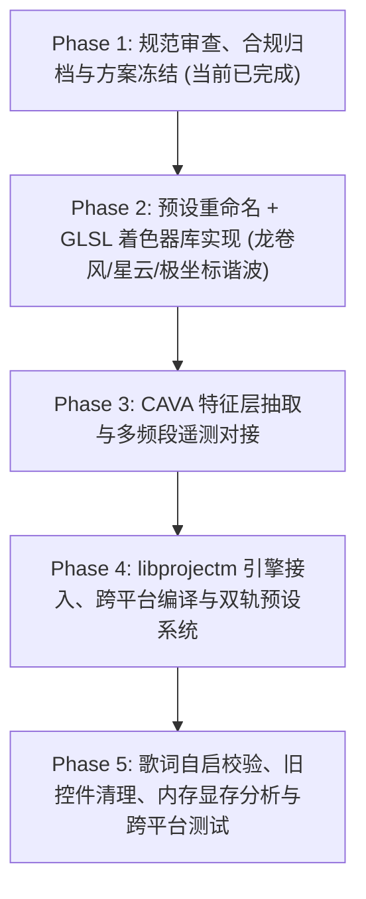

# 可视化系统全链路重构与 projectM 引擎接入设计方案

> **日期**：2026-11-22  
> **状态**：方案已批准，启动阶段 1 实施  
> **目标范围**：音频特征层（CAVA 标准升级）、渲染层（GLSL FragmentShader 迁移与预设重写）、引擎接入（libprojectm v4 桥接与双轨预设系统）、交互与资源加载（统一 ResourcePicker 与歌词图层融合）、内存显存治理。  
> **核心规范**：严格遵循仓库合规铁律，**严禁向 `source/` 添加代码依赖**，所有引入的第三方参考算法与 C-ABI 头文件均经由干净隔离的适配层落地于主库。

---

## 1. 背景与重构动力

当前 AuraDSP 的音频可视化系统在桌面端（Windows / Linux）实现了从底层音频流采集、FFT 频段计算到前端绘制的基本链路，但在多轮用户实测中暴露出一系列架构与体验瓶颈：

1. **渲染层 CPU 负荷与内存显存瓶颈**：
   - 现有多个预设（如粒子龙卷风 `style_tornado.dart`、星云 `style_nebula_flow.dart`、流体 `style_fluid.dart`）基于 Flutter `CustomPainter` 在 CPU 侧逐帧计算粒子运动、轨迹投影与重绘。
   - 粒子对象频繁创建导致垃圾回收（GC）压力增大；复杂 3D 透视投影在 CPU 运行不仅帧率受限，且在低配集成显卡设备上伴有明显卡顿与抖动。
2. **特征层表达能力与物理感知脱节**：
   - 底层当前采用固定的 32 对数频带，缺乏针对人耳听觉等响度曲线（ISO 226 / Fletcher-Munson）的感知加权补偿，导致高频泛音易被掩盖、中低频视觉表现单调；
   - 缺乏动态物理重力衰减加速度（Falloff）与积分降噪滤波（Integral Smoothing），频段起伏过于剧烈或平淡；
   - 缺乏自适应动态灵敏度（Autosens AGC），在不同母带电平（大动态交响乐 vs 高压流行乐）或用户旋钮调节时，频谱画面容易出现“顶死爆表”或“趴地不动”。
3. **命名冲突与预设概念混淆**：
   - 当前内置画笔中有一款名为 `MilkDrop` 的预设，其实质为简单的二维极坐标多边形/射线谐波（Polar Spectrum Warp），与真正的 Winamp MilkDrop / projectM 脚本渲染引擎同名，造成概念严重混淆。
4. **缺失原生 Winamp MilkDrop 脚本生态支持**：
   - 用户期望能够直接加载海量高质量的 `.milk` 预设脚本，并获得 GPU 级复杂流场反馈渲染，需要引入工业级 `libprojectm` 原生渲染引擎。
5. **视效交互与歌词融合细节问题**：
   - “粒子龙卷风”在实测中出现上下倒置、圆球杂物、摄像机视角过低、背景光晕跳变突兀等视觉问题；
   - 统一文件/文件夹导入需要全面切换到既有的平台适配层 `PlatformAdapters.instance.picker` (`ResourcePicker`)；
   - 歌词监听在 Windows/Linux 下需保障随软件自启，且歌词浮层需与多变的高清着色器背景保持高保真对比度。

---

## 2. 总体架构与重构四层蓝图

```
┌─────────────────────────────────────────────────────────────────────────────┐
│                          AuraDSP Visualizer 2.0                             │
├─────────────────────────────────────────────────────────────────────────────┤
│ 1. 特征层 (Feature Layer - CAVA 口径升级)                                    │
│    - 可变频段分配 (16 / 24 / 32 / 64 / 128 对数频段，中心频率动态分配)         │
│    - 感知等响度补偿曲线加权 (Perceptual Loudness Weighting)                   │
│    - 重力物理跌落加速度 + 积分降噪平滑滤波 (Noise Reduction 0.77)             │
│    - 动态自适应灵敏度控制 (Autosens AGC，自适应全动态范围 [0.0, 1.0])          │
│    - 统一经由 auradsp_viz_frame / ring buffer 遥测契约输出                   │
├─────────────────────────────────────────────────────────────────────────────┤
│ 2. 渲染层 (Render Layer - GPU FragmentShader 全面替代 CPU 画笔)             │
│    - 采用 Flutter FragmentProgram / FragmentShader GLSL 硬件着色器           │
│    - 统合 Uniform 输入标准 (uResolution, uTime, uBass/Mid/Treble, uColors)  │
│    - 原生风格着色器库：                                                     │
│      * particle_tornado.frag (上宽下窄漏斗风暴、仰角视角、缓动渐变光晕)          │
│      * nebula_flow.frag (多层宇宙柔雾气体漂移与恒星辉光)                       │
│      * harmonic_warp.frag (原 MilkDrop 重命名为极坐标谐波，GLSL 高清实现)      │
│      * cyber_grid.frag (3D 透视赛博合成波地形网格)                           │
│      * aurora_wave.frag & neon_tunnel.frag (既到着色器优化)                   │
├─────────────────────────────────────────────────────────────────────────────┤
│ 3. 脚本视效引擎 (libprojectm Native Engine 接入)                             │
│    - 跨平台 libprojectm v4 C-API 桥接层 (Windows / Linux)                   │
│    - 离屏渲染与 Flutter 纹理共享机制 (TextureRegistrar / PixelBuffer)        │
│    - 双轨预设调度系统：                                                     │
│      * 轨道 A：内置 GPU GLSL 原生着色器预设                                   │
│      * 轨道 B：外部 Winamp MilkDrop (.milk) 脚本预设                          │
│    - PCM 音频推流回路 (projectm_pcm_add_float 512~1024 帧连续流)             │
├─────────────────────────────────────────────────────────────────────────────┤
│ 4. 视图与交互层 (UI, Picker & Lyrics Integration)                           │
│    - 统一文件/文件夹导入：基于 PlatformAdapters.instance.picker (ResourcePicker)│
│    - 预设抽屉升级：双轨标签切换、分类索引、缩略图/预设参数调整                    │
│    - 歌词系统协同：Windows/Linux 开机与应用启动自启歌词流，透明高对比度浮层覆盖     │
│    - 显存/内存看门狗：Shader 实例单例化复用，零帧全零快速归位，纹理显存安全释放      │
└─────────────────────────────────────────────────────────────────────────────┘
```

---

## 3. 目录树规划与“严禁依赖 source/”合规隔离设计

本仓明确规定：**`source/` 为外部只读参考资产区，严禁在 CMakeLists.txt、构建脚本或 Dart 代码中直接引用任何 `source/` 下的文件**。所有引入代码必须建立受管净室目录，并落实许可证追踪。

### 3.1 目录规划表

```
JamesDSP/
├── core/
│   └── desktop/
│       └── visualizer/
│           ├── cava_engine/                  # [新增] CAVA 算法干净抽取层
│           │   ├── cava_engine.h             # 对数分频、等响加权、重力平滑、AGC 头文件
│           │   ├── cava_engine.c             # C-ABI 纯 C 实现 (MIT 许可证追踪)
│           │   └── cava_bridge.cpp           # 与 auradsp 引擎环形遥测对齐的桥接器
│           └── projectm_bridge/              # [新增] libprojectM C 桥接层
│               ├── CMakeLists.txt            # 跨平台构建脚本 (输出 libprojectm_bridge)
│               ├── projectm_bridge_api.h     # 桥接导出 API 头文件
│               ├── projectm_bridge.cpp       # 实例管理、PCM 投递、离屏渲染调用
│               └── gl_texture_bridge.cpp     # 跨平台纹理交换 (DXGI/GL/PixelBuffer)
│
├── vendor/
│   └── libprojectm/                          # [新增] 第三方预编译/头文件隔离区
│       ├── ORIGIN.md                         # 来源、版本锁定 (9e26f5b5b)、LGPL-2.1 说明
│       ├── include/
│       │   └── projectM-4/                   # 必需的最小公开 C 头文件集合
│       │       ├── core.h
│       │       ├── audio.h
│       │       ├── parameters.h
│       │       ├── render_opengl.h
│       │       └── playlist.h
│       └── lib/
│           ├── windows_x64/                  # projectM-4.dll + 导入库
│           └── linux_x64/                    # libprojectM-4.so
│
└── app/
    └── auradsp_app/
        ├── shaders/                          # [扩充] Flutter GLSL 硬件着色器
        │   ├── aurora_wave.frag              # 极光着色器
        │   ├── neon_tunnel.frag              # 霓虹隧道着色器
        │   ├── particle_tornado.frag         # [新增] 粒子龙卷风 GPU 着色器 (修复视角/漏斗)
        │   ├── nebula_flow.frag              # [新增] 星云流动 GPU 着色器
        │   ├── harmonic_warp.frag            # [新增] 极坐标谐波 GPU 着色器 (原 MilkDrop)
        │   ├── cyber_grid.frag               # [新增] 赛博朋克 3D 地形着色器
        │   └── fluid_dynamics.frag           # [新增] 二维流体动力学着色器
        └── lib/
            ├── core/
            │   └── visualizer_types.dart     # [修改] 预设枚举重命名 (milkDrop -> harmonicWarp, 增加 projectMScript)
            └── features/
                └── visualizer/
                    ├── models/
                    │   └── projectm_preset.dart  # MilkDrop 预设元数据模型
                    ├── shaders/
                    │   └── gpu_shader_service.dart # [增强] 着色器编译、缓存与 uniform 调度
                    ├── projectm/
                    │   ├── projectm_ffi.dart     # libprojectm C-ABI FFI 绑定
                    │   └── projectm_controller.dart # 状态机与纹理注册控制器
                    ├── styles/
                    │   ├── style_gpu_shader.dart # 通用 GPU Shader Painter
                    │   └── visualizer_painter_dispatcher.dart # 调度分发升级
                    └── views/
                        ├── visualizer_viewport.dart   # 双轨渲染视口 (Shader vs ProjectM Texture)
                        ├── visualizer_drawer.dart     # 双轨预设选择抽屉 (原生/MilkDrop 标签)
                        └── visualizer_lyrics_overlay.dart # 歌词与可视化深度融合图层
```

---

## 4. 特征层：CAVA 标准对齐与算法实现方案

### 4.1 算法核心四大支柱

1. **可变对数分频 (Configurable Logarithmic Bands)**：
   - 频段数量 $N \in [16, 128]$ 可通过配置动态初始化（默认 32，支持 16, 24, 32, 64, 128）。
   - 切分下限 $f_{low} = 50\text{ Hz}$，切分上限 $f_{high} = 12000\text{ Hz}$。
   - 频带边界：
     $$f_{edge}(i) = f_{low} \cdot \left(\frac{f_{high}}{f_{low}}\right)^{\frac{i}{N}}, \quad i \in [0, N]$$
   - 每一个频带对应 FFT 离散频点区间 $[bin_{lo}, bin_{hi}]$，通过区间能量积分与峰值抽取提取特征。

2. **感知等响度曲线加权 (Perceptual Loudness Curve Weighting)**：
   - 人耳对 2kHz~4kHz 最敏感，对低频（<100Hz）及高频（>10kHz）灵敏度显著下降。
   - 引入 ISO 226 等响度加权反向补偿因子 $W(b)$：
     $$V_{weighted}(b) = V_{raw}(b) \times W(b)$$
   - 避免传统 FFT 在视觉上只有低频猛烈跳动、中高频细节完全熄灭的问题。

3. **重力跌落物理模拟与积分平滑 (Gravity Falloff & Integral Noise Reduction)**：
   - 上升阶段：瞬态快速响应，如果当前帧能量大于上一帧，则立即跟进或按极短起音时间上升；
   - 下降阶段：模拟物理重力加速度 $g$，下落速度随帧递增：
     $$Fall(b) \leftarrow Fall(b) + g \cdot \Delta t$$
     $$V(b) \leftarrow \max(0, V_{prev}(b) - Fall(b))$$
   - 积分滤波：采用加权移动积分（CAVA 推荐系数 $0.77$）：
     $$V_{smooth}(b) = V_{prev}(b) \cdot 0.77 + V_{cur}(b) \cdot (1 - 0.77)$$

4. **动态自适应灵敏度控制 (Autosens AGC)**：
   - 动态跟踪历史峰值包络 $Peak_{hist}$：
     - 若当前频谱峰值触顶（> 1.0），则快速降低灵敏度增益；
     - 若连续多帧峰值偏小（< 0.3），则缓步提升增益；
   - 保证无论是播放柔和钢琴曲还是激烈重低音摇滚，均能充分利用视窗的 $[0.0, 1.0]$ 动态范围。

### 4.2 引擎遥测契约兼容保证

- `engine_viz.cpp` 的现有 32 频段 `VizFrame.spectrum` 与 `eqInSpectrum` 维持稳定输出，确保 EQ 面板（`smoke_eq_viz_tap`）与各页面电平计兼容性为 100%。
- 新增 `CavaEngine` 处理管线：可直接复用引擎提供的原始 FFT 频域能量或从音频环形缓冲区读取 PCM 数据，输出自适应多频带特征数组，供给 GPU Shader 与 projectM。

---

## 5. 渲染层：FragmentShader GPU 化与预设重写

### 5.1 GPU 着色器 Uniform 输入标准协议

所有原生着色器统一遵循标准化 Uniform 布局，便于 `GpuShaderPainter` 无差别调度：

```glsl
// Flutter FragmentShader 统一 Uniform 映射:
layout(location = 0) uniform vec2  uResolution;   // [float 0, 1] 视口像素宽高
layout(location = 1) uniform float uTime;          // [float 2] 连续动画时间戳 (秒)
layout(location = 2) uniform float uBass;          // [float 3] 低频能量 [0.0, 2.0]
layout(location = 3) uniform float uMid;           // [float 4] 中频能量 [0.0, 2.0]
layout(location = 4) uniform float uTreble;        // [float 5] 高频能量 [0.0, 2.0]
layout(location = 5) uniform vec4  uColorPrimary;  // [float 6..9] 主色调 RGBA
layout(location = 6) uniform vec4  uColorSecondary;// [float 10..13] 副色调 RGBA
layout(location = 7) uniform float uSensitivity;   // [float 14] 灵敏度系数
layout(location = 8) uniform float uParam1;        // [float 15] 样式特定参数 1 (如风暴开口)
layout(location = 9) uniform float uParam2;        // [float 16] 样式特定参数 2 (如相机高度)
```

### 5.2 核心预设重写方案

1. **粒子龙卷风 (`particle_tornado.frag`)**：
   - **几何形态纠偏**：通过数学方程保证漏斗上方开口扩张、下方收紧收敛到地面中心点（解决用户指出的“上下颠倒”问题）；
   - **摄像机视角**：采用仰俯角适中、略带俯视的 3D 透视矩阵变换（解决用户指出的“视角仰视出视野”问题）；
   - **背景渐变光晕**：背景 Vignette 辐射光晕随低频能量与时间缓慢正弦呼吸变色，杜绝色阶跳变（解决“色晕一顿一顿突变”问题）；
   - **去除杂物**：彻底剔除无关的实体圆球碰撞体，纯粹呈现由旋转漩涡线与螺旋粒子流构成的风暴场；
   - **内存显存优化**：纯 GLSL 片段着色器数学渲染，Dart 侧每帧仅传递固定数量 float uniform，内存开销为 0。

2. **极坐标谐波 (`harmonic_warp.frag`)**：
   - 将原错名为 MilkDrop 的预设正式更名为 **Harmonic Warp (极坐标谐波)**；
   - 在 GLSL 中计算极坐标 $(r, \theta)$，根据频段分布渲染平滑抗锯齿的频谱射线、向外辐射的脉冲波纹与柔和背光。

3. **星云 (`nebula_flow.frag`)**：
   - 结合多阶分形布朗运动 (Fractal Brownian Motion, FBM) 生成连续、可自由漂移的深空气体；
   - 音频低频能量控制星云核心的辉光扩散与膨胀，高频控制细碎星芒的闪烁。

---

## 6. libprojectm 原生引擎接入方案

### 6.1 C-ABI 桥接接口设计 (`projectm_bridge_api.h`)

```c
#pragma once
#include <stdint.h>

#ifdef __cplusplus
extern "C" {
#endif

typedef void* projectm_handle_t;

// 初始化 projectM 引擎实例，指定离屏渲染宽高
projectm_handle_t projectm_bridge_create(int width, int height);

// 销毁实例
void projectm_bridge_destroy(projectm_handle_t handle);

// 调整渲染分辨率
void projectm_bridge_resize(projectm_handle_t handle, int width, int height);

// 加载指定的 .milk 预设文件
int projectm_bridge_load_preset_file(projectm_handle_t handle, const char* file_path);

// 投递音频 PCM 数据 (512 或 1024 float 双声道交错)
void projectm_bridge_add_pcm_float(projectm_handle_t handle, const float* pcm_data, int samples_per_channel);

// 执行一帧渲染，并输出像素数据或绑定目标纹理
void projectm_bridge_render_frame(projectm_handle_t handle, uint8_t* out_rgba_pixels);

#ifdef __cplusplus
}
#endif
```

### 6.2 跨平台纹理与渲染回路

- **Windows 平台**：
  - 首选方案：基于 ANGLE / DirectX11 共享纹理或 PixelBuffer 提供给 Flutter `TextureRegistrar`。
  - 兜底安全方案：通过离屏 FBO 渲染至 RGBA 像素内存区，通过 `PixelBufferTexture` 提交给 Flutter 渲染管线，保证在所有老旧显卡与核显上零崩溃。
- **Linux 平台**：
  - 基于 EGL / OpenGL 纹理或 PixelBuffer 提交，与 Linux Flutter GTK 宿主对齐。

### 6.3 统一文件与目录选择交互 (`ResourcePicker`)

- 严格使用项目中已经统合并通过全平台测试的 `PlatformAdapters.instance.picker`：
  - 打开单预设：`picker.pickFiles(title: '加载 MilkDrop 预设', allowedExtensions: ['milk'])`
  - 打开预设包目录：`picker.pickDirectory(title: '选择 MilkDrop 预设目录')`
- 预设抽屉自动扫描目录中的所有 `.milk` 文件，支持快捷过滤、收藏与上一首/下一首预设循环轮播。

---

## 7. 歌词系统协同与全生命周期自启设计

### 7.1 桌面端歌词监听启动保证

- 用户明确要求：**“Linux 下和 Win 下的歌词监听确保启动软件后就自动开启，这样用户随时打开可视化就可以让歌词自动跟踪到播放进度”**。
- 实施审查：
  - 在 `app_model.dart` / `main.dart` 应用初始化链路中，将 `LyricsService`（或对应媒体会话监听器）的初始化提升至 `bootstrapServices()` 核心阶段。
  - Windows 端：自动挂载 `Windows.Media.Control.GlobalSystemMediaTransportControlsSessionManager` 监听。
  - Linux 端：自动通过 `dbus` 注册 MPRIS 媒体控制会话监听。
  - 启动后常驻后台低功耗监听，无需等到用户打开可视化页面才启动。

### 7.2 视觉图层层次与对比度保障

视口采用严密的叠层渲染（Stack）：
```
Layer 0 (底层): 动态背景 (GPU FragmentShader 或 libprojectm 纹理)
Layer 1 (中层): 可选测量刻度与网格 (Static Grid Overlay, 仅在柱状谱/示波器下显示)
Layer 2 (上层): 歌词沉浸浮层 (VisualizerLyricsOverlay)
                - 采用高对比度半透明渐变背板 (Scrim Gradient)
                - 动态阴影 (TextDropShadow) 与平滑缓动字号，确保任何背景视效下文本清晰
Layer 3 (顶层): 浮动控制工具栏 (VisualizerHud - 自动淡出隐藏)
```

---

## 8. 分阶段落地路线图



### 阶段 1：方案归档与设计基准冻结（当前）
- 剥除 `source/cava` 与 `source/projectm` 嵌套 `.git`。
- 升版 `source/ORIGIN.md` 与 `docs/10-架构/source-参考项目审理报告.md`（v3.0）。
- 产出本设计文档。

### 阶段 2：渲染层迁移与预设重命名（即刻启动）
1. 将 `VisualizerStyle.milkDrop` 重命名为 `VisualizerStyle.harmonicWarp`（极坐标谐波），清理名称冲突。
2. 编写 `particle_tornado.frag`：
   - 修正上大下小漏斗形态。
   - 适当提升相机视角。
   - 实现平滑过渡的背景光晕呼吸。
   - 剔除无关圆球杂物。
3. 编写 `nebula_flow.frag`（深空星云漂移）与 `harmonic_warp.frag`（极坐标谐波）。
4. 在 `pubspec.yaml` 注册新 shaders，在 `gpu_shader_service.dart` 注册并复用着色器。
5. 运行 `flutter analyze` 确保类型与构建完全通过。

### 阶段 3：CAVA 特征提取层落地
1. 在 `core/desktop/visualizer/cava_engine/` 下独立实现 CAVA 对数分频、等响加权、重力物理下坠与自适应灵敏度。
2. 保持向后兼容：既有 32 频段遥测字段不变，提供更精细的可变频段输出接口。
3. 单元测试与端到端信号流验证。

### 阶段 4：libprojectm 接入与双轨预设
1. 配置 `vendor/libprojectm` 最小头文件与动态库导出。
2. 编写 `projectm_bridge` C 接口与 Dart FFI 绑定。
3. 接入 `PlatformAdapters.instance.picker` 统一导入 `.milk` 预设。
4. 视口支持双轨渲染。

### 阶段 5：清理收尾、歌词保障与全套测试
1. 移除废弃的纯 CPU 画笔与无用代码。
2. 验证 Windows / Linux 启动即开启歌词监听。
3. 执行内存显存检测（确保着色器与纹理常驻不泄漏）。
4. 跑通自动化测试并产出构建包。

---

## 附记（2026-11-22 全量审查后补记，不改原文）

本方案文首状态「启动阶段 1 实施」已过期：阶段 1–4 主体已于
2026-11-22 当日落码（`20165d81`、`bf32fb2b`、`55cdfd1e`、
`e528975a`、`76dbecc4`、`6aa7a074`），阶段 5（清理收尾与全套
测试）未收尾。以下口径以实物为准，与正文冲突处以本附记为准：

1. **§6.1 桥 C-ABI 与实装不一致**：实装为
   `core/desktop/visualizer/projectm_bridge/projectm_bridge_api.h`
   的 9 个 `auradsp_projectm_*` 导出（create 带 fps、destroy/resize
   返回错误码、feed_pcm 有 2048 帧上限与 GL-context-current 前置
   条件）。后续绑定一律以该头文件为准，勿按 §6.1 文档签名编写。
2. **libprojectM 预编译库不在仓内、发行未纳入**：`vendor/libprojectm/`
   仅含头文件；桥构建选项默认 OFF，打包链不含桥 DLL 与
   projectM-4.dll。当前发行实态为桥不可用、可视化走 CPU 程序化
   近似回退；§3.1 目录树中的 `lib/windows_x64/projectM-4.dll` 等
   为规划路径，非实物。
3. **C 层 cava_engine 未接线**：`core/desktop/visualizer/cava_engine/`
   无任何构建/调用引用，特征层实装是 Dart 的
   `cava_feature_engine.dart`；§3.1/§8 中 C 层落地路径与实物
   分工不符，C 版去留待裁定（见未决问题登记 2026-11-22 附记）。
4. **桥 Dart 侧双实现并存且端到端未驱动**：生产工厂返回的
   `NativeProjectMBridge` 与测试在用的 `ProjectMNativeBridge`
   签名口径冲突（destroy/resize 返回值），且页面从未向 Stage
   传入桥实例、`initialize/feedPcm/renderFrame/loadPreset` 在
   生产路径零调用——「原生已接通」不成立，统一与接线待裁定。
   全量审查结论见 `docs/30-审查/全量代码审查-2026-11-22.md`。
