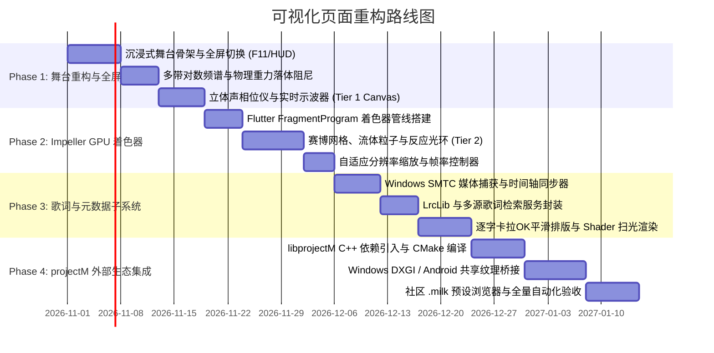

# AuraDSP 可视化页面（Visualizer Page）全面重构方案与技术设计文档

> **文档版本**：v1.0.0  
> **设计日期**：2026-10-29  
> **适用模块**：`app/auradsp_app`（前端展示）、`engine/`（音频帧数据推送）、`plugins/visualizer/`（原生渲染桥接）  
> **核心目标**：构建兼具录音室级专业声学测量、现代沉浸式视听美学、经典开源插件生态（Winamp MilkDrop/projectM）及跨平台歌词联动的顶级音频可视化工作站舞台。

---

## 一、 背景分析与重构诉求

### 1.1 现状与痛点
当前 AuraDSP 的可视化页面（`visualizer_page.dart`）功能较为初级单一：
- **视觉形式单一**：仅提供固定的 32 带对数柱状频谱（`SpectrumView`）与简单的 L/R 峰值电平条，缺乏示波器、立体声相位、瀑布图及现代粒子/着色器等多样化视觉风格。
- **动态交互与全屏缺失**：无法一键进入纯净全屏（Immersive Fullscreen）展示，在大屏、车载屏幕或家庭影音场景下缺乏沉浸感与观赏性。
- **扩展性局限**：未对接经典的音频视效生态（如 Winamp 传奇视效 MilkDrop / projectM、Windows Media Player 视效），亦无自定义着色器/脚本支持。
- **缺少音乐信息联动**：作为系统全局 DSP / 音频工作站，无法显示当前播放歌曲的元数据与同步歌词。

### 1.2 重构目标
1. **多端平滑多分辨率适配**：支持 Windows 11（桌面、4K/8K 超高分屏、高刷新率 120Hz/144Hz/240Hz）与 Android（触屏、横竖屏自适应、车载大屏），支持一键沉浸式全屏与自动隐藏控制底栏。
2. **多引擎/多风格视效矩阵**：
   - **录音室专业测量**：高精度柱状谱、立体声示波器（波形与利萨如 X-Y 环）、声相相位仪（Goniometer）、2D/3D 时频谱瀑布图（Waterfall）。
   - **生成式 GPU 视觉艺术**：基于 GPU Shader 的霓虹网格、流体粒子、反应式音频几何体、脉冲光环。
   - **经典插件生态整合**：引入现代开源 `projectM`（MilkDrop 2 C++ 实现），支持加载成千上万社区 `.milk` 预设；调研评估经典 Winamp AVS / WMP 插件兼容方案。
3. **跨平台实时歌词子系统**：支持 Windows SMTC（系统媒体传输控制）与播放源状态监听，接入开源歌词库与在线接口，支持标准 LRC 及逐字卡拉OK平滑滚动渲染。
4. **性能与美学平衡**：保障音频线程绝对 **RT-Safe**，渲染管线采用 GPU 硬件加速与离屏剔除，低功耗平稳运行。

---

## 二、 系统分层架构与总体数据流

为了在保持音频引擎超低延迟的前提下支撑复杂的 120fps GPU 渲染与歌词刷新，系统采用**四层解耦架构**：

```mermaid
flowchart TD
    subgraph AudioEngine ["1. 底层音频引擎 (engine/) - C++20 RT-Safe"]
        RT["音频处理主线程\n(zero-alloc, zero-lock)"]
        RT -->|逐块写入历史| HistRing["环形时域历史窗\n(viz_hist)"]
        HistRing -->|每 16~33ms 采样| EmitViz["emit_viz()\nHanning + 实数 FFT"]
        EmitViz -->|无锁写入| SPSC["SPSC 环形缓冲队列\nauradsp_viz_frame (1600B)"]
        HistRing -->|可选高波形流| WaveSPSC["无锁波形缓冲\nauradsp_waveform_frame"]
    end

    subgraph NativeBridge ["2. 原生视效桥接层 (C++ / FFI)"]
        SPSC -->|auradsp_viz_read()| DartFFI["Dart FFI 消费者"]
        WaveSPSC -->|PCM 缓冲推送| ProjectM["libprojectM C++ 引擎\n(MilkDrop 2 Core)"]
        ProjectM -->|OpenGL/D3D11 渲染| SharedTexture["GPU 共享纹理 / FBO\n(External Texture)"]
    end

    subgraph LyricsSubsystem ["3. 歌词与元数据子系统"]
        SMTC["Windows SMTC 监听\n(GlobalMediaSession)"] --> MediaSync["歌曲与时间轴同步器"]
        LocalTag["本地音频文件标签\n(ID3v2 / FLAC / LRC)"] --> MediaSync
        OnlineAPI["网络歌词服务\n(LrcLib / 网易云 / QQ)"] --> MediaSync
    end

    subgraph PresentationLayer ["4. 前端渲染舞台 (Flutter 3.x)"]
        DartFFI -->|ValueNotifier 30~120fps| StageHub["可视化舞台中央调度器\n(StageDirector)"]
        MediaSync -->|毫秒级高精度插值| LyricView["沉浸式逐字歌词渲染层"]
        SharedTexture -->|Texture() 组件| TextureWidget["原生纹理渲染视口"]
        
        StageHub --> Tier1["Tier 1: Canvas 矢量仪表\n(频谱/示波器/相位仪)"]
        StageHub --> Tier2["Tier 2: Impeller GPU Shader\n(FragmentProgram .frag)"]
        StageHub --> Tier3["Tier 3: 原生 MilkDrop 视口\n(External Texture)"]
        
        Tier1 & Tier2 & Tier3 --> ViewComposite["视效合成器 & HUD 控制底栏\n(自适应分辨率 / 全屏)"]
        LyricView --> ViewComposite
    end
```

---

## 三、 多层混合渲染管线设计 (Hybrid 3-Tier Pipeline)

不同类型的可视化对计算资源与图形 API 的需求截然不同。统一硬套 Canvas 会导致 4K 下掉帧，而所有视效全走 C++ 外部进程又会失去 Flutter UI 的灵活性与跨端一致性。因此设计**三层渲染梯队**：

| 梯队 (Tier) | 核心渲染技术 | 适用视效类型 | 目标性能 | 跨平台特征 |
|---|---|---|---|---|
| **Tier 1: 轻量矢量与仪表** | Flutter `CustomPainter` + `Canvas` | 经典对数频段柱、立体声 VU 表、声相测量仪、时钟雷达 | 60~120 FPS<br>CPU 占用 < 3% | Windows / Android 100% 原生纯 Dart |
| **Tier 2: 现代硬件着色器** | Flutter Impeller `FragmentProgram` (`.frag`) | 霓虹赛博网格、音频光线步进球体 (Raymarching)、极光波形、声波隧道 | 120~240 FPS<br>GPU 像素着色器硬件直出 | Windows (Vulkan/D3D) / Android 零外部依赖 |
| **Tier 3: 原生开源视效桥** | `libprojectM` (C++17) + DirectX/OpenGL 共享纹理 | MilkDrop 2 社区预设、EEL2 动态变形、复杂分形反应网 | 60~120 FPS<br>4K 工业级渲染 | Windows: DXGI 共享句柄<br>Android: NDK SurfaceTexture |

### 3.1 Tier 1: 录音室级矢量与声学测量组件
- **高阶分频对数算法**：突破现存固定 32 频段限制，支持 32 / 64 / 128 / 256 带平滑切换（按 IEC 61260 1/3 倍频程或 1/6 倍频程严格切分）。
- **物理重力落体与回弹阻尼**：
  $$\Delta y_{\text{peak}} = v_{\text{peak}} \cdot \Delta t + \frac{1}{2} g \cdot (\Delta t)^2$$
  峰值保持线引入微小反弹与衰减加速度阻尼，彻底消除机械假感。
- **双通道相干性与利萨如环 (Lissajous XY-Scope)**：
  将 L 信号投影至 X 轴，R 信号投影至 Y 轴，并旋转 45° 转换为 Mid/Side（$M = L+R, S = L-R$）坐标系。直观展现立体声单声道兼容性（宽椭圆=宽声场，直线=单声道，圆形=相位发散）。

### 3.2 Tier 2: 基于 Flutter Impeller 的 GPU Fragment Shader 引擎
利用 Flutter 3.x 的 `FragmentProgram`，编写原生 SPIR-V/GLSL 音频响应着色器。Dart 仅需在每一帧将归一化的频段数据（通过 `Float32List` 统一 uniform 打包）与时间戳 `iTime` 传入着色器：
- **音频纹理模拟**：将 32~64 个频段打包为连续 Uniform 浮点数组，Shader 内通过三次贝塞尔或余弦插值重建平滑连续的频响曲线。
- **精选原生 Shader 风格**：
  1. *CyberGrid 2088*：受低音脉冲驱动起伏的赛博朋克线框地形网格。
  2. *ChromaOrb*：根据高中低音三频段分别控制球体半径位移、表面噪波扰动与发光色彩的光线步进能量球。
  3. *SoundTunnel*：具有景深模糊与高光辉光（Bloom）的同心穿梭音频光环隧道。

### 3.3 Tier 3: 经典开源视效生态整合（Winamp MilkDrop / projectM）
对 Winamp、Windows Media Player 及开源视效方案进行可行性与架构深度分析：

#### 深度调研与选型裁定：
1. **Windows Media Player (.wvp / COM 插件)**：
   - *可行性评估*：**不建议直接加载二进制**。WMP 插件规范基于 1999 年的 32 位 COM 接口（`IWMPEffects`），要求宿主传递 GDI `HDC` 设备上下文。在 64 位现代化进程中运行 32 位老插件需要搭建庞大的 Thunking 进程间 IPC 桥，且 GDI 渲染早已无法适应 4K 高刷硬件加速。
2. **Winamp AVS (Advanced Visualization Studio)**：
   - 经典但架构陈旧，社区预设大多依赖旧版 x86 驱动。
3. **MilkDrop 2 与 `libprojectM`（终极解决方案）**：
   - **技术背景**：MilkDrop 2 是音频可视化历史上公认的巅峰之作。`projectM` 是其官方认可的跨平台现代开源 C++ 实现（完全遵循 LGPL-2.1，支持 Windows/Linux/Android/macOS）。
   - **核心特性**：原生 64 位支持、现代化 OpenGL/Vulkan 渲染后端、自带 EEL2 脚本求值器、内置数千款高品质 `.milk` 经典预设。
   - **架构实施方案**：
     - 在 `engine/plugins/visualizer/projectm_bridge/` 封装轻量 C API；
     - 引擎提供原生时域 PCM 数据（512 采样点/帧，通过 `projectm_pcm_add_float` 直灌）；
     - Windows 侧利用 Direct3D11 / WGL 共享纹理绑定至 Flutter 提供的 `FlutterDesktopTextureRegistrar`；Android 侧绑定至 `SurfaceTexture`；
     - 前端直接使用 Flutter `Texture(textureId: ...)` 进行零拷贝、满帧率呈现！

---

## 四、 跨平台实时歌词子系统设计

### 4.1 数据源与媒体同步机制
AuraDSP 作为系统全局 DSP 引擎，其核心特性在于处理系统上所有播放器的声音。为了让可视化页面拥有动态同步歌词，设计三通道元数据采集器：

```
[播放音频来源]
      │
      ├─► ① 本地播放文件 ──► 读取 ID3v2 USLT / SYLT 标签 / 本地同名 .lrc 文件
      │
      ├─► ② Windows 宿主 ──► Windows.Media.Control (SMTC GlobalSession)
      │                       └─ 实时抓取 Spotify / 微信 / 网易云 / Chrome / PotPlayer 的
      │                          Track Title、Artist、AlbumArt、Timeline (Position/Duration)
      │
      └─► ③ Android 宿主 ──► NotificationListenerService / MediaSessionManager
```

### 4.2 智能歌词检索与聚合引擎 (LyricAggregator)
当捕获到正在播放的歌曲标题与艺术家时，服务自动按优先级检索与缓存：
1. **本地优先**：检查当前音频文件同目录下的 `.lrc`、`.qrc` 文件；
2. **开放接口层 (LrcLib API)**：
   - 接入国际主流开源歌词库 `LrcLib.net`（完全开源免费、无需 Key、支持精确毫秒级时间轴匹配）；
3. **主流平台辅助检索**：
   - 备选支持网易云音乐、QQ音乐歌词检索解析器（仅读取公有 LRC/翻译文本）；
4. **歌曲时长校验（容差过滤）**：
   - 检索结果必须比对媒体时长，仅当 $|\Delta t| \le 2.0\text{s}$ 时采纳，避免同名翻唱串词。

### 4.3 渲染引擎与排版动效
- **格式支持**：
  - 标准 LRC 行级同步（`[mm:ss.xx] 歌词文本`）。
  - 增强型逐字卡拉OK（Enhanced LRC / QRC / TTML）：`[00:12.30]<00:12.30>你<00:12.60>好<00:12.90>呀`。
- **排版与渲染特性**：
  - **物理弹簧平滑滚动 (Spring Physics Scroll)**：当前活动行永远保持在舞台视觉中心（或偏左黄金分割线），上下行采用距离自适应的高斯虚化（Blur）与渐变不透明度。
  - **Shader 逐字扫光动效**：利用着色器或 `ShaderMask`，按字级时间戳进度实现文字颜色的丝滑光晕流动扫射。
  - **双语与音标折叠**：支持原语、中文翻译、罗马音/拼音三层排版，用户可一键折叠/展开翻译。

---

## 五、 全屏沉浸式与多分辨率自适应方案

### 5.1 响应式布局与断点矩阵
页面重构后将自适应以下四种典型显示环境：

```
┌────────────────────────────────────────────────────────────────────────┐
│ 超宽屏 / 4K 桌面 (Desktop Widescreen >= 1920px)                         │
│ ┌──────────────────────────────┬─────────────────────────────────────┐ │
│ │ 3D 频谱 / Shader 视觉舞台     │ 同步逐字歌词 + 实时音轨声学测量仪表 │ │
│ └──────────────────────────────┴─────────────────────────────────────┘ │
├────────────────────────────────────────────────────────────────────────┤
│ 标准桌面 / 笔记本 (Desktop Standard 1200 ~ 1920px)                     │
│ ┌────────────────────────────────────────────────────────────────────┐ │
│ │ 主视觉舞台（自适应高度）                                           │ │
│ ├────────────────────────────────────────────────────────────────────┤ │
│ │ 紧凑歌词悬浮浮层 / 底部多带电平走马灯                                │ │
│ └────────────────────────────────────────────────────────────────────┘ │
├────────────────────────────────────────────────────────────────────────┤
│ 移动端竖屏 / 窄屏 (Mobile Portrait < 600px)                           │
│ ┌──────────────────────┐  垂直堆叠布局：                               │
│ │ 极简声谱波形舞台     │  上半区展现低功耗流体波形/光环；               │
│ ├──────────────────────┤  下半区专注大字号逐字歌词翻滚。               │
│ │ 极简沉浸歌词         │                                               │
│ └──────────────────────┘                                               │
└────────────────────────────────────────────────────────────────────────┘
```

### 5.2 沉浸式全屏体系（Immersive Fullscreen）
1. **触发交互**：
   - 键盘快捷键 `F11` 或双击视效舞台任意区域进入/退出全屏；
   - 移动端点击全屏操作按钮或横屏自动提示切换。
2. **全屏状态行为**：
   - **完全隐去主程序框架**：隐藏主导航栏（`_Rail`）、窗口标题栏，整个窗口由视效和歌词接管；
   - **HUD 悬浮控制岛 (Smart HUD Dock)**：底部常驻半透明磨砂控制底栏（包含视效切换、参数调节抽屉、歌词开关、退出全屏）；
   - **光标与控件自动隐退**：当鼠标静止超过 **3.0 秒**，HUD 控制岛平滑淡出，光标隐藏；鼠标移动或触屏点击时立即平滑唤醒。
3. **动态自适应降采样 (Adaptive Resolution Scaling)**：
   - 在 4K/8K 屏幕或集显笔记本上，提供 `0.5x / 0.75x / 1.0x / 2.0x` 渲染缩放选项；
   - 复杂 3D/着色器视效可在 1080p 内部缓冲区分辨率渲染，再利用硬件双线性/双三次升采样拉伸铺满 4K 屏幕，确保无论何种显卡均可稳定 60/120fps 不卡顿。

---

## 六、 详细参数调节与设计美学规范

严格遵守项目的 [`.ai/rules/ui_design_spec.md`](file:///d:/temp_desktop/Proj/JamesDSP/.ai/rules/ui_design_spec.md) 铁律规范：

### 6.1 参数调节面板设计
所有参数收纳于右侧滑出的半透明磨砂抽屉（`VisualizerConfigDrawer`）或折叠面板中，包含：

```
可视化配置抽屉
├─ 视觉模式选择 (SegmentedButton)
│  ├─ 录音室测量 (Studio)
│  ├─ 赛博着色器 (Cyber Shader)
│  └─ MilkDrop 传奇 (projectM)
├─ 基础调节
│  ├─ 响应灵敏度 (Sensitivity: 0.2 ~ 3.0, 默认 1.0)
│  ├─ 下落阻尼/平滑度 (Decay Smoothing: 0.1 ~ 0.95)
│  └─ 刷新率上限 (FPS Cap: 30 / 60 / 120 / VSync)
├─ 进阶视觉增强 (AdvancedSection)
│  ├─ 辉光强度 (Bloom Intensity: 0.0 ~ 1.0)
│  ├─ 动态余辉/运动模糊 (Motion Blur Persistence: 0% ~ 90%)
│  ├─ 背景融合模式 (纯黑极简 / 专辑封面模糊反射 / 环境光 Ambient)
│  └─ 频段分割数 (32 / 64 / 128 / 256)
└─ 歌词与排版设置
   ├─ 歌词显示开关 (Lyrics Toggle)
   ├─ 逐字卡拉OK扫光 (Karaoke Animation: 开/关)
   ├─ 双语翻译显示 (Translation: 自动/开启/关闭)
   └─ 时间轴微调 (Time Sync Offset: -2000ms ~ +2000ms)
```

### 6.2 控件交互硬规范落实
- **统一问号说明**：所有视效参数必须统一调用 `InfoBadge(message: ...)`，电脑端悬停展开，移动端滑动自动唤醒。
- **出厂复位能力**：所有滑块配置 `defaultValue`，支持鼠标右键或双击整行瞬间重置。
- **单位严禁重复**：严格避免 `100ms ms` 或 `0.0dB dB`。

---

## 七、 实施演进路线图 (Roadmap & Milestones)

重构工程分为四个阶段稳步推进，确保每一步均有单测与 UI 自动化保障：



### 验收与质量门禁（Definition of Done）
1. **性能基准**：
   - Tier 1（矢量谱）在 Windows/Android 上 1080p/2K 渲染帧率稳定 $\ge 60$ fps，CPU 占用 $\le 3\%$；
   - Tier 2（GPU Shader）在集成显卡（Intel Iris Xe / AMD Radeon 680M）全屏 1080p 状态下稳定 60~120 fps；
   - 页面切换至后台（离屏）时，可视化与歌词渲染完全暂停，保持 **零 CPU/GPU 额外消耗**。
2. **RT-Safe 音频安全**：
   - 可视化高波形与频谱数据采集全程处于单独缓冲线程或无锁 SPSC 环形队列中，音频 DSP 处理主线程无任何系统调用或内存分配。
3. **UI 自动化测试**：
   - 补充 `test/ui/test_visualizer_fullscreen.py`、`test/ui/test_visualizer_modes.py`，确保置顶交互、快捷键响应、模式切换与图像差分比对 100% 通过。

