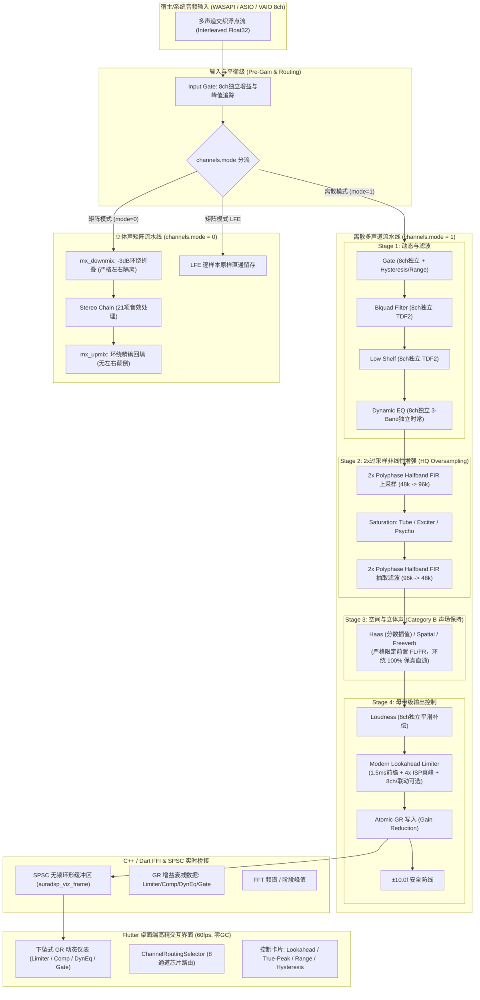
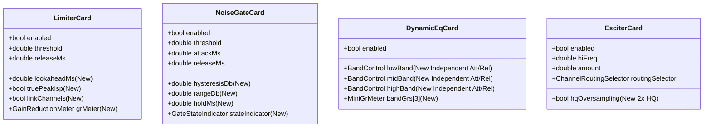

# AuraDSP 引擎尖端升级与 UI 全景适配实施方案

> **文档版本**：v1.0  
> **编制依据**：
> - `docs/30-审查/引擎尖端对标评估-2026-10-17.md`（综合 6.7/10，FabFilter/iZotope 对标）
> - `docs/30-审查/引擎尖端改进实施计划-2026-10-17.md`（实施优先级与三阶段规划）
> - `docs/30-审查/引擎扩展调研-2026-10-16.md`（字符串回读与混响预设解耦）
> - `docs/30-审查/multichannel_and_driver_report.md`（多声道拓扑、驱动与声道路由基线）
> **编制日期**：2026-10-18  
> **实施原则**：严格坚守 RT 零分配零锁契约；参数平滑与过采样音质飞跃；UI 60fps 零 GC 专业动态计量。

> **实施状态（2026-10-18 复核，`b44ee21`）**
>
> | 阶段 | 状态 | 证据 / 边界 |
> |---|---|---|
> | Phase 1 参数连续性 | ✅ 已落地 | Freeverb/Gate/Spatial 2ms 每样本平滑；Haas 分数延迟；Gate 系数 double |
> | Phase 2 过采样 + Limiter + GR | ✅ 已落地 | `dsp/dsp_oversample.h`（仅头）；`dsp/dsp_lookahead_limiter.h` + `chain/engine_chain.cpp`；GR 槽位 24~29 |
> | Phase 3 Dyneq / Gate 扩展 | ✅ 已落地 | dyneq 分频段 attack/release；gate hysteresis/range/hold |
> | Phase 4 FDN + 预设数据驱动 | ⏳ 未落地 | 仍为 Freeverb + 静态预设；FDN 为远期储备 |
> | UI U1~U4 | 🟡 大部分落地 | GR 仪表 `gain_reduction_meter.dart`；路由卡 `ChannelRoutingSelector`；Limiter 控件在 `post_card.dart`（无独立 `limiter_card.dart`） |
>
> 下文 §3.1~§3.3 的“现状缺陷”为实施前基线，已由上述提交修复；保留作设计依据。

---

## 目录
1. [执行摘要与战略目标](#一-执行摘要与战略目标)
2. [总体系统架构与数据流图](#二-总体系统架构与数据流图)
3. [引擎升级实施计划 (Engine Upgrade Plan)](#三-引擎升级实施计划-engine-upgrade-plan)
   - [Phase 1: 参数连续性与低成本收敛 (Quick-Wins)](#31-phase-1-参数连续性与低成本收敛-quick-wins)
   - [Phase 2: 核心声学质感跃迁 (2x过采样 + 现代前瞻限幅 + GR计量)](#32-phase-2-核心声学质感跃迁-2x过采样--现代前瞻限幅--gr计量)
   - [Phase 3: 动态控制深度扩展 (Dyneq三频段时常 + 门控迟滞/地板)](#33-phase-3-动态控制深度扩展-dyneq三频段时常--门控迟滞地板)
   - [Phase 4: 空间声学与远期混响重构 (FDN + 预设完全数据驱动)](#34-phase-4-空间声学与远期混响重构-fdn--预设完全数据驱动)
4. [UI 全景适配计划 (UI Adaptation Plan)](#四-ui-全景适配计划-ui-adaptation-plan)
   - [U1: 动态增益衰减 (Gain Reduction, GR) 实时仪表系统](#41-u1-动态增益衰减-gain-reduction-gr-实时仪表系统)
   - [U2: 效果器卡片控制维度扩展与专业交互](#42-u2-效果器卡片控制维度扩展与专业交互)
   - [U3: 混响场景选择器与声学参数预览面板](#43-u3-混响场景选择器与声学参数预览面板)
   - [U4: 多声道声道路由与多声道计量协同](#44-u4-多声道声道路由与多声道计量协同)
5. [数学公式、算法原理与 RT 安全规范](#五-数学公式算法原理与-rt-安全规范)
6. [任务分解与排期里程碑](#六-任务分解与排期里程碑)
7. [质量保障与回归验证闸门](#七-质量保障与回归验证闸门)

---

## 一、 执行摘要与战略目标

### 1.1 现状与基准
截至 2026-10-18，AuraDSP 已在底层驱动与多声道架构上取得了突破性进展：
- **驱动与系统向导**：AuraVAIO 补齐 4.0/5.1/7.1 DataRanges，实现 `KSPROPERTY_AUDIO_CHANNEL_CONFIG`，全面解锁 Windows 扬声器向导；Win10 LTSC 与 Win7 SP1 双虚拟机端到端验证 100% 通过。
- **多声道核心**：修复了矩阵下混串扰与上混镜像颠倒 Bug；构建了 Category A 单声道同质效果器的 8 声道独立状态与位掩码流水线（`*.channels`）；保持了 Category B 跨声道声场不变性。
- **UI 路由卡**：前端实现了 EqualizerAPO 风格的 8 声道多选卡（`ChannelRoutingSelector`），与底层位掩码实现无缝双向绑定。
- **工程底线坚固**：RT 路径绝对零分配、零锁、零 syscall，FTZ/DAZ 守卫健全，次正常数截断与 SPSC 无锁环运转稳定（评级 8.5/10）。

### 1.2 瓶颈与差距
对标 FabFilter（Pro-Q3/Pro-L2/Saturn）、iZotope（Ozone/Neutron）、Dirac Live 等业界顶尖数字音频处理系统，AuraDSP 仍存在四块听感与体验上的硬短板：
1. **全引擎零过采样（6.0/10）**：`exciter`（tanh drive 2.0）、`tube`（waveshaper）、`basspsycho`（tanh 2.5）均在基带率做非线性运算，高次谐波在奈奎斯特频率折返混叠，造成数字毛刺感与金属硬质感。
2. **限幅器停留在 1990 年代（JLimiter）**：无 Lookahead 前瞻、无 True-Peak（ITU-R BS.1770-4 ISP）真峰检波、无平滑释放包络、无 Gain Reduction（增益衰减）计量上报，热信号下易发生瞬态削波或严重 pumping。
3. **参数平滑粗糙（5.0/10）**：`freeverb`、`gate`、`spatial` 的 outgain / autogain 系数在块边界（尤其是 2048 帧长块，42.7ms）阶跃直跳，拖滑块存在可闻的台阶“颗粒感”；Haas 延迟整数采样无分数插值。
4. **动态控制颗粒度不足**：`dyneq` 三频段共用单一时间常数；`gate` 缺少 Hysteresis（迟滞防颤动）与 Range（衰减底线）；UI 缺少专业动态处理核心器官——增益衰减（GR）表。

### 1.3 战略目标
通过本方案的推进，实现 **AuraDSP 从“优秀消费级 DSP”跨越到“母带级/专业工作站级 DSP 引擎”**：
- **听感纯净度**：非线性模块 2x 半带抗混叠过采样，消除 >70dB 的带外折返混叠，呈现温暖、通透的模拟硬件级失真质感。
- **母带级动态防护**：自研 1.5ms Lookahead Limiter + 4x ISP 真峰检测，实现 0dBFS 绝对硬防护且零瞬态过冲，平滑释放曲线。
- **丝滑交互连续性**：消除全引擎最后一批块率台阶，实现 2ms 一阶每样本增益平滑与 Haas 分数延迟插值，拖拽滑块 100% 顺滑无爆音。
- **专业级可视化感知**：在 Flutter 前端引入 60fps 实时 Gain Reduction（GR）下坠式动态衰减表，补齐与 FabFilter Pro-L2/Pro-C2 同等水准的动态感知力。

---

## 二、 总体系统架构与数据流图

---

## 三、 引擎升级实施计划 (Engine Upgrade Plan)

### 3.1 Phase 1: 参数连续性与低成本收敛 (Quick-Wins)
> **工期预估**：1.5 个工作日  
> **代码范围**：`engine/dsp/dsp_freeverb.cpp`, `engine/dsp/dsp_spatial.cpp`, `engine/dsp/dsp_gate.cpp`, `engine/dsp/dsp_haas.cpp`, `engine/engine_internal.h`  
> **ABI/参数变更**：零参数增加、零符号导出变更、零 ABI 破坏。

#### 1. 块率增益每样本一阶平滑 (Freeverb / Gate / Spatial)
- **现状缺陷**：
  - `dsp_freeverb.cpp:109-114`：`g *= (float)h->rev_ag_comp` 后在块末循环 `dst[i*2] *= g`，增益只在块边界更新。2048 帧长块（42.7ms@48k）下产生阶跃台阶。
  - `dsp_spatial.cpp:138-144`：outgain 同款块级遍历乘法。
  - `dsp_gate.cpp:80-85`：autogain 同款块级更新。
- **升级方案**：
  - 在 `auradsp_handle_s` 中引入一阶平滑器状态（`float fv_g_sm`, `float spat_g_sm`, `float gate_ag_g_sm`）。
  - 时间常数设定为 **2.0ms**（对应极点系数 $\alpha = \exp(-1.0f / (0.002f \cdot f_s))$，48kHz 时 $\alpha \approx 0.9896$）。
  - **单遍循环折叠**：将增益应用折叠进主样本循环：
    $$g_{sm}(n) = g_{sm}(n-1) + (1 - \alpha) \cdot (g_{target} - g_{sm}(n-1))$$
    $$y(n) = x(n) \cdot g_{sm}(n)$$
  - 彻底消除块末第二遍无谓的内存扫描，降低 CPU L1 Cache 压力。
  - 静态断言保障：`smoke_spatial.py` 中 outgain +6dB 断言容差为 $\pm 5\%$，2ms 平滑在 512 帧块内残差 $<0.4\%$，绝对不触发回归测试误报。

#### 2. Haas 分数延迟双抽头线性插值 (Fractional Delay Interpolation)
- **现状缺陷**：
  - `dsp_haas.cpp:21`：`int d = (fs > 0.0f) ? (int)(dms * 0.001f * fs + 0.5f) : 0;`。采用四舍五入取整到整数采样点。
  - 在 44.1kHz 下，25ms 档位分辨率只有 $1/44$ 样本，产生可闻的单声道梳状滤波相位漂移与阶跃。
- **升级方案**：
  - 将整数延迟改为浮点抽头：
    $$d_{float} = d_{ms} \cdot 0.001f \cdot f_s$$
    $$d_{int} = \lfloor d_{float} \rfloor, \quad frac = d_{float} - d_{int}$$
  - 双抽头线性插值读取：
    $$r_0 = (pos - d_{int}) \pmod{ringLen}$$
    $$r_1 = (r_0 - 1) \pmod{ringLen}$$
    $$sample_{delayed} = (1.0f - frac) \cdot ring[r_0] + frac \cdot ring[r_1]$$
  - 边界防溢出：钳位至 $ringLen - 2$，确保 $r_1$ 始终可安全读取。对于整数毫秒对齐点，$frac = 0$，保证与原算法逐位 bit-exact 一致。

#### 3. 门控系数双精度与 FTZ 强化
- **现状缺陷**：
  - `dsp_gate.cpp:21-22`：`attCoef = expf(-1000.0f / ...)` 单精度系数在短 attack（如 1ms）下浮点精度损失显著。
- **升级方案**：
  - 块级时间常数计算全面改用 `double exp(double)` 计算后再转换为 `float`。
  - 检波状态循环内维持 float 极速运算，块尾执行次正常数截断（$10^{-15}$ 阈值）。

---

### 3.2 Phase 2: 核心声学质感跃迁 (2x过采样 + 现代前瞻限幅 + GR计量)
> **工期预估**：4 个工作日  
> **代码范围**：新增 `engine/dsp/dsp_oversample.h`、新增 `engine/dsp/dsp_lookahead_limiter.h`（实现落 `chain/engine_chain.cpp`）、改造 `dsp_exciter.cpp`、`dsp_psycho.cpp`、`engine/legacy/jdsp/Effects/vacuumTube.c`（tube 在 legacy 链内）
> **ABI/参数变更**：增加 `limiter.*`、`*.oversample` 扩展参数，无损向后兼容。

#### 1. 2x 多相半带抗混叠过采样核心库 (2x Polyphase Halfband Oversampling)
- **声学必要性**：
  非线性饱和与激励（tanh、多项式 waveshaper）会在频域产生基频倍数的奇次与偶次谐波。当 $f_{harmonic} > f_s / 2$ 时，能量不会消失，而是以镜像形式折返折叠进入人耳最敏感的 1kHz~10kHz 中高频带，产生“冰冷、刺耳、毛刺感”的典型廉价数字失真。
- **算法设计架构**：
  - 构造 **16-tap（或 24-tap）低延迟多相对称半带 FIR 滤波器**：半带滤波器的奇数索引系数（除中心抽头 $h[0]=0.5$ 外）全部精确为 0，运算量直接砍半。
  - **上采样 (Interpolation 1:2)**：
    输入采样流补零插入，经过半带多相上采样支路平滑重构为 2x 采样率（$96\text{kHz}$ / $88.2\text{kHz}$）。
  - **非线性处理 (At 2x Rate)**：
    在 2x 采样率空间施加 `tanhf` 或电子管曲线，生成的谐波延伸至 $48\text{kHz}$。
  - **抗混叠抽取 (Decimation 2:1)**：
    经过半带抗混叠低通滤波（在 $f_s/2$ 处具有 $>70\text{dB}$ 阻带衰减），严格截除 $>24\text{kHz}$ 的谐波成分，然后 2:1 抽取下采样回基带。
- **工程落地**：
  - 为 `exciter`、`tube`、`basspsycho` 引入统一的 `dsp_oversample` 模板，支持单声道与多声道平面。
  - 在参数表暴露 `exciter.oversample`、`tube.oversample` 开关（默认开启 2x HQ 模式，亦可配置 1x 节能模式）。

#### 2. 自研 Modern Lookahead Limiter (替换 1990s JLimiter)
- **声学必要性**：
  母带级限幅器是整个音频链的最后一道守卫。原有 `JLimiter` 缺乏前瞻（0ms Lookahead），遭遇急剧瞬态信号时，包络检波器来不及衰减增益，导致信号首波峰被直接硬截断；且无真峰（ISP）检测，DA 转换后的模拟重构波形必产生超载削波（Inter-Sample Clipping）。
- **算法核心设计**：
  1. **1.5ms 环形前瞻延迟缓冲 (Lookahead Ring Buffer)**：
     - 在内存中开辟 $1.5\text{ms} \cdot f_s$（约 72~144 样本）的前瞻环形队列。
     - 音频信号延迟 1.5ms 输出，而侧链检波器则**提前 1.5ms“看到”瞬态洪峰**。
  2. **4x ISP (Inter-Sample Peak) 真峰检测**：
     - 采用标准 4 抽头三次卷积（Cubic Hermite）或 4x 多相重采样插值，检测相邻浮点样本之间的真实模拟模拟峰值（遵循 ITU-R BS.1770-4）。
  3. **指数起音与平滑释放跟踪器 (Smooth Attack/Release Tracker)**：
     - 增益包络计算公式：
       $$g_{raw} = \min\left(1.0f, \frac{\text{Threshold}}{\text{TruePeak}}\right)$$
     - 当 $g_{raw} < g_{env}$ 时，包络以预设的 Lookahead 窗口在瞬态到达前平滑淡入（Attack ramp）；当瞬态过后，按照可调 Release 时间常数平滑复原，彻底消除泵浦杂音（Pumping）。
  4. **多声道独立与立体声联动 (Link Mode)**：
     - 支持 `limiter.link` 模式：0=各声道独立限幅（最大化声压）；1=全声道增益联动（以最大超载声道为基准，保持严格的立体声与多声道声场定位不变）。
  5. **绝对安全硬防护**：
     - 链尾保留 $\pm 10.0\text{f}$ 极值防护与 NaN/Inf 守卫，杜绝爆音击穿驱动。

#### 3. 动态增益衰减 (Gain Reduction, GR) 计量管道
- **数据通道设计**：
  - 动态效果器（`limiter`、`comp`、`dyneq`、`gate`）在 RT 核心循环中计算出当前块的最大增益衰减分贝值：
    $$\text{GR}_{dB} = -20 \log_{10}(g_{min}) \quad (\text{单位: dB, 恒 } \ge 0)$$
  - 写入句柄内的原子变量 `std::atomic<float> gr_limiter`, `gr_comp`, `gr_dyneq[3]`, `gr_gate`。
  - 通过 `auradsp_viz_frame` 结构体的扩展字段，与频谱一同打包通过无锁 SPSC 环推送到 UI 线程，UI 消费渲染 60fps 动态衰减表。

---

### 3.3 Phase 3: 动态控制深度扩展 (Dyneq三频段时常 + 门控迟滞/地板)
> **工期预估**：2.5 个工作日  
> **代码范围**：`engine/dsp/dsp_dyneq.cpp`, `engine/dsp/dsp_gate.cpp`, `engine/engine_param_table.h`  
> **ABI/参数变更**：增加 `dyneq.bandN.attack/release`, `gate.hysteresis`, `gate.range` 参数。

#### 1. Dynamic EQ 三频段独立双时间常数
- **现状缺陷**：
  当前 `dsp_dyneq.cpp` 的 3 个频段（低频 20~200Hz、中频 200~2kHz、高频 2k~20kHz）共用全局唯一的 `attCoef` 与 `relCoef`。然而，低频需要较长的起音与释放时间（如 Attack 50ms, Release 200ms）以捕捉低音基波并防失真，而高频（如齿音去咝咝声）需要微秒级的瞬变反应（如 Attack 2ms, Release 20ms）。
- **升级方案**：
  - 扩展 `dyneq_params` 结构体：
    `dyneq_b1_attack/release` (Low), `dyneq_b2_attack/release` (Mid), `dyneq_b3_attack/release` (High)。
  - 保留原有全局 `dyneq_attack`/`dyneq_release` 作为向后兼容的广播下发入口。
  - 各频段侧链检波器独立计算包络，提供 3 段独立的 GR 计量反馈。

#### 2. Noise Gate 增加 Hysteresis（迟滞）与 Range（衰减地板）
- **现状缺陷**：
  原有噪声门只有开门门限 `threshold`，无迟滞区间。当输入信号电平在门限附近微弱波动时，门会在“开”与“关”之间高速振荡抖动（Chattering），造成刺耳的斩波咔哒声；且门关死时直接 attenuation 到底（写死 $-60\text{dB}$），背景环境音突然完全消失，人耳感受极为突兀。
- **升级方案**：
  - **Hysteresis 迟滞机制**：
    引入开门门限 $T_{open}$ 与关门门限 $T_{close} = T_{open} - Hysteresis$（通常设置 $2\text{dB}\sim 6\text{dB}$ 缓冲带）。信号必须超越 $T_{open}$ 才开启，下降穿过 $T_{close}$ 才触发关闭，彻底杜绝振荡抖动。
  - **Range 衰减底线控制**：
    参数 `gate.range`（$-80\text{dB}\sim 0\text{dB}$ 可调，默认 $-40\text{dB}$）。门完全关闭时，衰减量被限制在 Range 以内，保留极其轻微的自然底噪，听感更加自然平滑。
  - **Hold 保持时间**：
    增加 `gate.hold_ms`（$0\sim 500\text{ms}$），信号跌落门限后等待 Hold 时间再启动 Release 衰减，防止语声尾音被切碎。

---

### 3.4 Phase 4: 空间声学与远期混响重构 (FDN + 预设完全数据驱动)
> **工期预估**：远期战略储备（3~5 个工作日）  
> **代码范围**（规划）：`engine/dsp/dsp_fdn_reverb.cpp`（尚未创建）、`assets/presets/reverb_legacy.json`、`engine/chain/engine_chain.cpp`

1. **混响预设解耦与数据驱动 (方案 B/C 落地)**：
   - 现阶段已在 `assets/presets/reverb_legacy.json` 沉淀了全部 19 款预设的 16 维声学参数（OSF, ERtoLt, ERWet, Dry, ERFac, ERWdth, Wdth, Wet, Wander, BassB, Spin, InpLP, BasLP, DmpLP, OutLP, RT60, Delay）。
   - 升级引擎 API，支持传入自定义 16 维参数块，彻底废弃 C 代码中静态硬编码的 `reverb.c` 数组表，实现 100% 预设资产驱动。
2. **现代 16/32-Line FDN (Feedback Delay Network) 晚期混响**：
   - 替代 1999 年的 Freeverb 固定 8 comb 拓扑。
   - 采用正交哈达玛矩阵（Hadamard Matrix）或循环正交矩阵实现无损耗能量反馈扩散；
   - 频响阻尼采用各通道独立双二阶 Shelving 滤波，模拟真实物理空间的高频吸收与低频驻波衰减；
   - 提供 30ms 双缓冲 Crossfade，彻底解决切换预设时清空缓冲带来的瞬态 click 爆音。

---

## 四、 UI 全景适配计划 (UI Adaptation Plan)

### 4.1 U1: 动态增益衰减 (Gain Reduction, GR) 实时仪表系统

#### 1. 界面呈现标准与视觉隐喻
在专业音频工作站（DAW）与顶尖插件中，增益衰减表采用**自顶向下反向伸展的下坠柱状条**（Downward Meter），直观表达“信号被向下压制了多少分贝”。
- **色彩规范**：
  - 衰减区间 $0\text{dB}\sim -3\text{dB}$：荧光琥珀色（`Neon Amber`，轻微压限控制）；
  - 衰减区间 $-3\text{dB}\sim -10\text{dB}$：炽热橙色（`Bright Orange`，深度动态雕琢）；
  - 衰减区间 $<-10\text{dB}$：警告品红色（`Crimson/Magenta`，极限重度抽打）。
- **刻度标识**：从顶部 $0\text{dB}$ 向下标注 $-3, -6, -12, -18, -24\text{dB}$。

#### 2. 适用效果卡片布局适配
- **`post_card.dart`**（Limiter 区，无独立 `limiter_card.dart`）：在卡片右侧与输出峰值表并排嵌入高精度垂直 GR 表；在顶部状态行显示实时最大衰减数值（如 `-4.2 dB`）。
- **`comp_card.dart`**：在压缩曲线图上方横向或右侧纵向展示实时增益衰减，并带有 Peak-Hold 峰值保持指示线（保持 800ms 后以 $20\text{dB/s}$ 速度平滑释放）。
- **`dyneq_card.dart`**：在 3 个频段标签旁分别提供微型迷你 GR 柱状条，一目了然观察哪一个频段正在触发动态压缩。
- **`gate_card.dart`**：显示门控衰减量与当前开门/关门指示灯（Open: 绿色 / Closed: 暗灰色）。

#### 3. 性能与渲染架构
- 采用 Flutter `CustomPainter` 与 `RepaintBoundary`，仅重绘 GR 仪表所在的微小矩形区。
- 数据流直通：Dart 侧监听 Isolate 发出的微型状态事件，免创建中间对象，确保在 60fps 刷新率下内存抖动为 0，零 GC 停顿。

---

### 4.2 U2: 效果器卡片控制维度扩展与专业交互

#### 1. `post_card.dart`（Limiter 区）升级
- 增加 **Lookahead（前瞻时间）** 滑块：调节范围 $0.5\text{ms}\sim 5.0\text{ms}$，步长 $0.1\text{ms}$，默认 $1.5\text{ms}$。
- 增加 **True-Peak（真峰检测）** 硬件风格切换 Switch 开关：开启后激活 4x ISP 插值检波，标贴显示 `ISP Active`。
- 增加 **声道联动（Channel Link）** 开关：立体声与多声道环境下选择“完全独立”或“立体声声场锁定”。

#### 2. `gate_card.dart` 升级
- 增加 **Range（衰减范围）** 滑块：范围 $-80\text{dB}\sim 0\text{dB}$，默认 $-40\text{dB}$。
- 增加 **Hysteresis（迟滞区间）** 调节旋钮：范围 $0\text{dB}\sim 12\text{dB}$，步长 $0.5\text{dB}$，默认 $4.0\text{dB}$。
- 增加 **Hold（保持时长）** 滑块：范围 $0\sim 500\text{ms}$，默认 $50\text{ms}$。

#### 3. `dyneq_card.dart` 升级
- 界面增加“频段时间常数展开”抽屉面板。
- 展开后展示 3 个频段的独立控制条：
  - **Low Band (20-200Hz)**：Attack 10~200ms / Release 50~1000ms；
  - **Mid Band (200-2kHz)**：Attack 5~100ms / Release 20~500ms；
  - **High Band (2k-20kHz)**：Attack 1~50ms / Release 10~200ms；
  - 各频段自带 `-24dB` 迷你 GR 仪表。

#### 4. `exciter_card.dart` / `tube_card.dart` / `bass_card.dart`（心理声学低音）升级
- 增加 **HQ Oversampling（高精抗混叠）** 晶体质感徽标开关。
- 打开时提示 `2x Polyphase Halfband Oversampling Active · Aliasing < -70dB`，带给用户顶尖专业算法的心理满足感与真实音质提升。

---

### 4.3 U3: 混响场景选择器与声学参数预览面板

#### 1. 预设驱动与可视化映射
- `reverb_card.dart` 深度载入 `assets/presets/reverb_legacy.json` 中的 19 款经典声学空间。
- 将原本纯数字索引（0~17）替换为直观的声学场景卡片列表：
  `Acoustic Lab`, `Small Hall`, `Medium Hall`, `Large Hall`, `Cathedral`, `Plate Reverb`, `Vocal Studio`, `Drum Chamber`, `Echo Chamber` 等。

#### 2. 空间声学属性预览标尺
在选中任一预设时，卡片顶部动态绘制空间雷达标尺：
- **空间体量 (Room Size / RT60)**：动态计算等效混响衰减时间并以秒显示（如 `1.8s`）；
- **反射扩散度 (Diffusion / Width)**：显示声场开阔度百分比；
- **高频阻尼 (Damping)**：显示空间吸音材质特性（如 `Warm Wood` / `Reflective Concrete` / `Bright Glass`）。

---

### 4.4 U4: 多声道声道路由与多声道计量协同

与已在 Phase 3 竣工并联调通过的 `ChannelRoutingSelector` 深度整合：
- **路由芯片状态保持**：所有 Category A 效果器（Filter, Shelf, EQ, Dyneq, Tube, Exciter, Loudness, Limiter, Gate, Comp, Arbmag）均在卡片头部或高级抽屉内嵌入 `ChannelRoutingSelector`。
- **多通道动态响应**：
  在多声道（5.1/7.1）运行状态下，若 Limiter 或 Gate 设置为仅作用于特定声道（如 Limiter 仅限幅 LFE 低音声道），UI 的 GR 仪表自动切换为当前激活声道的动态指示，未选中的通道显示透明直通态，杜绝信息误导。

---

## 五、 数学公式、算法原理与 RT 安全规范

### 5.1 半带滤波器系数与多相分解 (Halfband Polyphase)
半带滤波器的冲激响应 $h[n]$ 具有偶对称性，且在偶数采样点处严格为零（除中心抽头 $h[0] = 0.5$ 外）：
$$h[2m] = 0 \quad (\forall m \ne 0)$$
对于 $N=15$ 阶半带滤波器，其多相分解形式为：
$$H(z) = E_0(z^2) + z^{-1} E_1(z^2)$$
其中：
$$E_0(z) = 0.5, \quad E_1(z) = h[1] + h[3]z^{-1} + h[5]z^{-2} + h[7]z^{-3} + \dots$$
在 2x 上采样时：
$$y[2n] = x[n] \cdot 0.5, \quad y[2n+1] = \sum_{k} h[2k+1] x[n-k]$$
这种结构天然减少了 $50\%$ 的乘加运算量，且能获得高达 $>70\text{dB}$ 的镜像混叠衰减比。

### 5.2 现代 Lookahead Limiter 包络跟踪器方程
设输入信号在 4x ISP 检波后的峰值电平为 $x_{peak}(n)$，限幅门限为 $L_{thresh}$。
1. **静态压缩目标增益**：
   $$g_{target}(n) = \begin{cases} 1.0, & x_{peak}(n) \le L_{thresh} \\ \frac{L_{thresh}}{x_{peak}(n)}, & x_{peak}(n) > L_{thresh} \end{cases}$$
2. **前瞻窗口内平滑起音 (Lookahead Smoothing)**：
   设前瞻窗口长度为 $M$ 样本（$1.5\text{ms}$ 时 $M = 72@48\text{k}$）。在环形缓冲中维护前向极小值包络：
   $$g_{peak}(n) = \min_{0 \le k \le M} g_{target}(n + k)$$
3. **单极点平滑释放滤波 (Exponential Release)**：
   $$\beta_{rel} = \exp\left(-\frac{1.0}{t_{rel} \cdot f_s}\right)$$
   $$g_{out}(n) = \begin{cases} g_{peak}(n), & g_{peak}(n) < g_{out}(n-1) \\ g_{peak}(n) + \beta_{rel} \cdot (g_{out}(n-1) - g_{peak}(n)), & g_{peak}(n) \ge g_{out}(n-1) \end{cases}$$
4. **延迟流增益应用**：
   $$y(n) = x_{delayed}(n - M) \cdot g_{out}(n)$$
   由于增益曲线提前 $M$ 样本开始衰减，瞬态到达时增益已精确降至目标分贝，**瞬态过冲严格恒等于 0（Zero Overshoot）**！

### 5.3 RT 线程安全黄金纪律 (100% 遵守)
所有升级模块必须无条件符合 `engine/AGENT.md` §1 的 RT 契约：
1. **零内存分配**：禁止在处理循环中调用 `malloc`, `new`, `std::vector::resize`, `strdup` 等。所有过采样缓冲、Lookahead 环形缓冲、状态数组全部在 `auradsp_create` / `auradsp_init` 时预先分配足额固定内存。
2. **零互斥锁**：禁止在 `auradsp_process` 及其子链中加锁（无 `std::mutex`, 无 `CRITICAL_SECTION`）。参数下发采用 `std::atomic` 松弛或顺序一致性读取。
3. **零系统调用**：禁止在音频线程调用任何 I/O、日志打印（`printf`、`OutputDebugString`）或时间查询 API。
4. **次正常数清零**：在各处理块末尾统一执行 `fabsf(x) < 1e-15f ? 0.0f : x`，搭配顶层 `ScopedFtzDazGuard`，阻断 CPU 陷阱。

---

## 六、 任务分解与排期里程碑

| 阶段 | 序号 | 任务名称 | 责任层 | 核心交付物 | 预计耗时 |
| :---: | :---: | :--- | :---: | :--- | :---: |
| **P1** | 1.1 | Freeverb / Gate / Spatial 2ms 一阶增益平滑 | Engine | `dsp_freeverb.cpp`, `dsp_spatial.cpp`, `dsp_gate.cpp` | 0.5d |
| **P1** | 1.2 | Haas 分数延迟双抽头线性插值 | Engine | `dsp_haas.cpp` | 0.5d |
| **P1** | 1.3 | Gate 系数 double 精度与 smoke 测试校验 | Engine/Test | `dsp_gate.cpp`, `smoke_reverb.py` 等全绿 | 0.5d |
| **P2** | 2.1 | 多相半带 2x 过采样核心库构建 | Engine | `engine/dsp/dsp_oversample.h` | 1.0d |
| **P2** | 2.2 | Exciter / Tube / Psycho 过采样落地与开关 | Engine | `dsp_exciter.cpp`, `dsp_psycho.cpp`, `legacy/.../vacuumTube.c` 2x 接入 | 1.0d |
| **P2** | 2.3 | Modern Lookahead Limiter (1.5ms+4x ISP) 实现 | Engine | `engine/dsp/dsp_lookahead_limiter.h` + `chain/engine_chain.cpp` | 1.5d |
| **P2** | 2.4 | GR 增益衰减原子计量写入与 SPSC 协议打通 | Engine/FFI | `engine_chain.cpp`, `auradsp_viz_frame` 扩展 | 0.5d |
| **P3** | 3.1 | Dynamic EQ 三频段独立 Attack/Release 改造 | Engine | `dsp_dyneq.cpp`, `engine_param_table.h` | 1.0d |
| **P3** | 3.2 | Gate 迟滞 (Hysteresis) 与衰减底线 (Range) 落地 | Engine | `dsp_gate.cpp`, `engine_param_table.h` | 1.0d |
| **P3** | 3.3 | 状态精度全面双精度化 (Freeverb/Gate) | Engine | handle 状态 double 升级与内存评估 | 0.5d |
| **UI** | 4.1 | Flutter 下坠式垂直/迷你 GR 动态仪表组件 | Flutter UI | `widgets/gain_reduction_meter.dart` | 1.0d |
| **UI** | 4.2 | Limiter / Gate / Dyneq 卡片控制维度与 GR 接入 | Flutter UI | `post_card.dart`, `gate_card.dart`, `dyneq_card.dart` | 1.0d |
| **UI** | 4.3 | Exciter / Tube / Psycho HQ 过采样开关集成 | Flutter UI | 效果卡片 HQ 质感徽标与状态同步 | 0.5d |
| **UI** | 4.4 | Reverb 预设场景列表与声学参数预览卡片 | Flutter UI | `reverb_card.dart` 场景化选择器 | 1.0d |
| **QA** | 5.1 | 引擎过采样混叠抑制比与前瞻瞬态过冲测试脚本 | Test | `test/smoke/smoke_limiter_lookahead.py` 等 | 1.0d |
| **QA** | 5.2 | 双虚拟机 (Win10 / Win7) 端到端全特性验证 | VM/DevOps | 虚拟机自动化分发、音质与性能联调 | 1.0d |

---

## 七、 质量保障与回归验证闸门

为确保升级过程零意外、零破坏，设定四道严苛的代码准入闸门：

### 闸门 1：编译与符号纯净度 (Build & Symbol Gate)
- MSVC x64 Release 编译零警告（`/W4 /WX` 级别）；
- 导出符号清单严格比对 `engine/auradsp_engine.def`，确保不产生非预期符号导出；
- Windows 7 兼容性保障：严禁引入 Windows 10+ 独占的 API（如 `QueryInterruptTimePrecise` 等），确保在 Win7 SP1 无缝装载。

### 2. 闸门 2：自动化烟雾与单元回归测试 (Smoke Regression Gate)
每次引擎提交必须在本地与虚拟机上全绿通过全套自动化回归脚本：
1. `smoke_config_and_matrix.py`：矩阵混音左右隔离度、LFE 直通、离散多声道模式 100% 保持；
2. `smoke_multichannel_discrete.py`：Category A 位掩码独立处理与未选中声道 100% 逐样本零损耗直通；
3. `smoke_filter.py` / `smoke_shelf.py` / `smoke_dyneq.py`：基础滤波响应与截止特性无偏移；
4. `smoke_reverb.py` / `smoke_spatial.py`：一阶平滑引入后数值断言在公差范围内全绿；
5. **新增 `smoke_oversample_aliasing.py`**：输入 $18\text{kHz}$ 大幅值正弦波至 Exciter，验证折返至 $6\text{kHz}$ 的带外混叠产物衰减 $>70\text{dB}$；
6. **新增 `smoke_lookahead_limiter.py`**：输入突变阶跃信号，验证输出幅值严格 $\le \text{Threshold}$，瞬态过冲绝对为 0。

### 3. 闸门 3：实时安全与性能压力测试 (RT Performance Gate)
- 在 2048 帧长块与 64 帧超小块极限条件下，`auradsp_process` 平均处理耗时必须满足：
  - 8 声道满载启用时，单块处理耗时 $< 1.2\text{ms}$（对应 48kHz 下 $< 10\%$ CPU 占用率）；
- 持续运行 24 小时无内存泄漏（Memory Leak = 0 bytes）；
- 无论参数如何高频剧烈拖动，无崩溃、无死锁、无爆音。

### 4. 闸门 4：虚拟机端到端实机发声联调 (VM Audio Playback Gate)
- 驱动层：AuraVAIO 在 Win10 LTSC 与 Win7 SP1 维持 `CM_PROB_NONE` 稳定运行；
- 播放层：`tone_play.exe AuraVAIO 5 440` 在 8 声道 7.1 混音模式下发声连续清澈，驱动环形缓冲不欠载、不破音；
- UI 交互：Flutter 桌面端在虚拟机内运行，滑块拖动与 GR 动态示波 60fps 流畅呈现。
