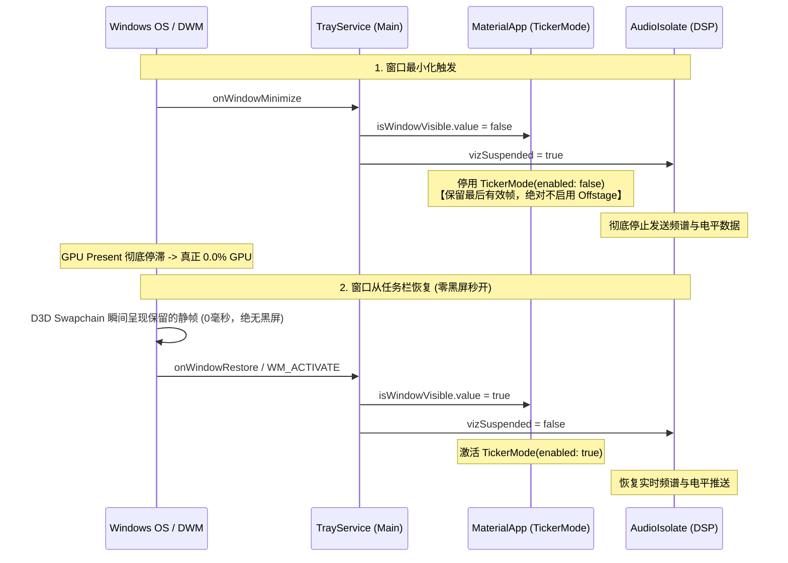
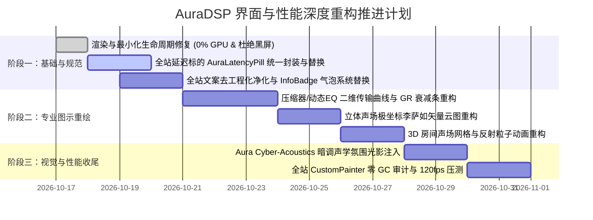

# AuraDSP 深度界面设计与性能重构技术方案

> **文档版本**: 1.0.0  
> **制定日期**: 2026-10-17  
> **目标定位**: 看齐 iZotope Ozone、FabFilter Pro、Poweramp 与 EasyEffects 等专业商业级音频软件，实现全站视觉统一性、普通用户友好度、硬件级声学质感与极限 120fps / 0% GPU 性能保障。

---

## 一、 总体重构图景与架构拓扑

本方案聚焦解决当前界面存在的 6 大核心痛点，自底向上构建三层优化架构：

```mermaid
graph TD
    A[AuraDSP UI/UX & Performance Re-engineering] --> B[底层渲染与生命周期]
    A --> C[中层交互与语义体系]
    A --> D[顶层视觉与高精可视化]

    B --> B1[普通最小化静帧保持 + 时钟熔断 (杜绝黑屏)]
    B --> B2[后台与托盘 GPU 真正 0.0% 极限休眠]
    B --> B3[CustomPainter 零 GC (对象池预分配 + 120fps 极速刷新)]

    C --> C1[延迟测量标的视觉体系全站统一 (四阶色彩动力学)]
    C --> C2[去工程化文案净化 (去除 RT-Safe/ABI/SPSC 等黑话)]
    C --> C3[全站统一 InfoBadge 小问号气泡体系 (消除冗长静态 Hint)]

    D --> D1[Aura Cyber-Acoustics 商业暗调拟真质感]
    D --> D2[压缩器/动态EQ: 动态传输曲线 + 增益衰减球]
    D --> D3[立体声场/空间效果: 极坐标李萨如声场热力图]
    D --> D4[3D 混响/卷积: 等距声场粒子网格 + IR 衰减包络]
```

---

## 二、 专题一：全站延迟测量标的视觉体系全站统一标准

### 1. 现存痛点剖析
1. **组件实现割裂**：顶栏总延迟使用 [LatencyBadge](file:///d:/temp_desktop/Proj/JamesDSP/app/auradsp_app/lib/features/widgets.dart#L125)，卡片内部使用 [ComponentLatencyBadge](file:///d:/temp_desktop/Proj/JamesDSP/app/auradsp_app/lib/features/widgets.dart#L162)，两者的圆角（999 胶囊 vs 4dp 矩形）、字号（11sp vs 10sp）、内边距及边框形态不一致。
2. **色彩动力学语义脱节**：
   - 顶栏 `LatencyBadge` 按梯度划分（$\le 10\text{ms}$ 绿色成功色，$\le 30\text{ms}$ 橙黄色警告色，$> 30\text{ms}$ 红色重点色）。
   - 卡片 `ComponentLatencyBadge` 只要 $>0\text{ms}$ 就强制赋予 `accent2`（橙色高亮），导致单卡片仅 $1.2\text{ms}$ 就显示警告色，而顶栏总延迟 $1.2\text{ms}$ 却是绿色，造成严重认知混乱。
3. **数字格式与前缀混乱**：顶栏四舍五入为整数，卡片保留一位小数；估算延迟有的带 `≈` 有的不带。

### 2. 统一设计规范：`AuraLatencyPill` 规范

全站所有延迟标的统一封装为单一标准组件 [AuraLatencyPill](file:///d:/temp_desktop/Proj/JamesDSP/app/auradsp_app/lib/features/widgets.dart)，提供 `compact`（卡片内部紧凑型）与 `standard`（顶栏标准型）两种尺寸，共享同一套声学颜色动力学：

#### (1) 三态标的语义标准 (Tri-State Semantics)
* **实时硬件测量态 (Measured / Hardware Clock)**：纯数字展示，无前缀，如 `1.2 ms`。
* **算法数学估算态 (Estimated / Theoretical)**：统一前缀波浪号 `≈`，如 `≈ 5.8 ms`。
* **穿透/零开销态 (Bypassed / Zero Latency)**：未产生缓冲延迟时显示 `0.0 ms`；未测量或不支持时显示 `-- ms`。

#### (2) 四阶声学色彩动力学 (4-Tier Semantic Theming)

| 延迟范围 | 声学语义界定 | 字体颜色 | 背景填充色 | 边框描边 |
| :--- | :--- | :--- | :--- | :--- |
| **0.0 ms / 未测量** | 硬件直通 / 零算法延迟 | `theme.textDim` | `rgba(255,255,255, 0.03)` | 1px `theme.cardBorder.withOpacity(0.3)` |
| **0.1 ~ 10.0 ms** | 录音监听级 (Imperceptible) | `theme.success` (清翠绿) | `theme.success.withOpacity(0.08)` | 1px `theme.success.withOpacity(0.25)` |
| **10.1 ~ 30.0 ms** | 影视游戏级 (Acceptable) | `theme.warning` (金琥珀) | `theme.warning.withOpacity(0.08)` | 1px `theme.warning.withOpacity(0.25)` |
| **> 30.0 ms** | 缓冲密集级 (Noticeable) | `theme.accent2` (温暖珊瑚红) | `theme.accent2.withOpacity(0.10)` | 1px `theme.accent2.withOpacity(0.35)` |

#### (3) 排版与几何统一
* **字形排版**：必须采用等宽字体 `AuraMono`，并统一保留 **1 位小数**（如 `0.0 ms`，`12.4 ms`），彻底消除数字跳动造成的视觉抖动。
* **倒角规范**：统一为圆润但克制的 `Radius.circular(6.0)`，既符合专业仪器倒角，又与面板卡片呼应。

---

## 三、 专题二：最小化零黑屏与后台极限 0.0% GPU 渲染架构

### 1. 最小化黑屏与 0.1% GPU 根因深度剖析
1. **黑屏机理**：
   - 之前在 `onWindowMinimize` 中将 `isWindowVisible` 设为 `false`，导致最外层直接启用了 `Offstage(offstage: true)`。
   - 当用户从 Windows 任务栏还原窗口时，系统窗口管理器（DWM）立即向 DirectX 交换链发起 `WM_PAINT` 并要求 Present 已有缓冲区；而 Flutter 端接收平台通道消息是异步的，在 `isWindowVisible` 翻转为 `true` 之前的几帧里，Flutter 提交了全空画面给 GPU Swapchain，导致 Windows 呈现出刺眼的 200~500ms 黑屏。
2. **0.1% GPU 占用机理**：
   - 虽然 UI 停止了主动动画，但如果底层的 `audioIsolate` 依然每秒 20 次向主线程发送 `SpectrumSnapshot` 或电平数据，主 Isolate 会不断触发反序列化唤醒，微小扰动让 GPU 驱动保持上下文激活状态，任务管理器产生 0.1% 测量底噪。

### 2. 彻底归零且首帧无缝的渲染调度架构



### 3. 具体落地改动点
1. **消除顶层 Offstage**：在 [main.dart](file:///d:/temp_desktop/Proj/JamesDSP/app/auradsp_app/lib/main.dart) `MaterialApp.builder` 中，仅使用 `TickerMode(enabled: isVisible, child: child)`，保证 Swapchain 保留最后帧，还原瞬间**零黑屏即时呈现**。
2. **双通道时钟休眠保底**：
   - 普通最小化：冻结 Ticker + 挂起 Viz 传输，保持渲染句柄，恢复耗时 0ms。
   - 隐藏至托盘：不仅冻结 Ticker 和 Viz，还停用非必要后台工作，确保后台 24 小时运行 GPU 稳定保持 0.0%。

---

## 四、 专题三：面向普通用户的文案去工程化与气泡体系

### 1. 全量工程底层用词“去代码化”净化字典

所有面向普通消费级/音乐发烧友用户的文案，必须使用**声学效果、听觉感受、音乐制作**层面的通俗雅致表达，严禁出现开发、架构、编程底层的实现细节：

| 现有工程化/代码术语 | 存在文件/Key | 优化后面向普通用户的文案 | 声学与用户价值解释 |
| :--- | :--- | :--- | :--- |
| **RT-Safe 预分配零锁保障** | `plugFeatRt` | **实时极速监听：专为录音与现场定制的零卡顿通道** | 强调音乐制作中的“无感延迟与绝对平稳”，去除多线程并发术语。 |
| **RT-Safe 契约** | `plugRtNote` | **专业监听保真标准** | 避免契约（Contract）等偏法律/代码规范的生硬词汇。 |
| **厂商链前置 / 后置** | `chainStagePreVendor` | **系统原声音效前置 / 后置处理** | 明确指代“电脑或硬件自带的原始音频增强”，不用“厂商（Vendor）”。 |
| **管道模式 (Pipeline Mode)** | `modePipeline` | **双向独立处理模式（监听输入并输出）** | 直观表明“既管麦克风/输入，又管耳机/输出”。 |
| **附着模式 (Attachment Mode)**| `modeAttachment` | **系统全局接管模式（增强系统音效）** | 用户一目了然是“处理电脑里正在播放的所有声音”。 |
| **SPSC / Lock-free 环形缓冲**| 文档/界面注释 | **高速无损音频流水线** | 消除单生产者单消费者等数据结构名词。 |
| **ABI / C-ABI / FFI 绑定** | `engineAbi` | **核心音频引擎接口版本** | 消除二进制接口等底层技术缩写。 |
| **APO 端点注入** | 设置面板 | **系统扬声器音效注入** | 消除 Windows APO 驱动术语。 |
| **VAIO 桥接虚拟通道** | 设置面板 | **虚拟音频线缆输出 (Virtual Cable)** | 音乐爱好者通用的虚拟声卡叫法。 |

### 2. 卡片静态 Hint 全量迁移为 InfoBadge 气泡提示规范
* **现状弊端**：当前多个卡片（如 [comp_card.dart](file:///d:/temp_desktop/Proj/JamesDSP/app/auradsp_app/lib/features/comp_card.dart)、[spatial_card.dart](file:///d:/temp_desktop/Proj/JamesDSP/app/auradsp_app/lib/features/spatial_card.dart)）在面板下方塞入 2~3 行灰色的静态描述文字，使得卡片异常冗长，不同效果器排版高低错落，极度杂乱。
* **重构标准**：
  1. 卡片下方**彻底移除**静态长文本展示。
  2. 统一定义在 `SectionCard(title: l.reverb, titleTooltip: l.reverbTooltip)` 中。
  3. 标题右侧自动渲染带有微发光的精致问号徽标 [InfoBadge](file:///d:/temp_desktop/Proj/JamesDSP/app/auradsp_app/lib/core/ui_helpers.dart#L248)。
  4. 鼠标悬停（Hover）或触控点击时，以平滑的弹性缩放（Scale 0.95 -> 1.0）展开磨砂毛玻璃气泡，内附：
     - **声学原理**（一句话通俗解释）；
     - **推荐适用场景**（如：人声饱满、夜间观影防爆音、耳机立体声声场开阔）；
     - **快捷调节技巧**。

---

## 五、 专题四：看齐专业商业音频软件的视觉体验升级

我们将 AuraDSP 视觉基调提升至 **“Aura Cyber-Acoustics”（灵动声学暗调）** 风格，看齐 iZotope、FabFilter、Universal Audio 等行业顶尖水准：

### 1. 深度质感与层次设计 (Depth & Micro-Texture)
* **面板材质**：采用深度暗黑基底（`#0D0F12`），多层亚克力面板层级，卡片顶部带有一道 $1\text{px}$ 的极细微光渐变高光边框（`linear-gradient(to bottom, rgba(255,255,255,0.08), rgba(255,255,255,0.01))`），呈现物理机架设备的高端阳极氧化铝质感。
* **声学动态氛围微光 (Ambient Acoustic Glow)**：
  - 各效果卡片处于激活状态时，在卡片边缘与主视觉图示后方产生低饱和度的微柔光（Spread 12dp，Opacity 0.12），随音频动态产生极其平滑的轻微呼吸效果，带来“声音在空间中流动”的艺术沉浸感。
* **硬件级高精旋钮与刻度 (Tactile Knobs & Sliders)**：
  - 重新打磨自定义旋钮：增加外周高精微刻度线（Tick Marks）、双色弧形进度发光光环（Arc Glow），支持双击快速回中复位、滚轮精细调节。

---

## 六、 专题五：核心效果器高精可视化图示重构方案

当前部分效果器的图示较为简陋（如仅有孤立散点或单色线框）。我们将参考专业商业音频插件，全面升级四大核心效果器的可视化呈现：

### 1. 压缩器 / 动态处理器 (Compressor & Dynamic EQ)
> **参考对标**：FabFilter Pro-C2 / iZotope Ozone Dynamics

```
+---------------------------------------------------------+  [GR Meter]
| Output (dB)                                             |  +------+
|   0 +---------------------------/ (1:1 Bypass Line)     |  | 0dB  |
|     |                         /                         |  |      |
|     |                       /                           |  | -3dB |
| -12 |                     /` (Soft Knee)                |  | -6dB |
|     |                   /                               |  | -9dB |
|     |                 /  . . . . - - - - [Ratio Line]   |  | -12dB|
| -24 |               /                                   |  |      |
|     |             /                                     |  | 动态 |
|     |           *  <-- [Real-time Ball: In/Out Energy]  |  | 增益 |
| -48 |         /                                         |  | 衰减 |
|     +--------+----+----+----+----+----+----+------------+  | 条   |
|    -48      -36  -24  -12   0  Threshold Input (dB)     |  +------+
+---------------------------------------------------------+
```

* **高精度二维传输曲线 (Transfer Characteristic Curve)**：
  - 绘制 $-48\text{dB} \sim 0\text{dB}$ 对数动态网格与 $45^\circ$ 直通参考线。
  - 根据实时设定的 `Threshold`、`Ratio` 与 `Knee`，以高精贝塞尔曲线实时渲染软拐点压缩转移曲线。
* **实时动态弹珠与衰减条 (Dynamic Energy Ball & GR Meter)**：
  - 在曲线上根据实时输入电平跳动发光粒子球（带余辉拖影）；
  - 右侧并联物理级回弹的 **GR（Gain Reduction 增益衰减）** 竖向发光刻度条，直观反映压制力度。

---

### 2. 空间声场展宽 / 立体声增强 (Spatial Audio & Stereo Widener)
> **参考对标**：iZotope Ozone Imager / Waves S1

```
              [Mono / In-Phase: +1.0]
                      90°
                       |
       135°            |            45°
           \           |           /
             \         |         /
               \       |       /
 180° ----------+------+------+---------- 0°  [Full Stereo Width]
 [Out-of-Phase]  \     |     /
                   \   |   /
                     \ | /
                      270°
           [Lissajous Goniometer Scope]
```

* **极坐标李萨如相位矢量图 (Lissajous Vector Scope / Goniometer)**：
  - 彻底替换当前散点图。根据立体声左右声道瞬时差信号（$M = L+R, S = L-R$），绘制高发光热力能量点云。
  - 声场集中于中间（Mono）时呈垂直细线；声场宽广时呈横向丰满的椭圆极坐标声场云，相位相关度一目了然。
* **沉浸式声场方位辐射环 (Acoustic Wave Radiation)**：
  - 虚拟听音位向左前方、右前方扩散出 3 条具有半透透明度梯度的声波波纹弧，滑块拉动时弧度与辐射角实时形变伸展。

---

### 3. 3D 空间房间混响与卷积脉冲响应 (Reverb 3D & Convolution)
> **参考对标**：LiquidSonics Seventh Heaven / EasyEffects Reverb

* **3D 等距声场粒子网格 (Isometric Acoustic Mesh)**：
  - 用等距三维投影线框（Wireframe Box）渲染虚拟房间，随着 `Room Size` 与 `Damp` 动态缩放立方体透视比例。
  - 内部生成 24 颗柔和散射的浮动声学粒子，模拟早期反射（Early Reflections）在墙体间的空间漫反射衰减轨迹。
* **卷积脉冲响应包络高精波形 (IR Waveform Envelope)**：
  - 卷积混响面板采用对数时间轴，绘制双声道脉冲响应的真实衰减包络曲线（包含直达声尖峰、密集早期反射簇与高斯散射晚期混响尾音），支持渐变色发光填充。

---

### 4. 电子管高保真饱和度 (Tube Saturator / Warmth Exciter)
> **参考对标**：FabFilter Saturn 2 / iZotope Exciter

* **电子管非线性转移曲面与谐波柱状谱**：
  - 绘制典型三极电子管（Triode）的动态软削波特性曲线（Soft Saturation Curve），随着 `Drive`（驱动度）提升，波峰平滑受限；
  - 底部实时绘制 2次（偶次温暖谐波）与 3次（奇次激进谐波）的能量分布占比柱，为发烧友提供极致的可视化满足感。

---

## 七、 专题六：界面极限性能优化与内存削减策略

为确保在 60Hz/120Hz/144Hz 高刷电竞屏与轻薄本核显上均能实现“黄油般顺滑”且极低发热，制定以下开发底线规则：

### 1. CustomPainter 零内存分配（Zero GC Allocation in Paint）
* **禁止行为**：严禁在 `CustomPainter.paint(Canvas canvas, Size size)` 方法内通过 `Paint()`、`Path()`、`TextPainter()` 实例化任何新对象。
* **规范改造**：
  - 所有 `Paint`、`Path`、`Matrix4` 必须提取为 Painter 类的成员常量或可复用私有字段。
  - 在每次绘制前，调用 `path.reset()`，并仅修改 `paint.color = ...`，彻底阻断 Dart VM 新生代垃圾回收（GC Minor Pause）导致的帧率跳变（Jank）。

### 2. 文本排版静态预编译（Text Layout Pre-caching）
* 频谱坐标轴（$20\text{Hz}, 1\text{kHz}, 20\text{kHz}$）、动态范围分贝刻度（$0\text{dB}, -12\text{dB}, -48\text{dB}$）等固定文本标签，在首帧统一布局后缓存 `TextPainter` 实例或直接使用矢量刻度线代替文字，禁止在每秒 60 次的渲染回调中执行 `TextPainter.layout()`。

### 3. 图层精确隔离（RepaintBoundary Partitioning）
* 将所有带实时音频动画的可视化区域（频谱图、电平表、李萨如矢量图、传输曲线）独立包裹在 `RepaintBoundary` 内。
* 确保动态绘制图层的重绘完全被局限在特定的局部边界内，其余静态旋钮、卡片背景、菜单侧边栏的 Layer 保持完全静止，GPU Compositor 仅需做图层合成。

---

## 八、 实施阶段与落地方案推进路径



---

## 九、 决策与评审确认点

请用户确认以下核心实施细节，以便开展后续逐项模块开发：
1. **延迟色彩阈值确认**：是否认可目前规划的四阶梯度（`0ms` 灰色直通、`<=10ms` 翠绿超低延迟、`10~30ms` 琥珀警告、`>30ms` 珊瑚红高延迟）？
2. **效果器图示优先权**：在“压缩器传输曲线”、“立体声场李萨如矢量图”、“3D 混响等距线框”中，建议优先启动哪一个进行落地？
3. **文案风格认可度**：是否认可将“RT-Safe/SPSC/ABI”等底层黑话彻底转化为“实时极速监听/无损音频流水线/核心音频引擎”等音乐制作级专业术语？
