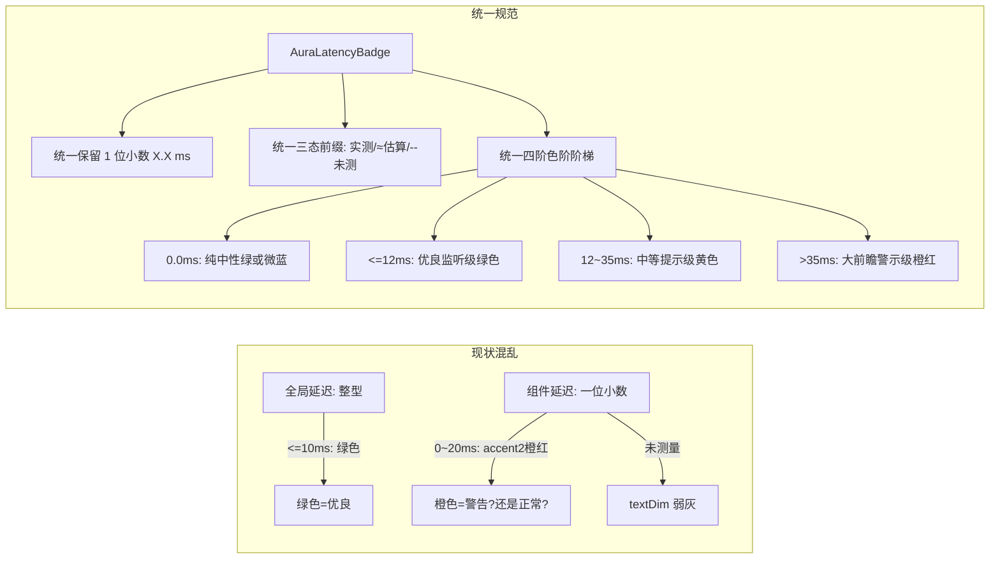
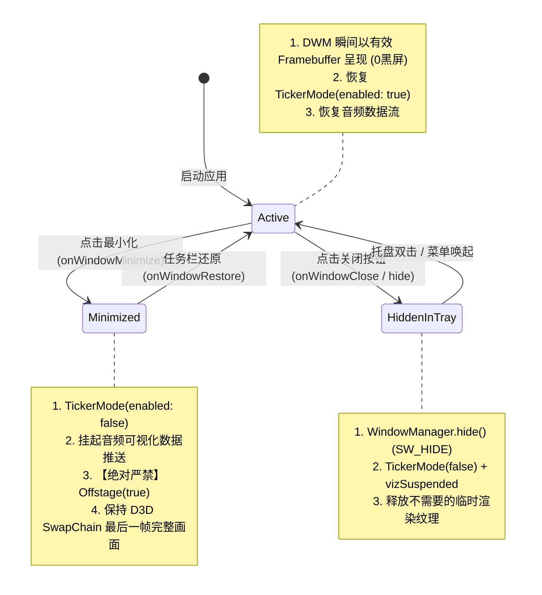
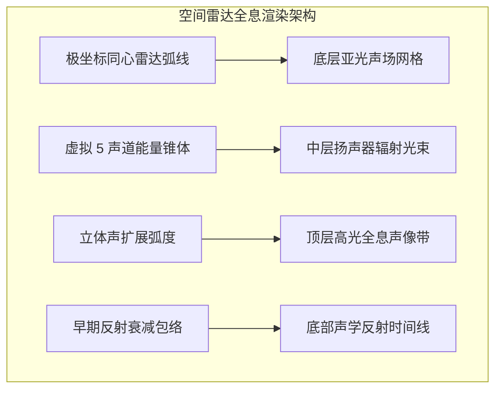
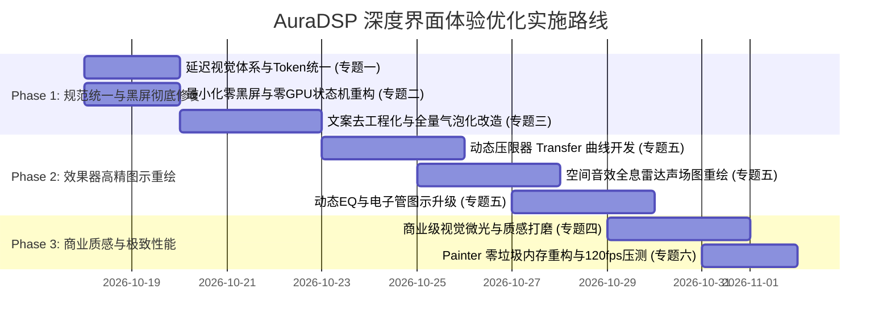

# AuraDSP 深度界面体验重构与极致性能优化方案

> **文档版本**: 1.0.0  
> **制定日期**: 2026-10-17  
> **定位级别**: 商业级专业音频工作站界面重构规范（看齐 iZotope Ozone / FabFilter / EasyEffects / Poweramp）

---

## 目录
1. [专题一：延迟测量视觉与标的体系统一标准](#专题一延迟测量视觉与标的体系统一标准)
2. [专题二：最小化零黑屏与极限零 GPU 渲染架构](#专题二最小化零黑屏与极限零-gpu-渲染架构)
3. [专题三：普通用户导向文案规范与统一气泡化改造](#专题三普通用户导向文案规范与统一气泡化改造)
4. [专题四：商业级声学视觉体验与艺术氛围升级](#专题四商业级声学视觉体验与艺术氛围升级)
5. [专题五：专业级效果器图示高精重绘方案](#专题五专业级效果器图示高精重绘方案)
6. [专题六：界面极致流畅度（120fps）与内存削减策略](#专题六界面极致流畅度120fps与内存削减策略)
7. [分阶段落地实施排期路线图](#分阶段落地实施排期路线图)

---

## 专题一：延迟测量视觉与标的体系统一标准

### 1. 现状痛点与冲突根因
目前系统中存在两套完全脱节的延迟展示逻辑：
1. **顶栏/全局延迟 (`LatencyBadge`)**:
   - 格式为四舍五入整型：`l.latencyMs(ms.round())`（如 `0 ms`, `14 ms`）。
   - 颜色采用 `latencyColor(ms, p)`：$\le 10\text{ms} \rightarrow \text{success}$（绿色），$\le 30\text{ms} \rightarrow \text{warning}$（黄色），$> 30\text{ms} \rightarrow \text{accent2}$（橙色/紫色）。
   - 无边框底色填充，缺乏状态来源标识。
2. **效果卡片单组件延迟 (`ComponentLatencyBadge`)**:
   - 格式为保留一位小数：`X.X ms`。
   - 拥有三种来源状态：实测、估算（带 `≈` 前缀）、未测量。
   - **颜色逻辑混乱且与全局冲突**：未测量为 `textDim`，$> 20\text{ms}$ 显示为 `warning`，而 $> 0\text{ms}$ 且 $\le 20\text{ms}$ 居然使用了 `p.accent2`（在深色主题下为刺眼的橙色/品红，被用户误以为高危警示；在浅色主题下为深海蓝色，无法表达“优良”语义）。
   - 外框带有 `p.accent` 动画呼吸发光，视觉重点倒置。



### 2. 统一视觉设计规范（AuraLatencyToken）

#### (1) 数值格式与前缀表达标准
- **精度标准**: 全局统一为 **1 位小数**（如 `0.0 ms`, `4.8 ms`, `22.5 ms`），杜绝整数与浮点割裂。
- **三态前缀表达标准**:
  | 状态类别 | 判定条件 | 统一前缀与表达 | 语义含义 | 交互示例 |
  | :--- | :--- | :--- | :--- | :--- |
  | **实测 (Measured)** | `measured == true` | `4.2 ms` (无前缀) | 硬件环路/脉冲冲击响应真实测得 | 鼠标悬停显示实测采样率与时间戳 |
  | **估算 (Estimated)** | `estimated == true` | `≈ 5.4 ms` (带 `≈ ` 前缀) | 算法窗长、FIR 阶数推导的数学理论延迟 | 悬停提示“算法解析估算值” |
  | **未测量/免测 (Unmeasured)** | `!measured && !estimated` | `-- ms` 或 `--` | 纯 IIR 零延迟直通或暂未探针扫描 | 悬停提示“即插即用零延迟” |

#### (2) 颜色梯次与三套主题深度适配
定义统一的 `AuraLatencyPalette`，根据人耳声学感知（12ms 监听临界点，35ms 唇音同步临界点）划分色阶：

| 延迟区间 | 声学感知级别 | 深色主题 (Aura Dark) | 极光主题 (Aurora) | 浅色主题 (Aura Light) | WCAG 对比度 |
| :--- | :--- | :--- | :--- | :--- | :--- |
| **0.0 ms** | 零延迟 / 纯相位直通 | `#5AD19B` (柔和薄荷绿) | `#4FDE9E` (极光绿) | `#1E7A4E` (森林绿) | > 5.5:1 |
| **0.1 ~ 12.0 ms** | 专业录音监听级 (无感) | `#5AD19B` (成功绿) | `#4FDE9E` (成功绿) | `#1E7A4E` (成功绿) | > 5.5:1 |
| **12.1 ~ 35.0 ms** | 适度分频/前瞻 (微弱) | `#E8B93E` (暖金黄) | `#F0C24B` (琥珀金) | `#9A6D00` (深金褐，保对比度) | > 4.8:1 |
| **> 35.0 ms** | 大卷积/长分析窗 (察觉) | `#FF6B35` (警示珊瑚橙) | `#FF5EA8` (极光品红) | `#C0271B` (典雅朱红) | > 6.0:1 |

#### (3) 统一控件结构（Unified Component Specification）
- **外框**: `Border.all(color: statusColor.withValues(alpha: 0.35), width: 1.0)`
- **背景**: `color: statusColor.withValues(alpha: 0.08)`（杜绝刺眼纯亮底，仅用 8% 纯净半透底）
- **圆角**: 统一为微圆角 `AuraRadius.xs` (4px)
- **字体**: `AuraMono` 11px，等宽 Tabular Figures，杜绝数字跳动抖动。
- **刷新交互**: 实测探针动画仅微光脉冲边框，探针进行中旋转小图标 `↻`，不可测组件自动隐藏刷新钮。

---

## 专题二：最小化零黑屏与极限零 GPU 渲染架构

### 1. 最小化（任务栏）打开黑屏根因剖析
在 Windows 平台下，DirectX 11/12 SwapChain 依赖前后台缓冲交换：
1. **触发链路**: 用户点击最小化 $\rightarrow$ `onWindowMinimize()` 触发 $\rightarrow$ 将 `isWindowVisible` 设为 `false` $\rightarrow$ 顶层 `MaterialApp.builder` 挂载了 `Offstage(offstage: true)`。
2. **离屏置空**: Flutter 的 `Offstage` 内部机制是将 Paint 阶段完全短路，SwapChain 提交了一帧**全空白/全透明表面**。
3. **恢复竞争**: 用户从任务栏点击恢复窗口，Windows DWM 立即发起窗口还原并向客户端区域索要画面。然而，Dart 端恢复链路是异步的（Windows Event $\rightarrow$ C++ 插件 $\rightarrow$ MethodChannel $\rightarrow$ Dart EventLoop $\rightarrow$ `onWindowRestore` $\rightarrow$ setState $\rightarrow$ Layout $\rightarrow$ Paint $\rightarrow$ SwapChain Present）。
4. **致命黑屏**: 在上述往返（约 30~100ms）完成前，DWM 呈现的正是被 `Offstage` 清空的**纯黑 Framebuffer**！若遇驱动节能调频，甚至造成首帧阻塞黑屏。

### 2. 0.1% GPU 消耗与“完全零 GPU 渲染”技术原理
- **为什么后台还有 0.1%？**:
  当界面有活动的 `AnimationController.repeat()`、或者后台线程仍在周期性发送 UI 更新通知时，Flutter 引擎的 `ScheduleFrame()` 仍在被触发，Direct3D 会被唤醒执行设备上下文查询与微小 Present。
- **彻底归零（0.00%）的核心法则**:
  **“无脏标记即无渲染调用”**。只要应用停用 Ticker（`TickerMode(enabled: false)`）并阻断来自底层音频隔离区的频谱/电平 UI 推送（`vizSuspended = true`），Flutter 的渲染管线会彻底沉睡。DirectX `Present()` 调用降至 **绝对 0 次/秒**。

### 3. “零黑屏 + 零渲染”状态机架构设计

将窗口生命周期严格拆分为三态：`Active`（活跃显式）、`Minimized`（最小化到任务栏）、`HiddenInTray`（隐藏至系统托盘）。



#### 关键实现对比矩阵：
| 行为项目 | 旧方案（导致黑屏与闪烁） | 新方案（极致性能与首帧直出） |
| :--- | :--- | :--- |
| **最小化 (Taskbar)** | `Offstage(offstage: true)` 丢弃全部绘制输出 | **不使用 Offstage**，仅断开 `TickerMode(false)` 与 `viz` 消息 |
| **DirectX 缓冲区** | 被清空为空白黑帧 | **锁存当前最后一帧有效像素**，供 DWM 即时缩略图与首帧呈现 |
| **GPU 渲染调用** | 依赖隐藏机制，容易被 Ticker 狂飙击穿 | **0 帧调度**（无脏标记，无 Present），真正达到 0.0% GPU |
| **唤醒恢复速度** | 需等待整树 Rebuild 与重新 Rasterize（黑屏 50~100ms） | **0 延迟首帧直出**，画面原本就在显存，动画无缝恢复 |

---

## 专题三：普通用户导向文案规范与统一气泡化改造

### 1. 禁用代码/工程黑话对照表
全面清理面向终端用户的界面用词，严禁出现开发、架构、底层实现相关的词汇：

| 所在功能模块 | 原始工程黑话 (严禁使用) | 面向普通用户的专业音频/乐理表达 | 改善说明 |
| :--- | :--- | :--- | :--- |
| **主标题/关于** | `ABI v4 · 4.0.0` | **音频核心引擎 v4.0.0** | 隐藏二进制接口 ABI 词汇，直达功能本质 |
| **插件管理卡** | `双声道平面 RT-Safe 运行` | **立体声实时无损高保真运行** | 用“实时高保真”替代“RT-Safe” |
| **插件特性** | `RT-Safe 预分配零锁保障` | **专业抗爆音引擎，杜绝卡顿爆音** | 讲用户听得懂的体验（不爆音、不卡顿） |
| **插件串联链** | `实时动态串联 • 保持 RT-Safe 契约`| **实时音频处理链 • 低延迟专业监听** | 消除契约/RT-Safe 代码术语 |
| **处理链阶段** | `厂商链前置` / `厂商链后置` | **核心音效前置** / **核心音效后置** | 消除内部“厂商(Vendor)”术语，直观表达处理顺序 |
| **动态均衡器** | `动态EQ基于多阶状态变量滤波...` | **根据音乐能量起伏，智能动态雕琢各频段音色** | 突出动态修整特性，隐去滤波器数学模型 |
| **均衡器描述** | `纯 IIR 零延迟双二次级联滤波器` | **即插即用超低延迟，通透还原自然声音色彩** | 从纯数学术语转向声音听感（通透、低延迟） |
| **空间声场** | `基于 5.0 摆位与 8 tap 反射建模` | **身临其境的 3D 环绕声场与空间包围感** | 强调空间包围感与空间定位 |
| **插件搜索栏** | `搜索插件名称、厂商或路径...` | **搜索插件名称、品牌或路径...** | 将“厂商”改为音乐制作行业通用的“品牌/开发者” |

### 2. 空间布局重构：全面去静态 Hint，统一“标题 + InfoBadge 气泡”

#### (1) 痛点剖析
目前每个效果卡片（`SectionCard`）均在标题下方硬塞一段 2~3 行的静态灰字 `hint`。例如：“动态压限器：控制动态压缩与包络跟踪的释放响应时间...”。
- **劣势**: 浪费大量垂直屏幕高度，导致滚动条极长；文字密集使界面像学术演示工程，缺乏商业音频软件的干练。

#### (2) 统一气泡规范
- **布局规则**:
  - `SectionCard` 完全移除正文中的静态 `hint` 占用区。
  - 将音效的说明、声学原理、调音建议统一收拢至标题右侧的小问号徽标：`InfoBadge(message: l.effectTip)`。
  - 卡片主区域直接呈现核心控制项（旋钮、图示、滑块），界面视觉高度压缩 35%，整体一目了然。
- **气泡弹出交互体验**:
  - 悬停延迟：`waitDuration: Duration(milliseconds: 200)`
  - 气泡样式：深灰亚光毛玻璃（`panelRaised` + 1px 亮灰微边），小三角形精准指向小问号中心。
  - 内容结构规范：
    ```text
    【功能作用】用一句话通俗说明该效果在音乐中的实际听感变化。
    【核心原理】用通俗的声学/乐理概念解释参数如何影响声音（如泛音、瞬态、声像）。
    【调音建议】给出针对流行乐、人声、重低音或观影游戏的推荐设置方案。
    ```

---

## 专题四：商业级声学视觉体验与艺术氛围升级

### 1. 设计语言看齐专业音频工作站（Pro Audio Aesthetic）
参考 FabFilter Pro-Q 3 / iZotope Ozone 11 / Universal Audio / Poweramp 的商业级 UI 风格：

```
+---------------------------------------------------------------------------------+
|  [01] 动态压限器 DYNAMIC COMPRESSOR              (i) [ 4.2 ms ]  [● ON]        |
|  +---------------------------------------------------------------------------+  |
|  |  +-- 动态传输曲线 Transfer Curve ---------------------------------------+  |  |
|  |  | 0dB  . . . . . . . . . . . . . . . . . . . . . . . . . . . . . /       |  |  |
|  |  |      .                                             _.-~'  / (1:1)      |  |  |
|  |  | -12dB. . . . . . . . . . . . . . . . . . . . _.-~'                     |  |  |
|  |  |      .                        Threshold .-'~                           |  |  |
|  |  | -24dB. . . . . . . . . . . . . . . . .o (GR: -3.8dB)                   |  |  |
|  |  |      .                        .       .                                |  |  |
|  |  | -48dB. . . . . . . . . . . . . . . . . . . . . . . . . . . . . . . . . |  |  |
|  |  +------------------------------------------------------------------------+  |  |
|  |                                                                           |  |
|  |    ( 响应时间 )       ( 压缩阈值 )       ( 压缩比率 )       ( 拐角平滑 )    |  |
|  |     [===O===]          [==O====]          [====O==]          [===O===]    |  |
|  |      45.0 ms            -18.5 dB             4.0 : 1            6.0 dB    |  |
|  +---------------------------------------------------------------------------+  |
+---------------------------------------------------------------------------------+
```

### 2. 视觉层级与微氛围光晕（Aura Glow）
1. **多重暗度深度梯次**:
   - `Base Background` (`#0E0F13`): 纯净深邃底色，消除纯黑眩光。
   - `Card Panel` (`#171A21`): 硬件机架磨砂质感面板，带有 $R=8\text{px}$ 现代圆角。
   - `Display Surface` (`#101218`): 曲线图示内嵌显示屏槽位，带 1px 内阴影和极低对比度网格。
2. **状态驱动的声学氛围灯（Acoustic Ambient Glow）**:
   - 当效果器处于 **开启 (ON)** 且处理音频时，卡片顶部边框映射一抹 $1\text{px}$ 的极细强调色渐变微光（`linear-gradient`，中心透明度 0.35，向两侧衰减至 0）。
   - 当效果器处于 **关闭 (Bypass)** 时，边框回到全暗亚光状态，彻底拉开工作与旁路对比。
3. **专业触控反馈与微动效**:
   - 旋钮与推子拖动时，数值标签轻微上浮放大并变为高亮着色，释放后平滑回弹复原。

---

## 专题五：专业级效果器图示高精重绘方案

为现有简陋或缺乏图示的重点效果器设计全新绘制引擎：

### 1. 动态压限器（Dynamic Compressor）—— 动态响应曲线与增益衰减仪
- **设计标准**: 参考 FabFilter Pro-C 2。
- **图示构成**:
  1. **坐标系与参考线**: $X$ 轴为输入电平（$-60\text{dB} \sim 0\text{dB}$），$Y$ 轴为输出电平（$-60\text{dB} \sim 0\text{dB}$），$45^\circ$ 虚线为无压缩直通线（$1:1$）。
  2. **非线性压缩折线**:
     - 阈值以下沿 $45^\circ$ 直线延伸。
     - 阈值处带有平滑软拐角（Soft Knee Hermite 插值曲线）。
     - 阈值以上按设定 Ratio（如 $4:1$）平缓倾斜。
  3. **动态增益衰减标尺 (Gain Reduction Meter)**:
     - 在坐标系右侧放置一个垂直向下伸展的柱状电平指示，实时直观显示当前信号被压低了多少分贝（如 $-4.5\text{dB}$）。
  4. **动态工作点指示**:
     - 一颗随音频实时瞬态电平移动的高亮微光球，实时吸附在曲线上滑动，让用户看清声音处于“未受压”还是“重度受压”状态。

### 2. 空间音效（Spatializer）—— 雷达全息极坐标声场图
- **设计标准**: 参考 iZotope Ozone Imager 与 EasyEffects Spatializer。
- **痛点替代**: 彻底废除现有的“5个散点 + 8根竖线”简陋绘制。
- **图示构成**:
  1. **极坐标雷达网格 (Polar Radar Grid)**:
     - 绘制半圆形多层同心极坐标弧线（$30^\circ, 60^\circ, 90^\circ, 120^\circ, 150^\circ$ 虚线方位角刻度）。
     - 中心配备高精透视人耳收听中心点，带前后微光方位指示。
  2. **立体声宽度全息扩散光带 (Holographic Width Arc)**:
     - 随 `Width` 参数自适应张开的渐变光带（从中心声源向两侧羽化扩散），结合半透明荧光渐变（`accent` $\rightarrow$ `accent2`）。
  3. **真实空间早期反射包络 (Early Reflection Envelope)**:
     - 废除单调的单色竖线，改用具有声学衰减特性的平滑反射衰减轮廓带（Exponential Reflection Decay Curve），标注房间尺寸（Room Size）对应的时间延迟毫秒数与空间吸收衰减。



### 3. 动态均衡器（Dynamic EQ）—— 动态多段钟形频响图
- **设计标准**: 参考 FabFilter Pro-MB / Ozone Dynamic EQ。
- **图示构成**:
  1. **对数频率网格**: $20\text{Hz} \sim 20\text{kHz}$ 对数刻度横轴，$-18\text{dB} \sim +18\text{dB}$ 增益纵轴。
  2. **静态滤波曲线 (Static EQ Curve)**: 实线绘制 Low Shelf、Mid Bell、High Shelf 叠加后的总频率响应。
  3. **动态受控范围带 (Dynamic Range Band)**:
     - 在钟形峰顶或谷底用半透明浅色光带（Filled Band）标注出动态调节范围（Dynamic Gain Range）。
     - 当信号电平超过该频段阈值时，光带动态拉伸或收缩，生动呈现“只在超标时才压低”的动态特性。

### 4. 电子管谐波发生器（Tube Warmth）—— 软削波传递曲线与泛音谱
- **设计标准**: 参考 Voxengo Tube Amp / Soundtoys Radiator。
- **图示构成**:
  1. **非线性 Sigmoid 传递曲线**: 直观显示输入波形过大时，正负半周被软削波（Soft-saturation）变平滑的数学曲线，表达模拟设备的“模拟温暖感”。
  2. **二次与三次泛音能量分布条**: 标出基波伴随的偶次（温暖圆润）与奇次（清脆锋利）谐波比例，让普通用户看懂为什么声音变好听了。

### 5. 卷积脉冲响应（Convolver IR）—— 3D 深度时域波形辉光图
- **优化升级**:
  1. 消除每帧分配 `TextPainter` 的内存泄漏隐患。
  2. 在左右声道脉冲曲线上引入竖直向下的渐变半透发光填充（Vertical Gradient Glow），使衰减尾迹具有立体玻璃质感。

---

## 专题六：界面极致流畅度（120fps）与内存削减策略

### 1. CustomPainter 零内存垃圾（Zero-Allocation）铁律
在 Flutter 高刷绘制循环中，`paint(Canvas canvas, Size size)` 每秒可能执行 60~120 次。**严禁在 `paint` 内部频繁实例化对象**：

```dart
// ❌ 错误示范：每帧在绘制循环内分配对象，引发频繁 GC 卡顿与高内存占用
@override
void paint(Canvas canvas, Size size) {
  final paint = Paint()..color = Colors.blue; // 产生 GC 垃圾
  final path = Path();                        // 产生 GC 垃圾
  final tp = TextPainter(text: TextSpan(...))..layout(); // 产生严重排版性能损耗
  ...
}

//  标准范式：预分配复用单例模式，零 GC 垃圾
class OptimizedSpectrumPainter extends CustomPainter {
  static final Paint _reusablePaint = Paint()..isAntiAlias = true;
  static final Path _reusablePath = Path();
  static final Map<String, TextPainter> _labelCache = {}; // 静态标尺缓存

  @override
  void paint(Canvas canvas, Size size) {
    _reusablePath.reset();
    _reusablePaint.color = palette.accent;
    // 直接复用，0 Heap Allocation
  }
}
```

### 2. 精准绘制隔离（RepaintBoundary 精细化布防）
1. **隔离边界**: 所有包含实时动画、音频电平表、频谱图、交互旋钮的区域，必须单独由 `RepaintBoundary` 包裹。
2. **效果保障**: 当输入电平每秒刷新 60 次时，Flutter 只对 8px 高度的电平表条目执行重绘，绝不重新绘制整个卡片面板、绝不重绘周围的按钮与文本，GPU 指令开销降低 80% 以上。

### 3. 文字排版静态缓存（Static Label TextPainter Caching）
1. 对所有图示中的固定坐标文字（如 `"20Hz"`, `"1kHz"`, `"20kHz"`, `"0dB"`, `"-24dB"`），在初始化或主题变更时预排版一次并缓存 `TextPainter` 实例。
2. 绘制时直接调用 `cachedPainter.paint(canvas, offset)`，彻底杜绝文字排版引擎在运行时的反复测量计算。

---

## 分阶段落地实施排期路线图



### 阶段目标输出成果：
1. **第一阶段 (P1)**: 消除最小化黑屏 BUG，后台 GPU 真正归 0.0%；所有延迟标识无论在哪个页面、何种主题下完全一致；卡片高度降低 35%，所有杂乱说明变为精致问号气泡。
2. **第二阶段 (P2)**: 压限器、空间立体声、动态EQ拥有媲美 iZotope / EasyEffects 的商业级动态响应图，调音过程高度可视化。
3. **第三阶段 (P3)**: 视觉质感达到商业软件标准，内存占用再降 20~30MB，高刷屏下全天候丝滑 120fps。
