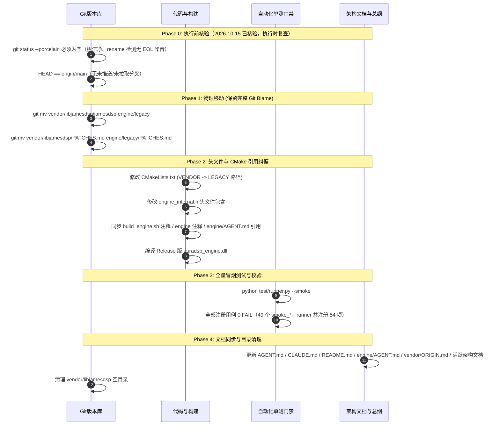

# JamesDSP 迁移至 engine/legacy/ 重组与融合实施方案

> **方案状态**：规划评审版 v2（方案先行，暂不改动业务代码）  
> **创建日期**：2026-10-15  
> **责任目标**：将原位于 `vendor/libjamesdsp/jamesdsp` 的 C 算法核正式收编为核心引擎内建资产（`engine/legacy/`），消解“只读第三方与深度打补丁”的架构冲突，为后续效果原子化平级融合奠定基础。

| 修订 | 日期 | 说明 |
|---|---|---|
| v1 | 2026-10-15 | 初稿（规划评审版） |
| v2 | 2026-10-15 | 按仓库实测核对更新（核对记录见 §6）：① 补丁计数修正（`PATCHES.md` 登记 12 条 P-001~P-012、P-003 保留编号、实际落地 11 项、源码内 38 处 `[PATCHED-AuraDSP]` 标记）；② 新增 Android 第二副本分叉事实与范围界定（§1.1-4、§1.3、§5.4）；③ 引用清单扩充（`build_engine.sh`、`engine/AGENT.md`、`tools/probe/fft_probe.cpp`）并修正行号；④ 测试计数更正（`test/smoke/` 57 个脚本、runner 注册 49 个 smoke 用例 / 54 条总项，原“20 个测试”作废）；⑤ 新增 Phase 0 执行前核验（工作树已洁净、`046fafe` 已同步 origin/main、EOL 已归一）；⑥ Phase 4 文档同步清单区分“活跃 / 历史”。 |

---

## 1. 动因与架构背景

### 1.1 现状与深层痛点

1. **认知混淆与目录倒挂**：
   * 外部观察者或新开发人员看到 `vendor/libjamesdsp`，容易误以为该模块是“某个特定平台（如 Android）专用的外部黑盒”。
   * 构建时，桌面引擎 `auradsp_engine.dll` 需跨级向上寻找 `../../../vendor/libjamesdsp`，破坏了 `engine/` 作为核心音频处理引擎的**自包含性（Self-Containment）**。
2. **“只读 Vendor”与“深度自研补丁”的逻辑冲突**：
   * 在行业规范中，`vendor/` 仅应存放未修改的上游第三方纯只读源码。
   * 然而，为了满足现代音频工作站特性（声场分带调节、表驱动链路重排、卷积干湿比实时混合、EQ 卷积器双缓冲无爆音等），我们已在其上实施了 **11 项已落地的深度改造**——`vendor/libjamesdsp/PATCHES.md` 共登记 **12 条**（`P-001` ~ `P-012`，其中 `P-003` 为保留编号、补丁尚未落地），源码内累计 **38 处** `[PATCHED-AuraDSP …]` 标记。
   * **现实是：它已经不再是一个冷冰冰的“外部依赖”，而是 AuraDSP 核心处理引擎中不可分割的基石。**
3. **效果器的“二元分裂”**：
   * 目前自研音效有 10 个（`engine/dsp/` 下的 `dsp_dyneq`、`dsp_gate`、`dsp_haas` 等），遵循现代 C++20 与 RT-Safe 规范；
   * 而 JamesDSP 的 12 个音效（EQ、Convolver、Reverb、Tube、Compressor 等）却被隔绝在 `vendor/` 下，导致调度链逻辑被切断为“前自研 → 中间 Vendor 单体 → 后自研”的夹心三明治形态。
4. **第二物理副本与双线分叉（实测新增）**：
   * 仓库中实际存在**两份** libjamesdsp 源码树：桌面 canonical `vendor/libjamesdsp/`（139 个受版本管理文件 = `jamesdsp/` 下 138 个 + 顶层 `PATCHES.md`），以及 Android 构建自持的 `core/android/vendor-src/libjamesdsp/`（135 个文件）。
   * 两份**已实质分叉**：Android 副本缺 `essential.h`、`jamesdsp.c`、`MemoryUsage.h`、`PATCHES.md` 4 个顶层文件；6 个 `jdsp/` 文件内容不同（桌面侧独有 534 行、Android 侧独有 109 行）。
   * Android 副本内**没有任何** `[PATCHED-AuraDSP]` 标记，不含表驱动链（`chain[16]` / `JamesDSPRebuildChain` / `graph.order`）、分带展宽（`bandMix`）等全部已登记改造——即它是一条**独立演进的旧基线分叉**，而非桌面线的镜像。
   * 迁移完成后 `engine/legacy/` 将成为桌面/通用侧唯一权威源；Android 副本的对齐策略作为独立后续决策（§5.4），**不纳入本次四阶段**。

### 1.2 预期收益

* **彻底纯化 `vendor/` 职责**：`vendor/` 下未来仅保留行业公开规范（`vendor/plugin-api/` 中的 CLAP 与 Steinberg VST3 头文件）。
* **引擎完整自包含**：`engine/` 包含全部 C++20 自研模块、C 经典算法、拓扑链与插件宿主，任何平台只需编译 `engine/` 即可得到完整功能的 DSP 动态库。
* **为音效全面融合铺平道路**：为后续将 JamesDSP 内部 12 级单体链拆散、转化为与自研模块平级的独立效果器提供物理结构支撑。

### 1.3 范围界定（本次明确不做之事）

* 只迁移桌面 canonical `vendor/libjamesdsp` → `engine/legacy`，**零算法改动**（平移 + 路径适配，100% 向后兼容）。
* `core/android/vendor-src/libjamesdsp/` 及其构建脚本 `build_jdsp.sh` **一行不动**（Android 编译自己那份副本，与桌面 CMake 无耦合，见 §3.2）。
* 历史文档（`docs/30-审查/`、`docs/40-回顾/`、`docs/20-执行/` 下既有 Spec、`docs/Windows通用底层音频驱动与四模式架构方案-2026-10-13.md` 等）**保持原貌**，不随迁移回改（见步骤 4 清单）。

---

## 2. 目标目录树设计

```text
AuraDSP/
├── engine/                               # ★ 核心 DSP 引擎（100% 自包含音频数学中枢）
│   ├── auradsp_engine.{h,cpp,def}        #   C ABI 唯一导出契约
│   ├── engine_internal.h                 #   内部符号与 Handle 单一入口
│   ├── auradsp_msvc_shim.h               #   MSVC 兼容宏前置声明
│   ├── auradsp_plugin_host.h             #   插件宿主公共头
│   ├── chain/                            #   链路拓扑、探针、无锁可视化
│   │   ├── engine_chain.cpp              #   process_stereo_chain 调度总成
│   │   ├── engine_audiofile.cpp          #   音频文件 IO
│   │   ├── engine_convolver.cpp          #   IR 脉冲载入与门卫
│   │   ├── engine_viz.cpp                #   30fps SPSC 环形缓冲
│   │   └── engine_probe.cpp              #   端到端阶跃与脉冲测量
│   ├── dsp/                              #   10 个现代 C++20 自研效果器（一模块一文件）
│   │   ├── dsp_dyneq.cpp                 #   三段全参数动态 EQ
│   │   ├── dsp_gate.cpp                  #   前置噪声门与去咝声
│   │   ├── dsp_haas.cpp                  #   Haas 差分环绕
│   │   ├── dsp_freeverb.cpp              #   Freeverb 混响
│   │   └── ...                           #   filter / bassmono / shelf / exciter / loudness / psycho
│   ├── host/                             #   VST3 / CLAP 宿主子模块（slots / scan / gui）
│   │
│   └── legacy/                           # ★【本次迁移目标】收编的经典 C 算法核
│       ├── PATCHES.md                    #   补丁登记簿（原封平移自 vendor，继续严格维护）
│       ├── essential.h                   #   全局数学与内存宏
│       ├── cpthread.{c,h}                #   跨平台轻量线程
│       ├── jamesdsp.c                    #   全局分配与入口封装
│       ├── MemoryUsage.h                 #   内存占用统计辅助
│       └── jdsp/                         #   算法与效果器本体
│           ├── jdsp_header.h             #   JamesDSPLib 大结构体与 API 声明
│           ├── jdspController.c          #   12 级表驱动链主控实现
│           ├── binaryBlobs.c             #   内置预设二进制常量（1MB）
│           ├── generalDSP/               #   底层基础数学（biquad、FFT、IIR、ASRC）
│           └── Effects/                  #   12 个经典音效纯 C 实现（EQ、tube、reverb、liveprog 等）
│
├── vendor/                               # ★ 第三方行业只读标准（纯净无业务代码）
│   ├── ORIGIN.md                         #   来源登记
│   └── plugin-api/                       #   行业纯接口规范头文件
│       ├── clap/                         #   CLAP 官方标准头文件（纯 C）
│       └── steinberg/                    #   VST3 SDK 官方标准头文件（纯 C++）
│
└── core/                                 # ★ 操作系统驱动与宿主壳
    ├── desktop/windows/CMakeLists.txt    #   Windows 构建脚本（调整引用指向 engine/legacy）
    └── desktop/windows-drivers/          #   系统级拦截驱动（02_voicemeeter / 03_system_apo）
```

> 注：`core/android/`（含 `vendor-src/libjamesdsp` 副本与 registrar 构建链）不在上图范围内，本次迁移完全不触碰（§1.3）。

---

## 3. 影响范围与改动矩阵

本次重组遵循**“零算法改动、仅平移与路径适配”**原则，保证 100% 向后兼容。

### 3.1 代码与头文件变更（2026-10-15 实测核对后的完整清单）

| 文件路径 | 原引用写法 | 目标引用写法 | 变更原因 |
|---|---|---|---|
| [engine/engine_internal.h](file:///d:/temp_desktop/Proj/JamesDSP/engine/engine_internal.h) L34-L35 | `#include "jdsp/jdsp_header.h"`<br/>`#include "jdsp/Effects/eel2/fft.h"` | `#include "legacy/jdsp/jdsp_header.h"`<br/>`#include "legacy/jdsp/Effects/eel2/fft.h"` | 语义显式化，避免裸 include 造成命名污染 |
| [engine/auradsp_engine.cpp](file:///d:/temp_desktop/Proj/JamesDSP/engine/auradsp_engine.cpp) L4 | 注释提到 `vendor/libjamesdsp` | 更新注释指向 `engine/legacy/` | 保持文档真实性 |
| [engine/auradsp_msvc_shim.h](file:///d:/temp_desktop/Proj/JamesDSP/engine/auradsp_msvc_shim.h) L5 | 注释提到 `libjamesdsp` 的 `essential.h` 行为 | 更新注释指引 | 保持文档真实性 |
| [engine/AGENT.md](file:///d:/temp_desktop/Proj/JamesDSP/engine/AGENT.md) L52、L60 | `vendor/libjamesdsp/jamesdsp/jdsp/jdspController.c`、`vendor/libjamesdsp/PATCHES.md` 补丁纪律指引 | 全部改为 `engine/legacy/…` 对应路径 | 补丁登记纪律的引用路径必须随迁 |
| [core/desktop/windows/build_engine.sh](file:///d:/temp_desktop/Proj/JamesDSP/core/desktop/windows/build_engine.sh) L5（注释） | `../../../vendor/libjamesdsp/  JamesDSP C engine` | `engine/legacy/` | 构建脚本注释真实性（脚本本身不编译 vendor） |
| [tools/probe/fft_probe.cpp](file:///d:/temp_desktop/Proj/JamesDSP/tools/probe/fft_probe.cpp) L5-L6 | `#include "jdsp/jdsp_header.h"`、`#include "jdsp/Effects/eel2/fft.h"`（依赖手工编译时 `-I vendor/libjamesdsp/jamesdsp`） | include 写法不变；编译参数 `-I` 改指 `engine/legacy` | 仓库内无固化编译命令，随实际编译参数同步即可 |
| AGENT.md / CLAUDE.md / README.md | 目录结构清单含 `vendor/libjamesdsp` | 更新为 `engine/legacy` | 见 Phase 4 文档同步 |

**明确不改的提及（语义性引用，迁移后依然准确）**：
* `engine/auradsp_engine.h:96`（“EQ 位于 libjamesdsp 的单体链内部”）、`engine/chain/engine_chain.cpp:401`（“libjamesdsp 稳态无分配”）等——仅指代算法血统/行为，不涉及路径，保留原样。

### 3.2 构建系统（CMakeLists.txt）变更

修改 [core/desktop/windows/CMakeLists.txt](file:///d:/temp_desktop/Proj/JamesDSP/core/desktop/windows/CMakeLists.txt)：

```cmake
# ==================== 原配置（2026-10-15 已逐项核对与现状一致） ====================
# set(VENDOR     "${CMAKE_CURRENT_SOURCE_DIR}/../../../vendor/libjamesdsp/jamesdsp")   # L4
# file(GLOB_RECURSE ENGINE_C CONFIGURE_DEPENDS "${VENDOR}/*.c")                        # L8
# list(FILTER ENGINE_C EXCLUDE REGEX "eel2/cpthread\\.c$")
# target_include_directories(... PRIVATE "${VENDOR}" "${VENDOR}/jdsp" ...)             # L41-42

# ==================== 目标新配置 ====================
set(API        "${CMAKE_CURRENT_SOURCE_DIR}/../../../engine")
set(LEGACY     "${API}/legacy")
set(PLUGIN_API "${CMAKE_CURRENT_SOURCE_DIR}/../../../vendor/plugin-api")

# 1. 递归扫描 engine/legacy 下的全部纯 C 算法实现
file(GLOB_RECURSE LEGACY_C CONFIGURE_DEPENDS "${LEGACY}/*.c")
# 排除与顶层重名的 eel2/cpthread.c
list(FILTER LEGACY_C EXCLUDE REGEX "eel2/cpthread\\.c$")

# 2. 组装动态库
add_library(auradsp_engine SHARED
    ${LEGACY_C}
    "${API}/auradsp_engine.cpp"
    # ... 其余 C++20 模块保持原样 ...
)

# 3. 包含目录：由 vendor 收拢至 engine/legacy
target_include_directories(auradsp_engine PRIVATE
    "${API}"
    "${LEGACY}"
    "${LEGACY}/jdsp"
    "${PLUGIN_API}"
)
```

**核验事实**：
* 整个 `CMakeLists.txt` 中 `libjamesdsp` 字面路径仅出现在 L4（经 `VENDOR` 变量用于 L8 / L41 / L42，全文件无其他 vendor 引用；L48 注释提及的 `vendor-src` 指 Android 侧副本，迁移后依然成立、无需改动）；`PLUGIN_API` 指向 `vendor/plugin-api`，**不属于本次迁移范围，保持不变**。
* **Android 零影响**：`core/android/registrar/examples/jamesdsp_engine/build_jdsp.sh` 通过 `find "$CORE_W/vendor-src/libjamesdsp" -name '*.c' ! -name 'cpthread.c'` 独立编译自己那份副本（其注释自称“83 files”），与桌面 CMake 无任何耦合，本次迁移对其 0 影响。

### 3.3 测试用例与自动化门禁影响

* **测试用例（`test/smoke/*.py`，经 [test/runner.py](file:///d:/temp_desktop/Proj/JamesDSP/test/runner.py) 调度）**：**0 影响**。所有单测脚本均通过 `ctypes` 调用导出的 C ABI（`auradsp_create`、`auradsp_set_param`、`auradsp_process`），对底层物理源码位置完全透明。
* **计数更正（2026-10-15 实测）**：`test/smoke/` 实有 **57** 个脚本；`runner.py` 注册表共 **54** 条——其中 **49 个 `smoke_*`**、3 个 `test_*`、2 个 `bench_*`。原方案所写“20 个测试”为过时估计，**以 runner 注册表实跑结果为准**：`python test/runner.py --smoke`（`--smoke` 参数已核验存在于 runner.py L162）执行的全部用例必须 **0 FAIL**。
* **编译产物路径**：产物依然统一输出到 `core/desktop/windows/out/Release/auradsp_engine.dll`，下游自动化流程零冲击。runner 自带 CMake 构建步骤，路径迁移的正确性会由构建阶段自动验证（一票否决）。

---

## 4. 实施路线：Phase 0 前置核验 + 四阶段无损切换流程

为确保重构不引发构建雪崩或历史断代，分为**前置核验（Phase 0）**与四个可独立回滚的步骤执行：



### Phase 0：执行前核验清单（2026-10-15 状态与执行时要求）

| # | 核验项 | 2026-10-15 状态 | 执行时要求 |
|---|---|---|---|
| 1 | 工作树洁净：`git status --porcelain` 为空（此前的 VAIO 驱动重构、spike 生成物、`gen/` 噪音等已分别落地为提交，如 `deabedb`） | ✅ 核验时点满足（两次核验均为 0 条）；⚠️ 同日稍晚出现**新一批在途改动（约 30 文件）**：Flutter 效果卡片 ×23、`engine/auradsp_engine.cpp`、`engine/chain/engine_probe.cpp`、`test/smoke/smoke_graph_order.py`、`vendor/…/jdspController.c`(+68) 与 `jdsp_header.h`(+4) | **每次执行前必须重新复查为空**；在途工作须先落地或暂存，`git mv` 提交必须纯净、不混入在途工作，保证可单独回滚 |
| 2 | 与远端同步：HEAD `046fafe`（含本方案）== `origin/main`，0 ahead / 0 behind | ✅ 满足 | 复查 |
| 3 | EOL 归一：`.gitattributes` 已提交；`git diff` 与 `git diff --ignore-cr-at-eol` 对 `vendor/libjamesdsp` **均为空**（历史换行符翻搅已消噪，rename 识别不会被 `core.autocrlf` 干扰） | ✅ 满足 | 复查第 1 项即可 |
| 4 | 补丁登记完整：`PATCHES.md` 12 条（P-003 保留编号）、源码 38 处 `[PATCHED-AuraDSP]` 标记，与迁移前树逐一随迁 | ⚠️ 核验时点满足；同日在途改动新增 1 处**未编号**标记（`jdspController.c` 内新函数 `JamesDSPFilterVendorOrder`，`PATCHES.md` 尚未登记） | 该在途补丁落地时**必须补登记**（预计 P-013）；迁移后抽查标记数 = 迁移前实测值 |
| 5 | 双副本认知：Android `core/android/vendor-src/libjamesdsp` 分叉事实已登记（§1.1-4、§5.4） | ✅ 满足 | 本次不触碰该树 |

> 结论：核验时点（2026-10-15）第 1~4 项前置条件均满足（第 5 项为范围约定，非门槛）；但**同日稍晚出现了新的在途工作（约 30 文件，含 vendor 链控文件与未编号补丁）**，因此执行 Phase 1 前必须重新满足第 1、4 两项——在途工作先落地、补丁先登记，之后方可 `git mv`。

### 详细步骤规范：

#### 步骤 1：物理平移（必须用 `git mv`）
使用 `git mv` 操作以保留文件全部提交历史与 blame 信息（依赖 Phase 0 的洁净树 + EOL 归一前提）：
```powershell
git mv vendor/libjamesdsp/jamesdsp engine/legacy
git mv vendor/libjamesdsp/PATCHES.md engine/legacy/PATCHES.md
```

#### 步骤 2：纠偏构建与头文件包含
1. 编辑 `core/desktop/windows/CMakeLists.txt`，将 `VENDOR` 替换为 `LEGACY`（L4 / L8 / L41 / L42 四处，见 §3.2）；
2. 编辑 `engine/engine_internal.h` L34-L35，更新包含路径（`legacy/jdsp/…`）；
3. 同步注释与纪律引用：`engine/auradsp_engine.cpp` L4、`engine/auradsp_msvc_shim.h` L5、`core/desktop/windows/build_engine.sh` L5、`engine/AGENT.md` L52/L60；如本次编译 `tools/probe/fft_probe.cpp`，其 `-I` 参数改指 `engine/legacy`；
4. 执行增量/全量构建：
   ```powershell
   cmake --build core/desktop/windows/out --config Release
   ```

#### 步骤 3：冒烟与音频回归（一票否决门禁）
运行项目统一测试入口：
```powershell
python test/runner.py --smoke
```
* **断言要求**：runner 注册的全部 49 个 `smoke_*` 用例（含 `smoke_eq_viz_tap.py`、`smoke_ir_block_jitter.py`、`smoke_chain_order.py`）**0 FAIL**；以实跑注册表为准，不以固定数量断言。

#### 步骤 4：元数据与文档登记
**同步（活跃文档，改引用路径）**：
1. 顶层 [AGENT.md](file:///d:/temp_desktop/Proj/JamesDSP/AGENT.md) 与 [CLAUDE.md](file:///d:/temp_desktop/Proj/JamesDSP/CLAUDE.md)、[README.md](file:///d:/temp_desktop/Proj/JamesDSP/README.md) 的目录结构清单；
2. [engine/AGENT.md](file:///d:/temp_desktop/Proj/JamesDSP/engine/AGENT.md) 中指向 vendor 的补丁纪律与结构描述（L52、L60）；
3. [vendor/ORIGIN.md](file:///d:/temp_desktop/Proj/JamesDSP/vendor/ORIGIN.md)，声明 `libjamesdsp` 已正式吸收入内建代码库（保留来源考古记录）；
4. 活跃架构文档中的路径引用：`docs/00-总览/项目架构与开发规范.md`、`docs/10-架构/APP-架构与设计方案.md`、`docs/10-架构/UI与音频效果深度重构与体验优化方案.md`；
5. 视需要同步 `.ai/memory/MEMORY.md`（按 §05 载体规则更新）。

**不改（历史文档，保持原貌）**：`docs/30-审查/*`、`docs/40-回顾/阶段性回顾-2026-10-13.md`、`docs/20-执行/代码审查与整改Spec-2026-10-13.md`、`docs/20-执行/用户反馈问题修复计划-2026-10-10.md`、`docs/Windows通用底层音频驱动与四模式架构方案-2026-10-13.md` 等——历史记录不回改。

6. 删除残留的空目录 `vendor/libjamesdsp`。

---

## 5. 后续演进建议：从“大单体链”到“原子化融合”

将文件迁移到 `engine/legacy/` 是**第一步（结构收编）**。完成之后，我们在未来可以进一步做**第二步（逻辑融合）**，彻底打破目前 `jdspController.c` 内部 12 级死绑的限制：

1. **提取独立 Stage 封装**：
   在 `engine/dsp/` 下新增适配封装（如 `dsp_legacy_eq.cpp`、`dsp_legacy_tube.cpp`、`dsp_legacy_convolver.cpp`），将原属于 `JamesDSPLib` 单体内部的处理函数直接暴露为标准独立接口：
   ```cpp
   void legacy_tube_process(auradsp_handle h, float* dst, int frames);
   void legacy_eq_process(auradsp_handle h, float* dst, int frames);
   ```
2. **处理链平级调度**：
   在 [engine/chain/engine_chain.cpp](file:///d:/temp_desktop/Proj/JamesDSP/engine/chain/engine_chain.cpp) 中，不再调用整块黑盒 `h->jdsp.processFloatMultiplexd(...)`，而是像调度自研的 `dyneq_process` 和 `gate_process` 一样，**逐个节点平级调用**。
3. **收益**：
   * 任意自研效果（如动态 EQ）可以随意插入到 JamesDSP 的经典效果之间（例如插入到管味模拟与 EQ 之间）；
   * 彻底实现真正自由的**任意拓扑音频处理图（Arbitrary Routing Graph）**！

### 5.4 Android 副本对齐（待决策，本次不执行）

迁移落地后，需要就 `core/android/vendor-src/libjamesdsp/`（135 文件，与桌面 canonical 分叉：缺 4 个顶层文件、6 个 jdsp 文件桌面侧独有 534 行 / Android 侧独有 109 行、无任何 `[PATCHED-AuraDSP]` 标记）择一处置：

* **路线 A — 归一（推荐评估）**：让 `build_jdsp.sh` 直接编译 `engine/legacy/`，删除 Android 副本。前置验证项：NDK 环境下顶层 `essential.h` / `jamesdsp.c` 的可编译性、其注释中“83 files”文件清单假设、以及全部已登记补丁（表驱动链、分带、干湿比、音色、limiter 等）进入后 Android 侧的音色/行为变化评估。
* **路线 B — 回灌（双线维护）**：以 `engine/legacy` 为基准，把 534 行已登记改造回灌 Android 副本，逐条补 `[PATCHED-AuraDSP]` 标记与 `PATCHES.md` 登记。成本是长期双树同步负担。
* **决策依据**：Android 线是否仍需独立演进；无论选哪条，都必须消除“无标记改码”现状（铁律 §3.3 禁止无登记的隐式修改）。

---

## 6. 附录：2026-10-15 实测核对记录（方案 ↔ 仓库差异清单）

以下为 v1 → v2 修订所依据的逐项实测结果（全部经 `git status` / `git grep` / `git ls-files` / `git diff --no-index` 现场核验）：

| 核对项 | 实测结果 | 对方案的修正 |
|---|---|---|
| 仓库状态 | HEAD `046fafe`（本方案初稿提交）== `origin/main`，0 ahead / 0 behind；`git status --porcelain` **0 条**（树洁净） | 原“脏树（VAIO staged 删除 + WaveRT 未跟踪 + gen/ 噪音）”已由后续提交（`deabedb` 等）清理完毕 → 新增 Phase 0 并标注“已满足” |
| EOL / 换行符 | `.gitattributes` 改动已提交；对 `vendor/libjamesdsp` 的 `git diff` 与 `git diff --ignore-cr-at-eol` **均为空** | 换行符翻搅已消噪，无需再作为待办；保留为 Phase 0 复查项 |
| 桌面 canonical | `vendor/libjamesdsp/` = **139** 文件（`jamesdsp/` 138 + 顶层 `PATCHES.md`）；`jamesdsp/` 顶层 = `essential.h`、`jamesdsp.c`、`MemoryUsage.h`、`cpthread.{c,h}` + `jdsp/` | §2 目标树补入 `MemoryUsage.h` |
| Android 副本 | `core/android/vendor-src/libjamesdsp/` = **135** 文件；文件名集合 = 桌面 `jamesdsp/` 减 `essential.h`、`jamesdsp.c`、`MemoryUsage.h`（无 Android 独有文件名）；`cpthread.c/h` 内容一致 | 新增 §1.1-4 与 §1.3 范围界定 |
| 双树分叉（`--no-index` numstat） | 6 个文件内容不同：`liveprogWrapper.c`(0/11)、`multimodalEQ.c`(6/28)、`stereoEnhancement.c`(2/30)、`vacuumTube.c`(7/77)、`jdspController.c`(92/326)、`jdsp_header.h`(2/62)；桌面独有 **534** 行、Android 独有 **109** 行 | 确立“桌面为唯一权威源、Android 另行对齐”策略（§5.4） |
| Android 补丁状态 | `git grep PATCHED -- core/android/vendor-src/libjamesdsp` **无匹配**；`JamesDSPRebuildChain`、`graph.order`、`chain[16]`、`bandMix[5]` 在 Android 树中**均不存在** | 更正早期“Android 副本更新/含 rebuild-chain”的假设：Android 是**缺全部登记改造的旧基线分叉** |
| 补丁登记 | `PATCHES.md` 含 **12** 条 `## P-001`~`## P-012`（P-003 为保留编号，补丁未落地）= 实际落地 **11** 项；源码 `[PATCHED-AuraDSP` 标记 **38** 处 | 修正 §1.1-2 表述（原“11 项，见 P-001~P-011”） |
| 桌面构建引用点 | `core/desktop/windows/CMakeLists.txt`：`VENDOR` 出现于 L4/L8/L41/L42（唯一构建入口）；`build_engine.sh` L5 为注释引用；`engine/auradsp_engine.cpp` L4 注释；`engine/engine_internal.h` L34-L35（原方案写 L33-L37）；`engine/auradsp_msvc_shim.h` L5；`engine/AGENT.md` L52/L60；`tools/probe/fft_probe.cpp` L5-L6 | §3.1 矩阵扩充为 7 行并修正行号 |
| Android 构建入口 | `build_jdsp.sh` L49：`find …/vendor-src/libjamesdsp -name '*.c' ! -name 'cpthread.c'`，与桌面 CMake 零耦合 | §3.2 标注“Android 零影响” |
| 测试清单 | `test/smoke/` 实有 **57** 个 `.py`；`runner.py` 注册 **49** `smoke_*` + 3 `test_*` + 2 `bench_*` = **54** 条；`--smoke` 参数存在（L162） | 修正 §3.3 与 Phase 3 断言（原“20 个测试”作废） |
| `engine/` 现状树 | 28 个受管文件：`chain/` 5 cpp（含 `engine_audiofile.cpp`）、`dsp/` 10 cpp、`host/` 5 cpp + `plugin_host_util.h`、根 6 文件 | §2 目标树补入 `engine_audiofile.cpp`，`dsp/` 描述与现状一致 |
| `vendor/` 现状 | 仅 `libjamesdsp/`、`plugin-api/`、`ORIGIN.md` | 与 §1.2“纯化后仅剩 plugin-api”目标衔接一致 |
| 核验后在途工作（同日晚些时候观测） | `git status` 由 0 → 约 30 文件：Flutter 效果卡片 ×23、`engine/auradsp_engine.cpp`(+14)、`engine/chain/engine_probe.cpp`(+25)、`test/smoke/smoke_graph_order.py`(+43)、`vendor/…/jdspController.c`(+68，新函数 `JamesDSPFilterVendorOrder`，带未编号 `[PATCHED-AuraDSP]` 标记)、`vendor/…/jdsp_header.h`(+4) | Phase 0 第 1、4 项改为“执行前必须重新满足”；该新补丁落地时须补 `PATCHES.md` 登记（预计 P-013），否则违反铁律 §3.3 |
