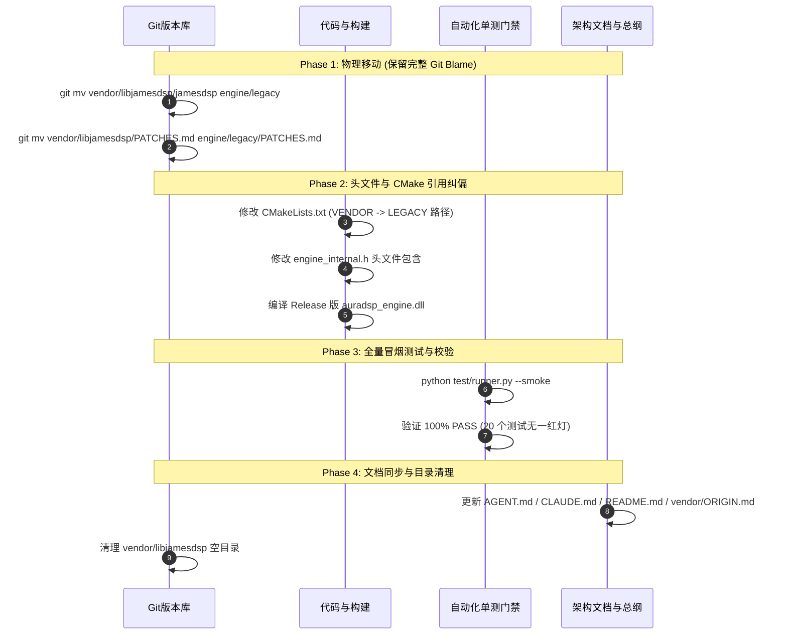

# JamesDSP 迁移至 engine/legacy/ 重组与融合实施方案

> **方案状态**：规划评审版（方案先行，暂不改动业务代码）  
> **创建日期**：2026-10-15  
> **责任目标**：将原位于 `vendor/libjamesdsp/jamesdsp` 的 C 算法核正式收编为核心引擎内建资产（`engine/legacy/`），消解“只读第三方与深度打补丁”的架构冲突，为后续效果原子化平级融合奠定基础。

---

## 1. 动因与架构背景

### 1.1 现状与深层痛点

1. **认知混淆与目录倒挂**：
   * 外部观察者或新开发人员看到 `vendor/libjamesdsp`，容易误以为该模块是“某个特定平台（如 Android）专用的外部黑盒”。
   * 构建时，桌面引擎 `auradsp_engine.dll` 需跨级向上寻找 `../../../vendor/libjamesdsp`，破坏了 `engine/` 作为核心音频处理引擎的**自包含性（Self-Containment）**。
2. **“只读 Vendor”与“深度自研补丁”的逻辑冲突**：
   * 在行业规范中，`vendor/` 仅应存放未修改的上游第三方纯只读源码。
   * 然而，为了满足现代音频工作站特性（声场分带调节、表驱动链路重排、卷积干湿比实时混合、EQ 卷积器双缓冲无爆音等），我们已在其上实施了 **11 项深度改造**（见 `vendor/libjamesdsp/PATCHES.md` 的 P-001 ~ P-011）。
   * **现实是：它已经不再是一个冷冰冰的“外部依赖”，而是 AuraDSP 核心处理引擎中不可分割的基石。**
3. **效果器的“二元分裂”**：
   * 目前自研音效有 10 个（`engine/dsp/` 下的 `dsp_dyneq`、`dsp_gate`、`dsp_haas` 等），遵循现代 C++20 与 RT-Safe 规范；
   * 而 JamesDSP 的 12 个音效（EQ、Convolver、Reverb、Tube、Compressor 等）却被隔绝在 `vendor/` 下，导致调度链逻辑被切断为“前自研 → 中间 Vendor 单体 → 后自研”的夹心三明治形态。

### 1.2 预期收益

* **彻底纯化 `vendor/` 职责**：`vendor/` 下未来仅保留行业公开规范（`vendor/plugin-api/` 中的 CLAP 与 Steinberg VST3 头文件）。
* **引擎完整自包含**：`engine/` 包含全部 C++20 自研模块、C 经典算法、拓扑链与插件宿主，任何平台只需编译 `engine/` 即可得到完整功能的 DSP 动态库。
* **为音效全面融合铺平道路**：为后续将 JamesDSP 内部 12 级单体链拆散、转化为与自研模块平级的独立效果器提供物理结构支撑。

---

## 2. 目标目录树设计

```text
AuraDSP/
├── engine/                               # ★ 核心 DSP 引擎（100% 自包含音频数学中枢）
│   ├── auradsp_engine.{h,cpp,def}        #   C ABI 唯一导出契约
│   ├── engine_internal.h                 #   内部符号与 Handle 单一入口
│   ├── auradsp_msvc_shim.h               #   MSVC 兼容宏前置声明
│   ├── auradsp_plugin_host.h             #   插件宿主公共头
│   ├── chain/                            #   链路拓扑、探针、无锁可视化
│   │   ├── engine_chain.cpp              #   process_stereo_chain 调度总成
│   │   ├── engine_convolver.cpp          #   IR 脉冲载入与门卫
│   │   ├── engine_viz.cpp                #   30fps SPSC 环形缓冲
│   │   └── engine_probe.cpp              #   端到端阶跃与脉冲测量
│   ├── dsp/                              #   10 个现代 C++20 自研效果器（一模块一文件）
│   │   ├── dsp_dyneq.cpp                 #   三段全参数动态 EQ
│   │   ├── dsp_gate.cpp                  #   前置噪声门与去咝声
│   │   ├── dsp_haas.cpp                  #   Haas 差分环绕
│   │   ├── dsp_freeverb.cpp              #   Freeverb 混响
│   │   └── ...                           #   filter / bassmono / shelf / exciter / loudness / psycho
│   ├── host/                             #   VST3 / CLAP 宿主子模块（slots / scan / gui）
│   │
│   └── legacy/                           # ★【本次迁移目标】收编的经典 C 算法核
│       ├── PATCHES.md                    #   补丁登记簿（原封平移自 vendor，继续严格维护）
│       ├── essential.h                   #   全局数学与内存宏
│       ├── cpthread.{c,h}                #   跨平台轻量线程
│       ├── jamesdsp.c                    #   全局分配与入口封装
│       └── jdsp/                         #   算法与效果器本体
│           ├── jdsp_header.h             #   JamesDSPLib 大结构体与 API 声明
│           ├── jdspController.c          #   12 级表驱动链主控实现
│           ├── binaryBlobs.c             #   内置预设二进制常量（1MB）
│           ├── generalDSP/               #   底层基础数学（biquad、FFT、IIR、ASRC）
│           └── Effects/                  #   12 个经典音效纯 C 实现（EQ、tube、reverb、liveprog 等）
│
├── vendor/                               # ★ 第三方行业只读标准（纯净无业务代码）
│   ├── ORIGIN.md                         #   来源登记
│   └── plugin-api/                       #   行业纯接口规范头文件
│       ├── clap/                         #   CLAP 官方标准头文件（纯 C）
│       └── steinberg/                    #   VST3 SDK 官方标准头文件（纯 C++）
│
└── core/                                 # ★ 操作系统驱动与宿主壳
    ├── desktop/windows/CMakeLists.txt    #   Windows 构建脚本（调整引用指向 engine/legacy）
    └── desktop/windows-drivers/          #   系统级拦截驱动（02_voicemeeter / 03_system_apo）
```

---

## 3. 影响范围与改动矩阵

本次重组遵循**“零算法改动、仅平移与路径适配”**原则，保证 100% 向后兼容。

### 3.1 代码与头文件变更

| 文件路径 | 原引用写法 | 目标引用写法 | 变更原因 |
|---|---|---|---|
| [engine/engine_internal.h](file:///d:/temp_desktop/Proj/JamesDSP/engine/engine_internal.h#L33-L37) | `#include "jdsp/jdsp_header.h"`<br/>`#include "jdsp/Effects/eel2/fft.h"` | `#include "legacy/jdsp/jdsp_header.h"`<br/>`#include "legacy/jdsp/Effects/eel2/fft.h"` | 语义显式化，避免裸 include 造成命名污染 |
| [engine/auradsp_engine.cpp](file:///d:/temp_desktop/Proj/JamesDSP/engine/auradsp_engine.cpp#L4) | 注释提到 `vendor/libjamesdsp` | 更新注释指向 `engine/legacy/` | 保持文档真实性 |
| [engine/auradsp_msvc_shim.h](file:///d:/temp_desktop/Proj/JamesDSP/engine/auradsp_msvc_shim.h#L5) | 注释提到 `libjamesdsp` 行为 | 更新注释指引 | 保持文档真实性 |

### 3.2 构建系统（CMakeLists.txt）变更

修改 [core/desktop/windows/CMakeLists.txt](file:///d:/temp_desktop/Proj/JamesDSP/core/desktop/windows/CMakeLists.txt)：

```cmake
# ==================== 原配置 ====================
# set(VENDOR     "${CMAKE_CURRENT_SOURCE_DIR}/../../../vendor/libjamesdsp/jamesdsp")
# file(GLOB_RECURSE ENGINE_C CONFIGURE_DEPENDS "${VENDOR}/*.c")
# list(FILTER ENGINE_C EXCLUDE REGEX "eel2/cpthread\\.c$")
# target_include_directories(auradsp_engine PRIVATE "${API}" "${VENDOR}" "${VENDOR}/jdsp" "${PLUGIN_API}")

# ==================== 目标新配置 ====================
set(API        "${CMAKE_CURRENT_SOURCE_DIR}/../../../engine")
set(LEGACY     "${API}/legacy")
set(PLUGIN_API "${CMAKE_CURRENT_SOURCE_DIR}/../../../vendor/plugin-api")

# 1. 递归扫描 engine/legacy 下的全部纯 C 算法实现
file(GLOB_RECURSE LEGACY_C CONFIGURE_DEPENDS "${LEGACY}/*.c")
# 排除与顶层重名的 eel2/cpthread.c
list(FILTER LEGACY_C EXCLUDE REGEX "eel2/cpthread\\.c$")

# 2. 组装动态库
add_library(auradsp_engine SHARED
    ${LEGACY_C}
    "${API}/auradsp_engine.cpp"
    # ... 其余 C++20 模块保持原样 ...
)

# 3. 包含目录：由 vendor 收拢至 engine/legacy
target_include_directories(auradsp_engine PRIVATE
    "${API}"
    "${LEGACY}"
    "${LEGACY}/jdsp"
    "${PLUGIN_API}"
)
```

### 3.3 测试用例与自动化门禁影响
* **测试用例（`test/smoke/*.py`）**：**0 影响**。所有单测脚本均通过 `ctypes` 调用导出的 C ABI（`auradsp_create`、`auradsp_set_param`、`auradsp_process`），对底层物理源码位置完全透明。
* **编译产物路径**：产物依然统一输出到 `core/desktop/windows/out/Release/auradsp_engine.dll`，下游自动化流程零冲击。

---

## 4. 四阶段实施路线与无损切换流程

为确保重构不引发构建雪崩或历史断代，分为四个可独立回滚的步骤执行：



### 详细步骤规范：

#### 步骤 1：物理平移（必须用 `git mv`）
使用 `git mv` 操作以保留文件全部提交历史与 blame 信息：
```powershell
git mv vendor/libjamesdsp/jamesdsp engine/legacy
git mv vendor/libjamesdsp/PATCHES.md engine/legacy/PATCHES.md
```

#### 步骤 2：纠偏构建与头文件包含
1. 编辑 `core/desktop/windows/CMakeLists.txt`，将 `VENDOR` 替换为 `LEGACY`；
2. 编辑 `engine/engine_internal.h`，更新包含路径；
3. 执行增量/全量构建：
   ```powershell
   cmake --build core/desktop/windows/out --config Release
   ```

#### 步骤 3：冒烟与音频回归（一票否决门禁）
运行项目统一测试入口：
```powershell
python test/runner.py --smoke
```
* **断言要求**：包括 `smoke_eq_viz_tap.py`、`smoke_ir_block_jitter.py`、`smoke_chain_order.py` 在内的所有测试必须 **100% 全部通过**。

#### 步骤 4：元数据与文档登记
1. 更新顶层 [AGENT.md](file:///d:/temp_desktop/Proj/JamesDSP/AGENT.md) 与 [CLAUDE.md](file:///d:/temp_desktop/Proj/JamesDSP/CLAUDE.md) 的目录结构清单；
2. 更新 [vendor/ORIGIN.md](file:///d:/temp_desktop/Proj/JamesDSP/vendor/ORIGIN.md)，声明 `libjamesdsp` 已正式吸收入内建代码库；
3. 删除残留的空目录 `vendor/libjamesdsp`。

---

## 5. 后续演进建议：从“大单体链”到“原子化融合”

将文件迁移到 `engine/legacy/` 是**第一步（结构收编）**。完成之后，我们在未来可以进一步做**第二步（逻辑融合）**，彻底打破目前 `jdspController.c` 内部 12 级死绑的限制：

1. **提取独立 Stage 封装**：
   在 `engine/dsp/` 下新增适配封装（如 `dsp_legacy_eq.cpp`、`dsp_legacy_tube.cpp`、`dsp_legacy_convolver.cpp`），将原属于 `JamesDSPLib` 单体内部的处理函数直接暴露为标准独立接口：
   ```cpp
   void legacy_tube_process(auradsp_handle h, float* dst, int frames);
   void legacy_eq_process(auradsp_handle h, float* dst, int frames);
   ```
2. **处理链平级调度**：
   在 [engine/chain/engine_chain.cpp](file:///d:/temp_desktop/Proj/JamesDSP/engine/chain/engine_chain.cpp) 中，不再调用整块黑盒 `h->jdsp.processFloatMultiplexd(...)`，而是像调度自研的 `dyneq_process` 和 `gate_process` 一样，**逐个节点平级调用**。
3. **收益**：
   * 任意自研效果（如动态 EQ）可以随意插入到 JamesDSP 的经典效果之间（例如插入到管味模拟与 EQ 之间）；
   * 彻底实现真正自由的**任意拓扑音频处理图（Arbitrary Routing Graph）**！
