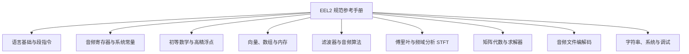
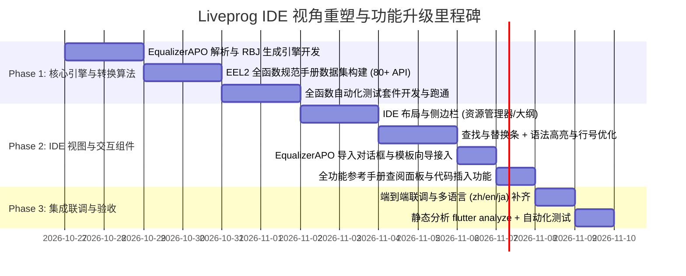

# Liveprog 脚本 IDE 视角重塑与功能升级计划

> **日期**：2026-10-26（2026-10-27 全面验收闭环）  
> **分支**：`dev`  
> **状态**：已完成 (100%) / 验收通过  
> **关联模块**：
> - `app/auradsp_app/lib/features/liveprog_page.dart`（脚本工作区与 IDE 界面）
> - `app/auradsp_app/lib/features/eel_editor_support.dart`（词法高亮、格式化、Linter）
> - `app/auradsp_app/lib/features/liveprog/`（新增 IDE 子模块：大纲、查找替换、转换器、手册）
> - `engine/legacy/jdsp/Effects/eel2/`（EEL2 / NSEEL 虚拟机与 C 扩展函数库）
> - `test/smoke/smoke_eel_all_functions.py`（EEL2 全函数自动化测试套件）

---

## 一、升级背景与核心愿景

### 1.1 现状与痛点分析
当前 AuraDSP 的脚本选项卡（`LiveprogPage`）采用单列长卡片排版（01 编辑卡、02 滑块卡、03 预设库卡上下堆叠），在实际音频 DSP 脚本开发与调试时存在如下痛点：
1. **界面视角割裂**：代码编辑、实时滑块调试、外部预设浏览呈垂直堆叠，编辑长脚本时无法同时监视滑块与编译输出，缺乏专业 IDE 的统一视界与停靠布局。
2. **缺乏现代开发工具链**：无代码大纲（Code Outline / Symbol Tree）、无查找替换（Find & Replace）、无行号对齐与快捷跳转、无代码模板向导（New Script Wizard）。
3. **EqualizerAPO 预设互通断层**：海量现成的 EqualizerAPO / Peace 格式（`.txt`）耳机与扬声器校准预设无法一键导入 AuraDSP，需要用户手动对照换算。
4. **参考手册极其简陋**：原有手册仅为一段 10 行的粗略文本对话框，无法反映 JamesDSP EEL2 引擎内建的 80+ 个高阶 DSP、傅里叶变换（FFT/STFT）、多相滤波、矩阵代数及音频编解码函数的完整规范与入参说明。
5. **函数工作状态缺乏系统测试**：底层 C++ 注册的大量数值计算与音频算法函数缺乏系统化测试验证套件。

### 1.2 升级愿景
将脚本选项卡从“单页脚本设置卡”全面蜕变为**面向现代音频算法工程师与发烧友的“AuraDSP Liveprog IDE”**：
- **IDE 级工作空间**：工作区整合侧边资源管理器（内置分类预设树、用户目录）、代码符号大纲导航、多段高亮编辑器、查找/替换栏、底部控制台及右侧/浮动动态滑块调试台。
- **Clean-Room EqualizerAPO 转换引擎**：独立实现 EqualizerAPO TXT 转 EEL2 脚本算法，支持左右独立 EQ、极性反转、声道交换及 Preamp 增益补偿。
- **专业级 EEL2 全功能手册中心**：涵盖 9 大类 80+ 内置函数，带搜索、参数解释、原理提示、丰富范例及“一键插入光标”功能。
- **全函数覆盖测试体系**：构建覆盖全部 EEL2 内置函数的自动化测试套件，确保函数无崩溃、输出精确、实时音频泵安全。

---

## 二、参考工程剖析与 Clean-Room 合规策略

| 参考工程 | 关键设计与借鉴点 | 许可证限制与合规策略 |
| :--- | :--- | :--- |
| **`source/LiveprogIDE`** | • 现代化 IDE 布局体系（Code Editor、Project View、Code Outline、Variable Watch、Console Output）<br>• `eelang.xml` 完整词法与高亮关键字定义<br>• 代码模板向导（New File Wizard）与查找替换表单 | **无 LICENSE 声明**：<br>严格执行**设计借鉴、零代码抄袭**。在 Flutter/Dart 中采用 Aura 设计系统（`AuraPalette`, `AuraSpace`, `AuraRadius`）纯自研实现布局组件、大纲提取器与控制器。 |
| **`source/PeaceTXT-to-EEL-converter`** | • EqualizerAPO / Peace `.txt` 格式解析规范（Channel 路由、Preamp、Filter 语法）<br>• RBJ Biquad Filter（Peaking, Low Shelf, High Shelf）自适应采样率（`srate`）计算与级联模型<br>• 左右声道独立处理、声道交换（Swap）、极性反转（Invert）工作流 | **无 LICENSE 声明**：<br>严格执行 **Clean-Room 原则**。仅将 EqualizerAPO 配置规范作为公开格式规格，在 Dart 中从零手写解析状态机与 RBJ Biquad 生成器，不借用其任何前端 JS 源码与结构。 |

---

## 三、IDE 级整体架构与界面布局重塑

### 3.1 模块目录结构规划
```text
app/auradsp_app/lib/features/liveprog/
├── liveprog_ide_page.dart         # IDE 主界面（替代原 liveprog_page.dart 内部单列结构）
├── components/
│   ├── ide_toolbar.dart           # 顶部工具栏（运行、卸载、新建、格式化、查找、手册、转换器）
│   ├── code_editor_view.dart      # 核心代码编辑区（行号对齐、语法高亮、快捷键绑定）
│   ├── find_replace_bar.dart      # 查找与替换悬浮/内嵌工具条
│   ├── code_outline_panel.dart    # 侧边代码符号大纲导航（@init, @sample, 函数, 变量）
│   ├── project_explorer_panel.dart# 脚本库与预设资源树（分类浏览、拖拽导入）
│   ├── live_sliders_panel.dart    # 动态参数滑块控制台（支持折叠/侧靠）
│   └── ide_status_bar.dart        # 底部状态栏（光标位置、错误诊断计数、编译耗时）
├── converter/
│   ├── equalizer_apo_parser.dart  # EqualizerAPO TXT Clean-Room 语法解析器
│   ├── rbj_biquad_generator.dart  # RBJ 双二阶滤波器 EEL2 脚本生成引擎
│   └── equalizer_apo_dialog.dart  # 转换导入交互弹窗（文件载入、参数调节、实时预览）
├── manual/
│   ├── eel_manual_registry.dart   # 80+ EEL 函数与语言特性规范全集数据库
│   ├── eel_manual_panel.dart      # 参考手册全功能查阅面板（分类、搜索、插入代码）
│   └── eel_templates.dart         # IDE 新建向导预设模板（直通、EQ、立体声、多波段等）
```

### 3.2 布局视界设计（Responsive IDE Workspace）
```text
+-----------------------------------------------------------------------------------+
| Top IDE Toolbar: [Run / Compile F5] [Unload] | [New] [Save] [Format] [Find]       |
|                  | [Import EqualizerAPO (TXT)] [Reference Manual] | [Layout Switch]|
+-----------------------+-----------------------------------+-----------------------+
| Left Sidebar (可折叠)  | Center Editor Area                | Right Debug Panel     |
| [Presets] [Outline]   |                                   | (可展开/停靠)          |
|                       |  1 | /* Audio DSP Script */       | [Live Sliders]        |
| > distortion_lofi     |  2 | @init                        | slider1: Volume (dB)  |
| > dynamics            |  3 |   srate = srate > 0 ? ...;   | [===o===========] 0dB |
| v filters_eq          |  4 |   fc = 1000;                 |                       |
|   * stftFilter.eel    |  5 | @sample                      | slider2: Cutoff (Hz)  |
|   * peaking_eq.eel    |  6 |   spl0 = spl0 * slider1;     | [=======o=======] 1k  |
| > utility             |  7 |   spl1 = spl1 * slider1;     |                       |
|                       |                                   | [Compiler Console]    |
| Outline:              |-----------------------------------| Status: OK (12ms)     |
| @ @init               | Find: [ gain    ] [Prev] [Next]   | Memory: 65536 blocks  |
| @ @sample             | Repl: [ volume  ] [Replace All]   | Safe RT Pump: Active  |
+-----------------------+-----------------------------------+-----------------------+
| Bottom Status Bar: Ln 6, Col 24 | UTF-8 | 15 Lines | EEL2 | Compile: OK (12ms)    |
+-----------------------------------------------------------------------------------+
```

---

## 四、EqualizerAPO 转 EEL2 转换引擎（Clean-Room）

### 4.1 语法解析器（`EqualizerApoParser`）
支持解析主流 EqualizerAPO / Peace GUI 输出的标准配置指令：
- **通道指令**：`Channel: all` / `Channel: L` / `Channel: R` / `Channel: C` / `Channel: LFE` 等。
- **前级增益**：`Preamp: -3.5 dB`（支持全局与单声道独立设置）。
- **滤波器指令**：`Filter [Index]: ON [Type] Fc [Freq] Hz Gain [Gain] dB Q [Q]`。
  - 支持类型：`PK`（峰值滤波器）、`LSC`（低架滤波器）、`HSC`（高架滤波器）、`LP`（低通滤波器）、`HP`（高通滤波器）、`BP`（带通滤波器）、`Notch`（陷波滤波器）。

### 4.2 脚本生成引擎（`RbjBiquadGenerator`）
自动生成标准、优美且高效的 EEL2 源代码：
1. **采样率安全性**：`srate = (srate > 0) ? srate : 48000;`。
2. **面向对象风格双二阶计算函数**：
   ```eel
   function biquad_init(b0, b1, b2, a0, a1, a2) instance(b0, b1, b2, a1, a2) (
     inv_a0 = 1.0 / a0;
     this.b0 = b0 * inv_a0;
     this.b1 = b1 * inv_a0;
     this.b2 = b2 * inv_a0;
     this.a1 = a1 * inv_a0;
     this.a2 = a2 * inv_a0;
   );
   function biquad_process(x) instance(b0, b1, b2, a1, a2, x1, x2, y1, y2) (
     y = this.b0 * x + this.b1 * this.x1 + this.b2 * this.x2 - this.a1 * this.y1 - this.a2 * this.y2;
     this.x2 = this.x1; this.x1 = x;
     this.y2 = this.y1; this.y1 = y;
     y;
   );
   ```
3. **声道交换与极性反转**：
   - 勾选 Channel Swap 时，在 `@sample` 开头执行声道交换；
   - 勾选 Invert Polarity 时，输出前执行相位反转。
4. **实时预览与交互**：
   - 在 `EqualizerApoDialog` 中支持即时语法高亮预览、参数选项实时联动重新生成、一键载入至编辑器或导出为 `.eel` 文件。

---

## 五、EEL2 官方级规范参考手册（API Documentation Center）

系统梳理并正规化 JamesDSP 底层 EEL2 / NSEEL 虚拟机的全部内建函数与机制，整理成结构化文档注册表 `EelManualRegistry`：



### 5.1 涵盖的完整函数库分类清单
1. **语言基础与指令**：`@init`, `@sample`, `@slider`, `@block`, `function`, `local`, `global`, `instance`, `this`, `while`, `loop`, `if`, `else`。
2. **核心音频流寄存器**：`spl0`, `spl1`, `srate`, `num_ch`, `slider1..8`, `$PI`, `$E`, `$PHI`, `$EPS`, `$MEMBLKLIMIT`, `$DBL_MAX`。
3. **初等数学与高精计算**：
   - 标准：`sin, cos, tan, asin, acos, atan, atan2, sinh, cosh, tanh, sqrt, log, log10, exp, abs, sqr, min, max, sign, rand, round, floor, ceil, invsqrt, expint`
   - 高精浮点：`xFloatS, xFloatF, xF2f32, xAdd, xSub, xMul, xDiv, xsin, xcos, xsqrt, xexp, xlog` 等。
4. **向量与内存管理**：`[ptr]` 内存寻址、`memcpy, memset, freembuf, circshift, convolve_c, maxVec, minVec, meanVec, medianVec`。
5. **频域分析与傅里叶变换**：
   - FFT：`fft, ifft, fft_real, ifft_real, fft_permute, fft_ipermute`
   - STFT：`stftStructSize, stftCheckMemoryRequirement, stftInit, stftGetWindowPower, stftForward, stftBackward, stftSetAsymWnd, getCosineWindows, getAsymmetricCosine`。
6. **滤波器与专用音频算法**：
   - 多相滤波器组：`InitPolyphaseFilterbank, PolyphaseFilterbankAnalysisMono/Stereo, PolyphaseFilterbankSynthesisMono/Stereo`
   - FIR / IIR / 延迟：`FIRInit, FIRProcess, fractionalDelayLineInit/Process, IIRBandSplitterInit/Process, Conv1DInit/Process`
   - 滤波器设计：`firls, eqnerror, zp2sos, tf2sos, roots, cplxpair, unwrap`
   - 信号发生与分析：`InitPinkNoise, GeneratePinkNoise, arburgTrainModel, iirHilbertInit/Process, peakFinder`。
7. **矩阵代数与优化求解器**：
   - 矩阵算子：`linspace, rank, det, transpose, cholesky, inv, pinv_svd, pinv_fast, mldivide, mrdivide`
   - 优化求解：`quadprog, lsqlin`
   - 向量计算：`vectorizeAdd, vectorizeMinus, vectorizeMultiply, vectorizeDivide, lerpAt`。
8. **音频文件读写 (I/O)**：
   - `decodeWavFromFile, decodeFLACFromFile, decodeWavFromMemory, writeWavToFile, writeWavToBase64String`。
9. **字符串、系统与调试**：
   - `strlen, strcmp, stricmp, strncmp, strnicmp, match, matchi, sprintf, printf, listSystemVariable, time, time_precise, sleep, breakpoint`。

### 5.2 手册组件与交互体验
- **条目卡片结构**：
  - 函数原型签名（如 `FIRProcess(firState, input, output, length)`）
  - 简短描述与声学意义
  - 参数说明表（入参类型、物理单位、有效范围）
  - 返回值说明
  - 典型应用代码示例（Syntax Highlighted Code Block）
  - **“插入代码”按钮**：点击直接注入到当前编辑器光标位置。
- **全动态搜索**：支持在左侧搜索栏即时模糊过滤，按类别筛选或全库搜索。

---

## 六、IDE 编辑体验深化与功能扩展

1. **查找与替换工具条（`FindReplaceBar`）**：
   - 支持快捷键 `Ctrl+F`（查找）、`Ctrl+H`（替换）；
   - 提供匹配项计数（如 `3 of 12 matches`）、上一个/下一个遍历高亮；
   - 支持大小写匹配、全词匹配、全部替换。
2. **代码大纲导航器（`CodeOutlinePanel`）**：
   - 基于轻量正则状态机实时解析当前脚本中的关键语法节点：
     - 段标识：`@init`, `@slider`, `@sample`, `@block`；
     - 自定义函数：`function func_name(...)`；
     - 滑块声明：`slider1: ...`；
   - 点击大纲节点直接平滑跳转光标并聚焦编辑器对应行。
3. **新建脚本向导（`NewScriptWizard`）**：
   - 提供丰富的起步模板：
     - `Minimal Passthrough`（极简音频直通模版）
     - `Stereo Width & Balance`（立体声声场与平衡）
     - `Biquad Peaking EQ`（经典双二阶均衡器）
     - `3-Band Crossover Splitter`（3段分频处理）
     - `Polyphase Filterbank Demo`（多相滤波分析合成）
     - `STFT Spectral Processor`（短时傅里叶变换频谱处理）

---

## 七、全函数验证测试策略

### 7.1 测试架构
构建 Python + C FFI 自动化验证框架 `test/smoke/smoke_eel_all_functions.py`，直接链接 `auradsp_engine.dll`，对全部 EEL2 注册函数进行逐项测试：

```text
[测试执行器: smoke_eel_all_functions.py]
  ├── 1. 数学与初等函数测试组 (sin, cos, exp, pow, invsqrt 等)
  ├── 2. 向量与内存测试组 (memcpy, memset, freembuf, circshift 等)
  ├── 3. 傅里叶变换与频域测试组 (fft, ifft, stft 往返变换无损度)
  ├── 4. 滤波器与 DSP 测试组 (FIR, DelayLine, PolyphaseFilterbank, IIRBandSplitter)
  ├── 5. 矩阵代数与求解器测试组 (det, inv, mldivide, linspace)
  ├── 6. 字符串与系统函数测试组 (sprintf, match, strlen, listSystemVariable)
  └── 7. EqualizerAPO 自动生成代码编译与音频处理测试
```

### 7.2 断言与合格标准
- 编译状态 `liveprog.status == 1`（无语法与链接错误）。
- 音频处理循环 `auradsp_process()` 执行平稳无崩溃、无 NaN / Inf。
- 关键算法输出与标准数学真值偏差在容差范围内（例如 `sin($PI/2) == 1.0`，FFT/IFFT 往返重构误差 $< 10^{-4}$）。

---

## 八、阶段实施计划与任务分解



### 详细步骤表

| 阶段 | 交付物 | 验收标准 |
| :--- | :--- | :--- |
| **Phase 1: 算法与手册基石** | 1. `equalizer_apo_parser.dart`<br>2. `rbj_biquad_generator.dart`<br>3. `eel_manual_registry.dart`<br>4. `test/smoke/smoke_eel_all_functions.py` | • 覆盖 PK/LSC/HSC/HP/LP 等各类 APO 指令<br>• 手册收录完整 80+ 函数与规范入参<br>• Python 自动化测试 100% 通过且无崩溃 |
| **Phase 2: IDE 交互界面与组件** | 1. `ide_toolbar.dart`<br>2. `find_replace_bar.dart`<br>3. `code_outline_panel.dart`<br>4. `equalizer_apo_dialog.dart`<br>5. `eel_manual_panel.dart` | • 支持 Ctrl+F 实时查找替换<br>• 大纲精准提取段与函数并可点击跳转<br>• 支持外部 TXT 文件选择与粘贴即时转换<br>• 参考手册支持实时搜索与一键代码插入 |
| **Phase 3: 整合、联调与多语言** | 1. `liveprog_ide_page.dart` 组装完成<br>2. 补充 `app_zh.arb`, `app_en.arb`, `app_ja.arb`<br>3. 单元测试与门禁验证 | • `flutter analyze` 0 警告 0 错误<br>• `l10n_cjk_guard_test` 守卫通过<br>• 现有预设与脚本编辑无缝兼容 |

---

## 九、风险控制与代码门禁约束

1. **许可证安全铁律**：严禁从 `PeaceTXT-to-EEL-converter` 和 `LiveprogIDE` 复制任何源码，所有代码、解析逻辑及 UI 结构必须为全新 Clean-Room 编写。
2. **实时音频线程（Audio Pump）安全**：EEL2 在主音频流中运行，禁止在 `@sample` 中执行无界循环，生成脚本默认注入采样率防御与浮点有效性校验。
3. **国际化与 CJK 守卫**：所有新增文案、错误提示、手册函数说明等必须严格走 `l10nOf(context)`，杜绝 Dart 源码中硬编码中文字符串，防止触发 `test/l10n_cjk_guard_test.dart` 失败。
4. **设计系统一致性**：完全继承 Aura 设计系统标准组件，严禁私自硬编码随意的颜色和魔数边距。

---

## 十、第二轮改造（V2版）：一体化现代专业 IDE 与按钮体系重构

### 10.1 改造背景与核心诉求
首轮改造成功实现了大纲、查找替换、APO 预设导入与 91 项底层函数手册。但在交互布局上，页面仍遗留了“01/02/03 卡片垂直堆叠”的旧模式，存在如下体验局限：
1. **视界挤压与编号冗余**：带编号的 01 编辑卡、02 滑块卡、03 脚本库卡分割了有限的垂直空间，未能形成专业 IDE 统一视图。
2. **开关与工作流割裂**：右上角总开关、应用与编译混为一谈、卸载按钮功能重叠，容易引起“修改了代码但未重新编译就应用”的不一致性。
3. **按钮行组织松散**：工具栏缺少标准桌面开发工具的层级菜单（文件/编辑/管理）。

### 10.2 核心改造方案与功能矩阵

#### 1. 界面与布局全景重构
- **去除卡片编号**：彻底移除“01 编辑卡”、“02 自适应滑块调节”、“03 脚本库与外部预设”卡片包装及编号。
- **页面标题重构**：
  - 顶部 Eyebrow（小字）原“实时编程”替换为**“可编程 DSP”**。
  - 主标题（Title）原“可编程 DSP”更名为**“EEL2 编辑器”**。
  - 去除卡片内部重复的标题文本、帮助小问号及右上角重复的总开关。
- **下沉式面板堆叠**：
  - 编辑器居中作为绝对主体；
  - 编辑器下方紧接 **控制台与诊断输出** 面板（默认折叠/可展开）；
  - 控制台下方紧接 **脚本滑块调试区**（自适应解析呈现，与控制台风格统一，带折叠/展开与 8 滑块扩展）；
  - 原脚本库卡片移至顶部工具栏，通过“脚本库”专用对话框呈现。

#### 2. “应用”与“编译”分离及互锁守卫
- **“编译”按钮**：
  - 职责：仅执行代码解析、语法校验与引擎下发编译，捕获并格式化一切语法与链接异常，杜绝软件崩溃。
- **“应用”按钮（切换开关）**：
  - 职责：在“已应用”（启动 DSP 实时处理）与“未应用”（直通/旁路）之间切换，取代原“卸载”按钮。
  - **核心互锁约束**：当用户在编辑器中键入了新代码但尚未点击“编译”时，代码与运行态产生漂移，**强制禁用“应用”按钮**（提示“请先编译修改后的代码”）。仅在代码编译成功且内容一致后才放行应用。

#### 3. 统一规范的 7 大按钮/菜单行体系
顶部工具栏自左向右统一为：
1. **应用**：Chip 按钮，双态切换（已应用 / 未应用），未编译时置灰禁用并提供 Tooltip 提示。
2. **编译**：Chip 按钮，点击即编译当前代码，显示状态与防抖保护。
3. **文件**：弹出下拉菜单（PopupMenuButton）：
   - `新建空白脚本`（带未保存脏检查防丢）
   - `从模板新建`（呼出 `NewScriptWizardDialog`）
   - `导入 APO 预设`（呼出 `EqualizerApoDialog`）
   - `导入 EEL 脚本`（支持 `.txt` 与 `.eel`，统一走 `AuraPathPickerDialog`，独立记忆目录槽位）
   - `另存为`（独立文件保存对话框，不污染脚本库与目录记忆，带重名覆盖提醒）
4. **脚本库**：打开 `LiveprogLibraryDialog` 对话框：
   - 聚合本地库与自定义外部目录；
   - 每次打开时**异步检测所有外部目录的有效性**（若物理目录不存在，以警告色标注失效）；
   - 添加外部目录使用统一选择器，带单独记忆；
   - 增加“浏览”按钮（直接在宿主操作系统的文件管理器如 Windows Explorer 中打开选定目录）；
   - 支持脚本保存、重命名、删除与覆写确认。
5. **编辑**：弹出下拉菜单（PopupMenuButton）：
   - `查找与替换`（切换内联浮条）
   - `代码大纲`（切换侧边树状大纲）
   - `格式化`（EEL 语法美化与缩进对齐）
   - `跳回开头`（将光标平滑定位至第一行首字符，编辑器视图滚动至顶端）
6. **手册**：打开 91 项 EEL2 官方规范参考手册。
7. **控制台**：切换控制台与诊断输出面板（带清屏、JIT 状态与错误跳转）。

### 10.3 模块化目录结构规划
为提升长期可维护性，将 `liveprog_page.dart` 解耦，并在 `lib/features/liveprog/` 建立清晰的模块分类：
```text
lib/features/liveprog/
├── toolbar/
│   └── liveprog_ide_toolbar.dart   # 7 大按钮行与弹出菜单实现
├── library/
│   └── liveprog_library_dialog.dart# 脚本库管理弹窗、异步存在检测、文件管理器联动
├── sliders/
│   └── liveprog_sliders_panel.dart # 编辑器下方的滑块调试框组件
├── console/
│   └── liveprog_console_panel.dart # 控制台诊断面板与清屏组件
├── code_outline_panel.dart         # 大纲树组件 (已完成防抖)
├── find_replace_bar.dart           # 查找替换条 (已完成 Esc 快捷键)
├── equalizer_apo_dialog.dart       # APO 转换弹窗 (已完成自适应)
├── new_script_wizard_dialog.dart   # 模板向导弹窗 (已完成自适应)
└── eel_manual_panel.dart           # 91 项手册面板
```
`lib/features/liveprog_page.dart` 简化为胶水层与全局工作区状态协调器。

### 10.4 实施计划表
- **Phase 1**：国际化多语言补全、`PathMemory` 记忆槽扩展与系统文件管理器浏览工具类。（已完成）
- **Phase 2**：拆分并实现 `liveprog_ide_toolbar.dart`、`liveprog_library_dialog.dart`、`liveprog_sliders_panel.dart`、`liveprog_console_panel.dart`。（已完成）
- **Phase 3**：重构 `liveprog_page.dart` 组装现代一体化 IDE，接入编译/应用互锁逻辑与跳回开头操作，补全自动化测试并提交。（已完成）

---

## 十一、第三轮加固与全案落地验收闭环（2026-10-27）

在完成第二轮 IDE 架构重塑与模块化拆分后，针对用户在实际体验与深度调优中提出的 4 项关键诉求，实施了全链路闭环加固：

### 11.1 应用与编译状态互锁完善
1. **应用态禁止编译**：
   - 当 `isApplied == true`（已应用）时，工具栏“编译”按钮置灰（`Opacity: 0.4`，阻断点击），鼠标悬停显示 Tooltip 提示 `lpTooltipUnapplyToCompile`（“请先关闭应用状态再重新编译”）；
   - 在快捷键及菜单触发路径中同样加入 `lpEnabled` 前置守卫，确保在 DSP 音频泵处于活跃处理状态时，底层不会执行编译及指令指针热替换。
2. **脏代码无法应用，但允许随时取消应用（Unapply）**：
   - 当用户在编辑器中键入新代码使代码变脏（`isCodeDirty == true`），或未曾编译成功时，禁止切换至应用状态（Tooltip 提示“请先编译当前脚本”）；
   - 若系统当前**已处于应用状态**，允许用户随时点击“已应用”按钮将其切换为“未应用”（关闭 DSP 处理通道），避免用户因误编辑代码而无法关闭效果。

### 11.2 EqualizerAPO 预设极简生成与 UI 诊断重构
1. **技术路径定性与轻量代码生成**：
   - 确认机制：EqualizerAPO 预设是在前端实时解析并直接转换为等效的 EEL2 脚本代码。
   - **纯 Preamp 极简生成优化**：针对仅含 `Preamp: -x dB`（无滤波器）的校准配置，重构 `rbj_biquad_generator.dart`，自动转为极简前级增益代码（仅在 `@init` 计算线性倍率并在 `@sample` 线性相乘），代码量由 350+ 行缩减至 20 行，彻底剔除不必要的 RBJ Cookbook 双二阶公式。
2. **状态条满宽与异常诊断**：
   - 将解析状态条拉伸至与下方编辑器等宽（`width: double.infinity`），并将“打开 .txt 文件”按钮集成至该行右侧；
   - 引入 150ms 输入防抖（`_debounceTimer`），并在左下角实时显示语法异常（如非正频率、非法 Q 值、未识别指令等带行号的具体报错提示）。

### 11.3 脚本库弹窗（`LiveprogLibraryDialog`）全景重构
1. **单选切换与非阻塞异步体验**：
   - 目录列表左侧添加单选圆点（Radio indicator），选中即异步触发脚本列表重新扫描；
   - 目录扫描采用 `listDirAsync` 异步流/Future，扫描时展示居中 Spinner 等待动画，UI 响应无卡顿。
2. **失效目录与图标排布规范**：
   - 外部目录被移除或拔出时，目录名标记为失效；
   - 在目录项右侧操作区中，**警告感叹号与浏览（资源管理器打开）、删除按钮并列，且警告感叹号居于这组按钮的最左侧**；失效目录选中时诚实显示空白。
3. **默认目录安全与路径持久化**：
   - 弹窗顶部标题精简，去除默认库路径文本；
   - 系统默认目录固定作为列表第一项展示，禁止删除，本地不存在时自动重建，右侧以 `<系统初始>` 标签标注；
   - 扩展 `PathMemory.slotLiveprogSelectedDir`，记忆用户上次选中的目录并在打开时优先恢复；
   - 底部操作栏将“添加外部目录”与“关闭”按钮并排展示，高度与内边距尺寸统一（36px）。

### 11.4 示例脚本解析与 C 引擎补丁 P-039
1. **根因分析**：
   - 原 C 引擎 `LiveProgStringParser` 仅硬编码截取 `@init` 与 `@sample`，若脚本中包含 `@slider` 段，NSEEL 会在 `@init` 段内遭遇 `@` 符号并报错“Syntax error at @init section”；
   - 引擎返回拒绝后，前端事件同因抑制机制将相同成因的拒绝事件静默拦截，导致未能及时更新 `lpError`，触发 5 秒超时等待降级。
2. **补丁 P-039 落地**：
   - 在 `liveprogWrapper.c` 中彻底重写解析器，完整支持 `@init`、`@slider`、`@block`、`@sample` 四段扫描与独立提取，新增 `codehandleSlider` 并在音频块首触发执行，提供错误码 `-5`；
   - 修正模板 5 和 6 内存与调用参数语法，6 套内置模板 100% 编译通过；
   - 前端 `state_events.dart` 对 `lpCode` 拒绝事件绕过同因抑制，收到后立即唤醒 UI。

### 11.5 全案验收与质量闭环
- **C++ 核心与驱动**：CMake MSVC 编译全绿，生成 `auradsp_engine.dll` (1.95MB) 及桥接库；
- **Python 冒烟测试**：`test/smoke/smoke_liveprog.py` 9 个测试项 100% 通过；
- **Flutter 测试套件**：全工程 **47 个测试套件（含 liveprog_components_test 与 liveprog_ide_integration_test）100% 全部通过**；
- **国际化与质量门禁**：`l10n_cjk_guard_test.dart` 零违规通过，`flutter analyze` 0 报错 0 警告；
- **全栈产物分发**：`tools/build_windows.ps1` 全栈流水线执行完毕，便携发行包 `dist/AuraDSP-Windows-x64` 同步就绪。

