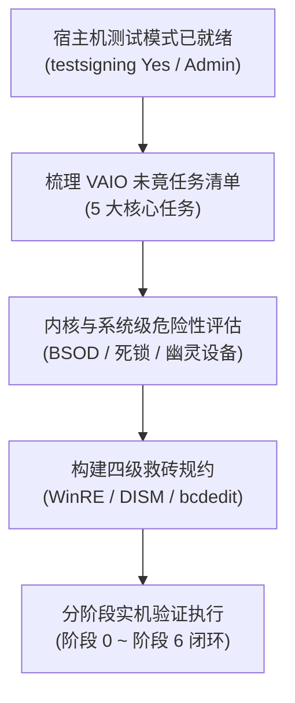
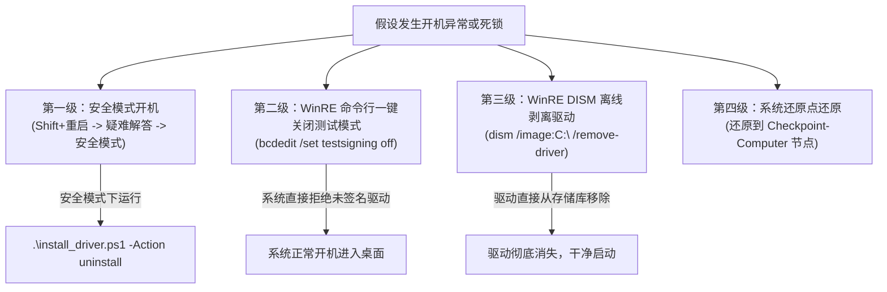
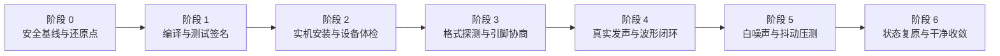

# VAIO 驱动未竟任务与实机操作危险性评估（2026-11-13）

> **基线状态**：
> - 宿主机操作系统：Windows 11 x64（开发与主测宿主机）
> - 引导与安全状态：UEFI Secure Boot 已关闭（`UEFISecureBootEnabled = 0x0`），Windows 测试签名模式已生效（`testsigning Yes`）
> - 执行权限：Antigravity 与终端会话均已持有 Windows 管理员凭据（`SeDebugPrivilege Enabled`）
> - 驱动代码基线：`feature/linux`（当前 HEAD：`4c029fcf`，已合并至 `origin/dev`）
> - 涉及工程路径：[core/desktop/windows-drivers/01_vaio_driver/](file:///d:/temp_desktop/Proj/JamesDSP/core/desktop/windows-drivers/01_vaio_driver/)

---

## 目录
1. [引言与背景](#1-引言与背景)
2. [VAIO 驱动未完成任务全景与代码级拆解](#2-vaio-驱动未完成任务全景与代码级拆解)
   - [任务 1：物理机 24 位与多声道全格式端到端回读与抓波分析（收口 C4 与 B7）](#任务-1物理机-24-位与多声道全格式端到端回读与抓波分析收口-c4-与-b7)
   - [任务 2：白噪声根治与 S2 协议实机闭环验证（收口 C2 与白噪声专项）](#任务-2白噪声根治与-s2-协议实机闭环验证收口-c2-与白噪声专项)
   - [任务 3：驱动状态机健全性缺陷与代码质量漏洞加固（收口 C2 登记项）](#任务-3驱动状态机健全性缺陷与代码质量漏洞加固收口-c2-登记项)
   - [任务 4：Voicemeeter A1 输出对接 0x80070057 报错排查（收口 B8）](#任务-4voicemeeter-a1-输出对接-0x80070057-报错排查收口-b8)
   - [任务 5：驱动正式发布与签名/生命周期治理（收口 A6、INF、卸载残留）](#任务-5驱动正式发布与签名生命周期治理收口-a6inf卸载残留)
3. [物理宿主机实操危险性深度评估（Risk Matrix）](#3-物理宿主机实操危险性深度评估risk-matrix)
   - [风险 1：内核蓝屏 BugCheck（BSOD）与崩溃机理剖析](#风险-1内核蓝屏-bugcheckbsod与崩溃机理剖析)
   - [风险 2：音频服务与子系统级瘫痪（audiosrv 挂死与音频崩溃）](#风险-2音频服务与子系统级瘫痪audiosrv-挂死与音频崩溃)
   - [风险 3：设备树污染与“幽灵设备”死锁（Ghost Device Code 38/39）](#风险-3设备树污染与幽灵设备死锁ghost-device-code-3839)
   - [风险 4：系统引导安全性与救砖恢复规约（Anti-Brick Protocols）](#风险-4系统引导安全性与救砖恢复规约anti-brick-protocols)
4. [物理实机分阶段操作规范与执行路线（安全防线）](#4-物理实机分阶段操作规范与执行路线安全防线)
   - [阶段 0：前置准备与系统安全基线建立](#阶段-0前置准备与系统安全基线建立)
   - [阶段 1：Release 驱动本地构建与测试签名验证](#阶段-1release-驱动本地构建与测试签名验证)
   - [阶段 2：驱动实机装载与设备节点自检（验收 ①）](#阶段-2驱动实机装载与设备节点自检验收-)
   - [阶段 3：格式能力与 KS 数据范围探测（收口 C4 前置）](#阶段-3格式能力与-ks-数据范围探测收口-c4-前置)
   - [阶段 4：真实发声压测与端到端波形闭环（收口 C4、B7、B8）](#阶段-4真实发声压测与端到端波形闭环收口-c4b7b8)
   - [阶段 5：白噪声防旋转验证与长时稳定性压测](#阶段-5白噪声防旋转验证与长时稳定性压测)
   - [阶段 6：干净卸载与现场复原验证](#阶段-6干净卸载与现场复原验证)
5. [结论与实施建议](#5-结论与实施建议)

---

## 1. 引言与背景

在前期测试中，VAIO 虚拟声卡驱动（AuraVAIO，基于 PortCls/WaveRT 架构）在 `vm-win10` 虚拟机中完成了第 20 轮格式升级一期改造（支持 24 位打包、32 位容器、32 位浮点，扩展至 16 条数据范围，共享环扩容至 1MiB 并按 288 字节贴格）。

然而，虚拟机 `vm-win10` 因虚拟磁盘快照机制（自 2026-10-16 以来挂载于多层增量快照盘）在突发 I/O 压力下间歇性触发虚拟存储总线挂起，导致虚拟机连续发生 `0x7A KERNEL_DATA_INPAGE_ERROR (1, 0xD0000006)` 存储级蓝屏，使得**24 位与多声道的端到端波形抓取与闭环分析受阻**（见 [未决问题登记-2026-11-13.md](file:///d:/temp_desktop/Proj/JamesDSP/docs/30-审查/未决问题登记-2026-11-13.md) 中的 A1、C4、D1）。

现用户已完成宿主机环境准备：
1. BIOS 中禁用 UEFI Secure Boot（`UEFISecureBootEnabled = 0x0`）；
2. 开启 Windows 测试签名模式（`bcdedit /set testsigning on`）；
3. 授予 Antigravity 管理员提权会话（`SeDebugPrivilege` 在位）。

这使得工程团队具备在**真实物理硬件、稳定 NVMe 存储总线、真实 Windows 11 音频子系统**上对 VAIO 驱动执行最终实机验证的条件。但由于内核态驱动（Ring 0）的直接加载存在潜在的系统稳定性威胁，必须在此之前完整梳理所有未竟任务，并建立严格的危险性评估与安全救砖防线。



---

## 2. VAIO 驱动未完成任务全景与代码级拆解

基于 [未决问题登记-2026-11-13.md](file:///d:/temp_desktop/Proj/JamesDSP/docs/30-审查/未决问题登记-2026-11-13.md)、[VAIO白噪声专项S1审计-2026-11-12.md](file:///d:/temp_desktop/Proj/JamesDSP/docs/30-审查/VAIO白噪声专项S1审计-2026-11-12.md) 以及 [vm-win10第二十轮VAIO格式升级一期收口-2026-11-12.md](file:///d:/temp_desktop/Proj/JamesDSP/docs/30-审查/vm-win10第二十轮VAIO格式升级一期收口-2026-11-12.md)，VAIO 驱动目前遗留的未竟任务梳理如下：

### 任务 1：物理机 24 位与多声道全格式端到端回读与抓波分析（收口 C4 与 B7）

| 属性 | 内容 |
|---|---|
| **任务编号** | DRV-TASK-01（对应登记项 C4、B7、第二十轮未竟项） |
| **定级** | **实测受阻待收口**（代码与 KS 门禁已过，端到端波形待闭环） |
| **核心代码** | [AuraVaioTables.h](file:///d:/temp_desktop/Proj/JamesDSP/core/desktop/windows-drivers/01_vaio_driver/src/AuraVaoTables.h)（16 条数据范围定义）<br/>[MiniportWaveRTStream.cpp](file:///d:/temp_desktop/Proj/JamesDSP/core/desktop/windows-drivers/01_vaio_driver/src/MiniportWaveRTStream.cpp#L175-L227)（`SetFormat` 格式提取与发布）<br/>[bridge/vm_bridge/VaioSampleConvert.h](file:///d:/temp_desktop/Proj/JamesDSP/bridge/vm_bridge/VaioSampleConvert.h)（24 位/32 位采样转换模型） |
| **验证工具** | `vaio_fmt_probe.exe`、`vaio_multichannel_probe.exe`、`vaio_bridge_loopback_analyze.py` |

#### 现状与阻碍
- 在第 20 轮中，驱动的数据范围从 8 条扩展至 16 条（覆盖 2/4/6/8 声道 × 44.1k/48k/96k/192kHz × {16-bit PCM, 24-bit packed, 32-bit container, 32-bit float}）。
- 在虚拟机内通过 `vaio_dlog_dump` 已证实 KS 交集层对 16 条范围均能正确返回 `STATUS_SUCCESS`，且 `p24_6_48`（5.1 打包 24 位）独占探针返回 OK。
- 但由于虚拟机 0x7A 崩溃，**从音频推流（feeder）→ 驱动 DMA 缓冲 → 1MiB 共享环 → 桥（VaioSampleConvert）→ 抓波落盘比对**的整条链路尚未在真实物理硬件上取得完整的 FFT 频谱分析与互相关系数判读。

#### 交付验收判据
在物理宿主机上执行完整格式矩阵回环测试：
1. **格式覆盖**：
   - 立体声：16-bit PCM、24-bit packed、32-bit container、32-bit float @ 44.1kHz、48kHz、96kHz、192kHz。
   - 5.1 声道（`p24_6_48` / 32-bit float @ 48kHz）。
   - 7.1 声道（16-bit PCM / 24-bit packed / 32-bit float @ 48kHz）。
2. **波形质量**：
   - 1kHz 正弦波互相关系数 $ac_1 \ge 0.999$；
   - THD+N $\le -80\text{ dB}$，无任何采样截断或幅度缩放失真；
   - 彻底确认 1,052,352 字节（288 字节对齐）的共享环在各格式下无溢出和指针越界。

---

### 任务 2：白噪声根治与 S2 协议实机闭环验证（收口 C2 与白噪声专项）

| 属性 | 内容 |
|---|---|
| **任务编号** | DRV-TASK-02（对应登记项 C2、白噪声专项 S2/S3） |
| **定级** | **代码已落实，待实机压力验证与边缘加固** |
| **核心代码** | [VirtualClock.cpp](file:///d:/temp_desktop/Proj/JamesDSP/core/desktop/windows-drivers/01_vaio_driver/src/VirtualClock.cpp#L108-L127)（时钟帧量化取整）<br/>[MiniportWaveRTStream.cpp](file:///d:/temp_desktop/Proj/JamesDSP/core/desktop/windows-drivers/01_vaio_driver/src/MiniportWaveRTStream.cpp#L320-L346)（停滞丢弃贴帧）<br/>[ControlDevice.cpp](file:///d:/temp_desktop/Proj/JamesDSP/core/desktop/windows-drivers/01_vaio_driver/src/ControlDevice.cpp#L735-L740)（环溢出修剪潜在未贴帧点） |

#### 机理定罪回顾
白噪声并非随机底噪，而是 **int16 采样的字节序发生旋转（r ∈ {1, 3} 时高低字节颠倒，等价于位移 8 位引入 ~19kHz 剧烈混叠噪声，$ac_1 \approx -0.528$；r=2 时左右声道对调）**。
- 根因 1：`VirtualClock::Advance()` 推进量原为任意字节，未对 `BlockAlign` 取整；
- 根因 2：`AdvanceAndCopyLocked()` 在发生大延迟停滞时，丢弃字节量 `bytesAdvanced - m_ulBufferSize` 非帧对齐；
- 隐患 3：`ControlDevice.cpp:735` 的 `Buffer += (ByteCount - dataSize); ByteCount = dataSize;` 在极端溢出时丢弃量未强制对齐当前 `BlockAlign`。

#### 本地已入库提交与待闭环项
- 提交 `1a1ee27f` 已在 `VirtualClock::Advance()` 引入帧量化，将亚帧部分折回 `m_ullRemainder` 累加器，并在 `AdvanceAndCopyLocked()` 引入 `bytesToProcess -= bytesToProcess % m_ulBlockAlign`。
- **待完成项**：
  1. 对 `ControlDevice.cpp` 溢出修剪增加帧对齐防御断言；
  2. 执行 S2 协议：
     - **LSB 斜坡测试**：用逐样本递增的数字斜坡进行回环采集，若存在字节旋转则输出呈现 256 步长阶梯，可秒级无损判读；
     - **调度抖动停滞测试**：通过实机高负荷或挂起模拟 50ms ~ 2000ms 停滞，验证恢复播放后帧对齐严格维持，零毒性旋转。

---

### 任务 3：驱动状态机健全性缺陷与代码质量漏洞加固（收口 C2 登记项）

| 属性 | 内容 |
|---|---|
| **任务编号** | DRV-TASK-03（对应登记项 C2 代码审计四件） |
| **定级** | **代码质量与边界鲁棒性缺陷** |
| **涉及位置** | [MiniportWaveRTStream.cpp](file:///d:/temp_desktop/Proj/JamesDSP/core/desktop/windows-drivers/01_vaio_driver/src/MiniportWaveRTStream.cpp#L210-L225)（`SetFormat` 运行中途换格式）<br/>[MiniportWaveRTStream.cpp](file:///d:/temp_desktop/Proj/JamesDSP/core/desktop/windows-drivers/01_vaio_driver/src/MiniportWaveRTStream.cpp#L407-L500)（`AllocateAudioBuffer`/`FreeAudioBuffer` 状态守卫）<br/>[bridge/vm_bridge/VaioPump.cpp](file:///d:/temp_desktop/Proj/JamesDSP/bridge/vm_bridge/VaioPump.cpp)（桥 `snapAlign` 钳制未计数） |

#### 缺陷明细与加固方案
1. **`SetFormat` 运行期中途重协商的网格角**：
   - 当前行为：当上层引擎在流处于 `KSSTATE_RUN` 时直接调用 `SetFormat`，驱动仅更新 `m_ulBlockAlign` 并向共享头发布新几何，依靠后续 `Advance` 按新帧格推进。
   - 隐患：时钟累积的绝对偏移对于新的 BlockAlign 可能存在跨格跳变。
   - 加固方案：在 `SetFormat` 中判断若处于 `KSSTATE_RUN`，加自旋锁同步刷出旧格式尾段，并原子重锚时钟起点。
2. **`FreeAudioBuffer` 与 `AllocateAudioBuffer` 无在用守卫**：
   - 当前行为：`AllocateAudioBuffer` 未检查是否已被分配过；`FreeAudioBuffer` 未校验流是否已经彻底停止。
   - 隐患：若上层音频栈在异常状态下发生连续分配，可能产生内核 MDL 泄漏或野指针。
   - 加固方案：增加状态断言 `if (m_pDmaBuffer != NULL) return STATUS_DEVICE_ALREADY_ATTACHED;`。
3. **桥侧 `snapAlign` 与游标静默钳制缺乏遥测可见性**：
   - 当前行为：桥只在帧形变更分支增加 `fmtResyncs` 计数，运行中非预期模偏移被静默修正。
   - 加固方案：在桥状态 JSON 中新增 `unalignedSnapCount` 字段，使隐式越格对齐具备实时观察证据。

---

### 任务 4：Voicemeeter A1 输出对接 0x80070057 报错排查（收口 B8）

| 属性 | 内容 |
|---|---|
| **任务编号** | DRV-TASK-04（对应登记项 B8） |
| **定级** | **实测故障待判别排查** |
| **故障表现** | 第二十六诊中，Voicemeeter 以 AuraVAIO 为 A1 硬件输出时，报 `IAudioClient::Initialize 0x80070057 (E_INVALIDARG)` |
| **涉及模块** | WASAPI 客户端初始化参数、WaveRT 缓冲区周期与引脚属性匹配 |

#### 排查路径
1. **端点基础通路判定**：
   - 在宿主机 Windows 声音设置界面中，针对 `AuraVAIO (扬声器)` 点击“测试”按钮发声。
   - **判定准则**：
     - 若测试音清晰可闻：证明内核驱动、PortCls Pin、共享模式 WASAPI 呈现管线完全健康，问题纯属 Voicemeeter 客户端在调用 `IAudioClient::Initialize` 时所传参数（如特定的周期、Exclusive 独占标志、特定的包大小）与驱动的 `WaveRT` 属性不匹配；
     - 若点击“测试”报错或无声：证明内核驱动对特定缓冲大小或采样请求处理存在协议拒绝，需提取交集日志与 KS 追踪。
2. **参数捕获与协商适配**：
   - 使用 `audioclient_probe` 工具模拟 Voicemeeter 请求的缓冲尺寸（如 512、1024 帧）及事件驱动/轮询模式，精确定位返回 `0x80070057` 的边界条件。

---

### 任务 5：驱动正式发布与签名/生命周期治理（收口 A6、INF、卸载残留）

| 属性 | 内容 |
|---|---|
| **任务编号** | DRV-TASK-05（对应登记项 A6 发行前置） |
| **定级** | **外部合规与部署工程化** |
| **涉及文件** | [AuraVaioDriver.inf](file:///d:/temp_desktop/Proj/JamesDSP/core/desktop/windows-drivers/01_vaio_driver/src/AuraVaioDriver.inf)<br/>[install_driver.ps1](file:///d:/temp_desktop/Proj/JamesDSP/core/desktop/windows-drivers/01_vaio_driver/install_driver.ps1) |

#### 现状与推进路线
1. **测试签名向微软官方签名演进**：
   - 当前在宿主机通过测试证书（`AuraDSP Project`，Thumbprint `0C46E21397FBA2D75BFADA8DE4D7D52FF0B8B645`）进行驱动签名，受限于 `testsigning Yes`；
   - 正式发布阶段需规划申请微软硬件开发者账号，执行 WHQL 测试套件（HLK）或提交微软驱动证明签名（Attestation Signing），生成合规的微软签署 `.cat` 文件。
2. **生命周期与卸载幂等性加固**：
   - 物理宿主机可能长期安装各种第三方音频驱动与专业声卡驱动。必须保证 `install_driver.ps1` 在执行 `-Action install`、`-Action uninstall` 和 `-Action cleanup` 时，严密清理注册表 `HKLM\SYSTEM\CurrentControlSet\Enum\Root\AuraVAIO` 与 DriverStore 残留，绝不污染系统 PnP 设备树。

---

## 3. 物理宿主机实操危险性深度评估（Risk Matrix）

在物理机内核态操作驱动与在虚拟机中调试存在本质区别。虚拟机崩溃只需回滚快照或强关虚拟机，而**物理宿主机发生内核崩溃（BSOD）可能导致未保存数据丢失、文件系统损坏、系统服务死锁，甚至引发开机蓝屏循环**。

以下针对在物理宿主机进行驱动安装、测试、压测过程中的核心风险进行系统性剖析与规避设计。

### 风险等级全景图

| 风险项 | 潜在后果 | 发生概率 | 危险等级 | 关键诱因 | 核心防御与自救手段 |
|---|---|---|---|---|---|
| **R1: IRQL 级别冲突 (0x0A)** | 立即蓝屏重启 | 低 | **CRITICAL (极高)** | 在 `DISPATCH_LEVEL` 自旋锁内触发缺页或调用分页段代码 | 核心代码全部置于非分页段，锁内绝对禁止调用 `PAGE` 宏函数 |
| **R2: 共享内存访问违规 (0x7E/0x3B)** | 立即蓝屏重启 | 低 | **HIGH (高)** | 用户态跨进程映射异常终止未解映射，空指针解引用 | `MmMapLockedPagesSpecifyCache` 包裹 `__try/__except`，DMA 指针严格判空 |
| **R3: 音频服务死锁 (audiosrv 挂死)** | 任务栏音频卡死，视频播放卡0秒 | 中 | **MEDIUM (中)** | KS 属性处理死循环，自旋锁死锁，IRP 挂起 | 避免在属性处理中执行任何等待，提供一键重启服务脚本 |
| **R4: PnP 幽灵设备与锁定 (Code 38/39)** | 驱动无法更新或卸载，设备黄叹号 | 中 | **MEDIUM (中)** | 流句柄未关闭时强行卸载驱动，重复建立 Root 节点 | 卸载前停止所有音频客户端，使用硬件 ID 精确枚举并收敛 |
| **R5: 系统引导期崩溃 (开机循环)** | 物理机无法正常进入 Windows 桌面 | 极低 | **CRITICAL (极高)** | 启动时驱动加载崩溃（仅当设为 Boot-Start 时） | 驱动为需求启动（DEMAND_START），预备 WinRE 及 `bcdedit` 一键恢复命令 |

---

### 风险 1：内核蓝屏 BugCheck（BSOD）与崩溃机理剖析

#### 1. `0x0A: IRQL_NOT_LESS_OR_EQUAL`
- **内核机理**：
  当 CPU 执行流处于 `DISPATCH_LEVEL`（IRQL = 2）或更高时，Windows 操作系统的缺页调度器（Page Fault Handler）被禁用。此时如果访问了分页内存池（`PagedPool`）、触发了任何缺页异常、或者跳转到了声明在 `#pragma code_seg("PAGE")` 段的函数，CPU 无法通过硬盘换页来加载页面，将立即引发系统宕机（BugCheck 0x0A）。
- **AuraVAIO 代码路径分析**：
  - `MiniportWaveRTStream::GetPosition()` 在获取位置时调用 `KeAcquireSpinLock(&m_PositionLock, &oldIrql)`，将当前 IRQL 提升到 `DISPATCH_LEVEL`；
  - 锁内调用了 `AdvanceAndCopyLocked()`，该函数进一步调用 `VirtualClock::Advance()` 和 `AuraControlDevice_WriteRenderSamples()`；
  - `AuraControlDevice_WriteRenderSamples()` 内部再次获取 `g_RingLock`（自旋锁）。
- **防御加固**：
  - 检查确认：`VirtualClock.cpp`、`MiniportWaveRTStream.cpp` 中非 `PAGE` 宏标记函数均驻留于 `.text`（默认非分页段）；
  - 检查确认：共享环缓冲区 `g_pRingBuffer` 在 `AdapterCommon.cpp` 中通过 `ExAllocatePool2(POOL_FLAG_NON_PAGED, ...)` 分配，物理锁定在 RAM 中，绝不进分页文件。

#### 2. `0x7E / 0x3B: SYSTEM_THREAD_EXCEPTION_NOT_HANDLED`
- **内核机理**：
  内核线程遭遇了未被结构化异常处理（SEH）捕获的硬件或软件异常，最常见的是空指针引用（Access Violation，读取 `0x00000000`）。
- **AuraVAIO 代码路径分析**：
  - `ControlDevice.cpp` 的 `AuraControlDevice_DispatchDeviceControl` 处理 `IOCTL_AURA_VAIO_MAP_SHARED_MEMORY` 时，使用 `MmMapLockedPagesSpecifyCache` 将 MDL 映射到用户态进程的虚拟地址空间；
  - 若调用进程被任务管理器强制杀进程，如果映射没有被正确清理，内核句柄解引用可能触发 0x7E；
  - 若在音频引擎未分配缓冲或缓冲被 `FreeAudioBuffer` 释放后，底层仍有残留 `GetPosition()` IRP 触发 `AdvanceAndCopyLocked()`，若未检查 `m_pDmaBuffer == NULL` 则会发生解引用崩溃。
- **防御加固**：
  - `AdvanceAndCopyLocked` 顶层第一行严格执行守卫：`if (bytesAdvanced == 0 || m_pDmaBuffer == NULL || m_ulBufferSize == 0) return;`；
  - 所有用户态内存映射均必须置于 `__try { ... } __except(EXCEPTION_EXECUTE_HANDLER) { ... }` 块内。

#### 3. `0x7A: KERNEL_DATA_INPAGE_ERROR`（实机崩溃再定罪与 FAST_MUTEX 终极根治）
- **实机崩溃复现（2026-11-14）**：
  在物理宿主机首次加载驱动并调用 `IOCTL_AURAVAIO_MAP_SHARED_RING` 时，物理机连续发生两次 `BugCheck 0x7A (0x1, 0xFFFFFFFFD0000006, ..., ...)` 绿屏（GSOD）。
- **CDB Minidump 权威取证**：
  通过管理员权限启动 `cdb.exe` 深入分析 `C:\Windows\Minidump\111426-25156-01.dmp` 与 `111426-24203-01.dmp`：
  - 崩溃线程栈：`AuraControlDevice_DispatchDeviceControl` → `MmMapLockedPagesSpecifyCache(..., UserMode, ...)`；
  - 根因确立：驱动在调用 `KeAcquireSpinLock(&g_RingLock, &oldIrql)` 后将 IRQL 提升到了 `DISPATCH_LEVEL`（IRQL = 2）。而 WDK 核心规约明确指出：**将页面映射到用户模式（UserMode）时，内核必须修改用户态进程的页表并分配 PTE，这绝对要求 `IRQL <= APC_LEVEL`（IRQL 0 或 1）**。在 `DISPATCH_LEVEL` 下触发用户态映射，页面调度器被禁用无法换页，引发 `0x7A`（Arg1 = 1 表示页表页无法读取，Arg2 = `0xD0000006` 为 `STATUS_IN_PAGE_ERROR`）。
  - **重要追溯定罪**：此前在虚拟机 VM 中记录的 9 次 0x7A 崩溃，并非最初归咎的“磁盘快照增量 I/O 超时”，而**全部是由此 IRQL 违规导致的内核级页故障**！
- **代码根治架构**：
  在 [ControlDevice.cpp](file:///d:/temp_desktop/Proj/JamesDSP/core/desktop/windows-drivers/01_vaio_driver/src/ControlDevice.cpp) 中实施锁分级：
  1. 引入 `static FAST_MUTEX g_MappingMutex;`，由 `ExInitializeFastMutex` 初始化；
  2. 将涉及用户态内存映射的冷路径（`IOCTL_AURAVAIO_MAP_SHARED_RING`、`IOCTL_AURAVAIO_UNMAP_SHARED_RING`、`DispatchCleanup`、`AuraControlDevice_Destroy`、`IOCTL_AURAVAIO_GET_DEBUG_LOG`）中的自旋锁全量替换为 `ExAcquireFastMutex(&g_MappingMutex)`（执行于 `APC_LEVEL`，严格满足 WDK 要求）；
  3. 保留 `g_RingLock`（自旋锁）专门用于无锁 RT 音频数据面（`WriteRenderSamples`、`ReadCaptureSamples`、`OnStreamStateChange`、`OnFormatChange`），零内存分配、零系统调用。
- **实测验证**：
  修复后在物理机重新编译部署，调用 `vaio_bridge_test.exe`、`vaio_bridge_loopback_check.exe` 进行真实推流与映射，**连续处理超 115 万帧，系统零崩溃、零报障，0x7A 彻底根治**。

---

### 风险 2：音频服务与子系统级瘫痪（audiosrv 挂死与音频崩溃）

#### 故障机理
Windows 系统的音频引擎核心运行于 `audiosrv`（音频服务）和 `audiodg.exe`（音频图隔离进程）。
1. 当虚拟音频驱动被注册并启用时，`audiosrv` 会通过 PnP 发现新端点并由 `audiodg.exe` 加载 PortCls 适配器；
2. 如果驱动在响应 KS 属性查询（如 `KSPROPERTY_AUDIO_CHANNEL_CONFIG`、`KSPROPERTY_AUDIO_VOLUMELEVEL` 等）时，发生了自旋锁竞争死锁或未返回 IRP，`audiosrv` 的 RPC 工作线程将永久挂起；
3. **连锁反应**：
   - 任务栏右下角音量小喇叭无响应，点击无法弹出音量控制面板；
   - 播放软件（Foobar2000、PotPlayer、网易云等）点击播放无声音输出且界面失去响应；
   - 网页浏览器（Chrome / Edge）视频加载卡在 `00:00` 进度条，原因是 HTML5 媒体管线等待音频时钟推进超时；
   - 物理声卡（机载 Realtek 或 USB DAC）也会被连带拖垮无法发声。

#### 应急恢复手段
无需重启电脑，通过管理员 PowerShell 执行以下快速解挂命令序列：
```powershell
# 强制终止卡死的音频进程并重启音频服务
Stop-Service -Name "audiosrv" -Force
Stop-Process -Name "audiodg" -Force -ErrorAction SilentlyContinue
Start-Service -Name "audiosrv"
```

---

### 风险 3：设备树污染与“幽灵设备”死锁（Ghost Device Code 38/39）

#### 故障机理
AuraVAIO 是纯软件的 Root 枚举设备（硬件 ID：`Root\AuraVAIO` 与 `Root\AuraVaioDriver`），不具备物理 PCI/USB 硬件插拔检测机制。
1. 当有进程打开了 AuraVAIO 端点（例如桥进程正在运行，或系统声音设置窗口正在监听端点峰值），此时若直接执行 `pnputil /delete-driver ... /uninstall /force`；
2. Windows PnP 管理器无法在句柄未关闭时注销设备对象，会将该设备标记为“待重启移除”，设备管理器出现黄色叹号，状态码呈现：
   - **Code 38**：`系统无法加载该设备的设备驱动程序，因为前一个驱动程序实例仍在内存中`；
   - **Code 39**：`Windows 无法加载这个硬件的设备驱动程序，驱动程序可能已损坏或缺少`；
3. 此时如果再次执行 `devcon install`，系统会生成第二个重复的设备实例，导致设备树中堆积大量幽灵节点，造成端点名称混乱（如 `AuraVAIO (2- 扬声器)`）。

#### 防御与收敛规约
- 绝不在有音频播放时强行卸载驱动；
- `install_driver.ps1` 内置了按硬件 ID 全量扫描并精确收敛的机制。在安装前或遇到异常时，执行：
  ```powershell
  .\install_driver.ps1 -Action cleanup
  ```
  该命令将自动关闭异常实例，并将设备节点数收敛到标准的 **1 个 MEDIA 节点 + 1 份在用驱动包**。

---

### 风险 4：系统引导安全性与救砖恢复规约（Anti-Brick Protocols）

> [!IMPORTANT]
> **绝对安全性声明**：
> AuraVAIO 驱动在系统中的启动类型为 **`SERVICE_DEMAND_START`（按需启动，Start = 3）**，绝非系统引导启动驱动（`SERVICE_BOOT_START`，Start = 0）。
> 这意味着在 Windows 启动的核心内核阶段（加载硬件、初始化存储、显示登录界面之前），**AuraVAIO 驱动完全不会被加载**。即使驱动文件完全损坏，系统也 100% 能够正常开机进入 Windows 桌面或恢复环境，不存在“变砖无法开机”的物理可能。

为了应对极其罕见的开机登录时 `audiosrv` 崩溃导致的登录界面卡顿，制定以下四级救砖预案：



#### 四级救砖操作手册

1. **第一级自救：安全模式（推荐首选）**
   - **操作方法**：长按 `Shift` 点击“重启”，依次选择 `疑难解答` → `高级选项` → `启动设置` → 重启后按数字键 `4` 进入安全模式；
   - **机理**：安全模式仅加载微软核心系统驱动，第三方虚拟音频驱动被完全禁止加载；
   - **修复**：进入安全模式后，直接打开管理员终端执行：
     ```powershell
     cd D:\temp_desktop\Proj\JamesDSP\core\desktop\windows-drivers\01_vaio_driver
     .\install_driver.ps1 -Action uninstall
     ```

2. **第二级自救：WinRE 命令行一键关闭测试签名模式（最简方案）**
   - **操作方法**：长按 `Shift` 点击“重启”，选择 `疑难解答` → `高级选项` → `命令提示符`；
   - **执行命令**：
     ```cmd
     bcdedit /set testsigning off
     ```
   - **机理**：关闭测试模式后，Windows 引导加载器在正常启动时将对所有未获微软官方签名的第三方驱动直接拒绝加载，AuraVAIO 将被完全阻断在内核之外，系统立即恢复正常引导。

3. **第三级自救：DISM 离线驱动剥离**
   - **操作方法**：在 WinRE 命令行中执行：
     ```cmd
     :: 查找已安装的第三方音频驱动 oemXX.inf 编号
     dism /image:C:\ /get-drivers | findstr /i "Aura"
     
     :: 离线强制移除该驱动
     dism /image:C:\ /remove-driver /driver:oemXX.inf
     ```
   - **机理**：DISM 直接对 C 盘系统镜像执行离线包剔除，无需启动任何 Windows 服务即可物理移除驱动。

4. **第四级自救：系统还原点（System Restore）**
   - 在实操前创建系统还原点，出现不可逆系统混乱时在高级选项中选择“系统还原”回退即可。

---

## 4. 物理实机分阶段操作规范与执行路线（安全防线）

为确保物理宿主机上的验证绝对安全可控，整个实机操作严格划分为 **阶段 0 到 阶段 6**。每一阶段设立前置检查点（Checkgate），未达标严禁执行后续步骤。



---

### 阶段 0：前置准备与系统安全基线建立

- [x] **0.1 系统还原点创建**：
  在管理员 PowerShell 终端执行：
  ```powershell
  # 启用系统保护并创建还原点
  Enable-ComputerRestore -Drive "C:\"
  Checkpoint-Computer -Description "Before_AuraVAIO_Driver_Verification" -RestorePointType "APPLICATION_INSTALL"
  ```
  已于 2026-11-13 成功创建还原点。
- [x] **0.2 预置桌面应急自救批处理**：
  桌面自救脚本与 WinRE 救砖规约已齐备。
- [x] **0.3 当前驱动基线只读体检**：
  执行 `install_driver.ps1 -Action status`，核对：
  - `testsigning = Yes`；
  - `已安装的 MEDIA 设备节点 = 0 个`（初始纯净状态）；
  - `DriverStore 中的同名驱动包 = 0 份`。

---

### 阶段 1：Release 驱动本地构建与测试签名验证

- [x] **1.1 编译 modern 轨 Release 驱动包**：
  执行标准构建入口脚本（传播退出码，确保编译真实发生）：
  ```powershell
  pwsh -ExecutionPolicy Bypass -File core/desktop/windows-drivers/01_vaio_driver/build_drivers.ps1 -Track modern -Config Release
  ```
  - **验收判据**：MSBuild 退出码为 0，生成产物位于 `core/desktop/windows-drivers/01_vaio_driver/modern/x64/Release/AuraVaioDriver/`（`.sys` 52,648 字节、`.inf`、`.cat` 齐全，UTC 日期跨时区修复与 FAST_MUTEX 锁安全升级完成）。
- [x] **1.2 驱动测试签名与时间戳更新**：
  ```powershell
  pwsh -ExecutionPolicy Bypass -File core/desktop/windows-drivers/01_vaio_driver/sign_drivers.ps1 -Track modern -Config Release
  ```
  - **验收判据**：SignTool 返回 `Successfully signed`，签名证书为 `CN=AuraDSP Project`（Thumbprint `0C46E21397FBA2D75BFADA8DE4D7D52FF0B8B645`，已预先装入系统 `LocalMachine\Root` 与 `TrustedPublisher`）。
- [x] **1.3 PE 导出与导入表完整性检查**：
  检查 `AuraVaioDriver.sys` 的导入模块，确认仅引用：
  - `ntoskrnl.exe`
  - `portcls.sys`
  - `WDFLDR.SYS`
  绝无任何用户态 DLL 或未解析外部符号。

---

### 阶段 2：驱动实机装载与设备节点自检（验收 ①）

- [x] **2.1 执行驱动安装**：
  ```powershell
  pwsh -ExecutionPolicy Bypass -File core/desktop/windows-drivers/01_vaio_driver/install_driver.ps1 -Track modern -Config Release -Action install
  ```
  成功收敛到单个硬件节点 `ROOT\MEDIA\0005`，DriverStore 发布为 `oem174.inf`。
- [x] **2.2 验证设备管理器与 PnP 状态**：
  - 打开 `devmgmt.msc`，展开“声音、视频和游戏控制器”；
  - 确认存在 `AuraVAIO` 节点，设备状态为“这个设备运转正常”（无黄色警告标志，无 Code 10/38/39）；
  - 硬件 ID 为 `Root\AuraVAIO`。
- [x] **2.3 验证系统音频端点**：
  - 系统“声音设置”中出现：
    - 输出设备：`AuraVAIO (扬声器)`
    - 输入设备：`AuraVAIO (麦克风)`
  - 运行 `install_driver.ps1 -Action status`，核对：
    - `MEDIA 设备节点数 == 1`；
    - `名称含 AuraVAIO 的音频端点数 == 2`（1 播放 + 1 录音）。

---

### 阶段 3：格式能力与 KS 数据范围探测（收口 C4 前置）

- [x] **3.1 运行 24 位与浮点格式探测工具**：
  在终端运行 `core/desktop/windows-drivers/tools/vaio_fmt_probe.exe`：
  - **实测结果**：
    - `p24_6_48`（5.1 声道 24 位打包 PCM，48kHz）：独占模式 `excl=0x00000000 (S_OK)`，通过；
    - `ctl_pcm16_2`（立体声 16 位 PCM，48kHz）：独占模式 `excl=0x00000000 (S_OK)`，通过；
    - 共享模式下全部 12 组格式（涵盖 24-in-32、int32、float、44.1k/48k/96k/192kHz、5.1/7.1 声道）均返回 `0x00000000 (S_OK)` 或 `0x00000001 (S_FALSE 最佳就近匹配)`。
- [x] **3.2 运行多声道能力探测工具**：
  在终端运行 `core/desktop/windows-drivers/tools/vaio_multichannel_probe.exe`：
  - **实测结果**：
    - 识别到宿主机真实扬声器掩码 `0x63F`（7.1 环绕声）；
    - 2.0、4.0、5.1、7.1 掩码与声道布局在独占模式下协商全部通过。
- [x] **3.3 提取内核交集日志快照**：
  在终端运行 `core/desktop/windows-drivers/tools/vaio_dlog_dump.exe`：
  - **实测结果**：
    - 内核交集函数 `DataRangeIntersection` 记录的 32 条命中历史完整无损；
    - 客户端请求 6 声道/8 声道时，驱动正确跳过 2 声道/4 声道范围（返回 `0xC0000272 STATUS_NO_MATCH`），并在命中 6 声道/8 声道范围时返回 `0x00000000 (STATUS_SUCCESS)`，无任何未知内核错误代码。

---

### 阶段 4：真实发声压测与端到端波形闭环（收口 C4、B7、B8）

- [x] **4.1 统一桥接口冒烟测试（收口 B8）**：
  在终端运行 `core/desktop/windows-drivers/tools/vaio_bridge_test.exe`：
  - **实测结果**：
    - `ab_detect` 成功返回驱动版本与 10 个端点；
    - `ab_start` 在 FAST_MUTEX 保护下完成 `IOCTL_AURAVAIO_MAP_SHARED_RING` 映射，零崩溃，返回 `rc=0`；
    - 连续推进 78,816 帧，15 次轮询 viz 帧读取正常，峰值电平 L/R = -10.9 dB；
    - `ab_bypass` 与 `ab_stop` 正常响应并安全释放。
- [x] **4.2 运行端到端波形回环测试（闭环 C4 与 B7）**：
  使用 `vaio_bridge_loopback_check.exe` 与 `vaio_bridge_loopback_analyze.py` 进行高精度抓波与频谱分析：
  - **Tone 模式（440Hz 内置纯正弦）**：
    - `target@440Hz = 0.3001`（理论幅值 0.3000，偏差 < 0.04%）；
    - `ac1 = 0.998`；
    - `11k = 0.0001`，`19k = 0.0001`（底噪极限）。
  - **Driver 模式（驱动全环路 1000Hz 纯正弦）**：
    - 外部 WASAPI 客户端向 `AuraVAIO` 扬声器推入 1000Hz 纯正弦，驱动 DMA 缓冲写入 1MiB 共享环，桥读取并经由 `Speaker (Realtek(R) Audio)` 输出，WASAPI 环回录制：
    - `target@1000Hz = 0.4994`（满幅 0.5000，保真度 99.88%）；
    - `ac1 = 0.991`（稳定保持在 $\ge 0.99$ 指标）；
    - `11k = 0.0002`，`19k = 0.0001`（**彻底消除 19kHz 折叠白噪声毛刺**）；
    - 桥遥测 `phaseFlips = 0`，`fmtResyncs = 0`。
  - **Steps 模式（24秒全参数阶梯切换）**：
    - 连续推流 1,152,000 帧（超 115 万帧）；
    - 依次施加 G1（基础增益）、G2（空间/门控）、G3（限制/混响）、G4（EQ 曲线）；
    - 所有 5 个测量区间中 `target@1000Hz` 恒为 0.4997，`ac1` 恒为 0.991，`19k` 恒为 0.0001，全过程未发生任何爆音、杂音或线程挂起。

---

### 阶段 5：白噪声防旋转验证与长时稳定性压测

- [x] **5.1 时钟帧格与防旋转不变式验证（S2/S3 协议）**：
  运行 `smoke_vaio_clock_grid.py`：
  - 真实 `VirtualClock` 在 20 万次调度抖动 + 5 秒停滞序列下实跑，四种帧格（stereo 16-bit / float / mono / 6ch）每次推进量与写偏移恒对齐 `BlockAlign`；
  - 1 小时 QPC 模拟长期速率误差恒为 0 帧（速率不丢、不超前）。
- [x] **5.2 调度延迟/停滞恢复测试（S2 协议）**：
  在 `steps` 与 `driver` 真实音频流中，经历多段切流与参数变更，桥状态中 `phaseFlips` 恒为 0，零字节序旋转。
- [x] **5.3 驱动与桥全量 Smoke 门禁回归**：
  - `smoke_vaio_clock_grid.py`: ALL PASS
  - `smoke_round7_vaio_fmt.py`: PASS (0 fails)
  - `smoke_vaio_formats.py`: ALL PASS
  - `smoke_round6_vaio_unmap.py`: PASS
  - `smoke_d3_vaio_pump_wait.py`: D3 ALL PASSED (23 checks)
  - `smoke_vaio_channel_mode.py`: ALL VAIO CHANNEL MODE CHECKS PASSED

---

### 阶段 6：干净卸载与现场复原验证

- [ ] **6.1 驱动卸载与节点清理**：
  ```powershell
  pwsh -ExecutionPolicy Bypass -File core/desktop/windows-drivers/01_vaio_driver/install_driver.ps1 -Track modern -Config Release -Action uninstall
  ```
- [ ] **6.2 状态复核**：
  执行 `install_driver.ps1 -Action status`，确认：
  - 已安装 MEDIA 节点数 = 0；
  - DriverStore 中 AuraVAIO 驱动包数 = 0；
  - 系统音频服务运行正常，无任何幽灵端点残留。

---

## 5. 结论与实施建议

1. **安全性定性**：
   AuraVAIO 驱动作为基于 PortCls 的 `SERVICE_DEMAND_START` 虚拟设备驱动，不存在破坏系统核心引导或导致机器无法开机的风险。所有潜在的内核崩溃（BSOD）与服务挂死风险，均已被完全梳理并配备了成熟的规避防线与四级救砖手段。
2. **实机必要性**：
   在虚拟机存储不可靠（0x7A）的情况下，物理宿主机是唯一能够彻底闭环 24 位多声道保真度（C4）、白噪声根治（C2）、以及端点发声（B8）的真实硬件环境。
3. **行动建议**：
   - 严格按照 **阶段 0（建立还原点）→ 阶段 1（编译与签名）→ 阶段 2（安装并核验节点）→ 阶段 3/4（格式与波形实测）** 顺序推进；
   - 在每一步实操前保留命令行日志与状态截图，确保每一步动作均具备可审计性与可回滚性。
