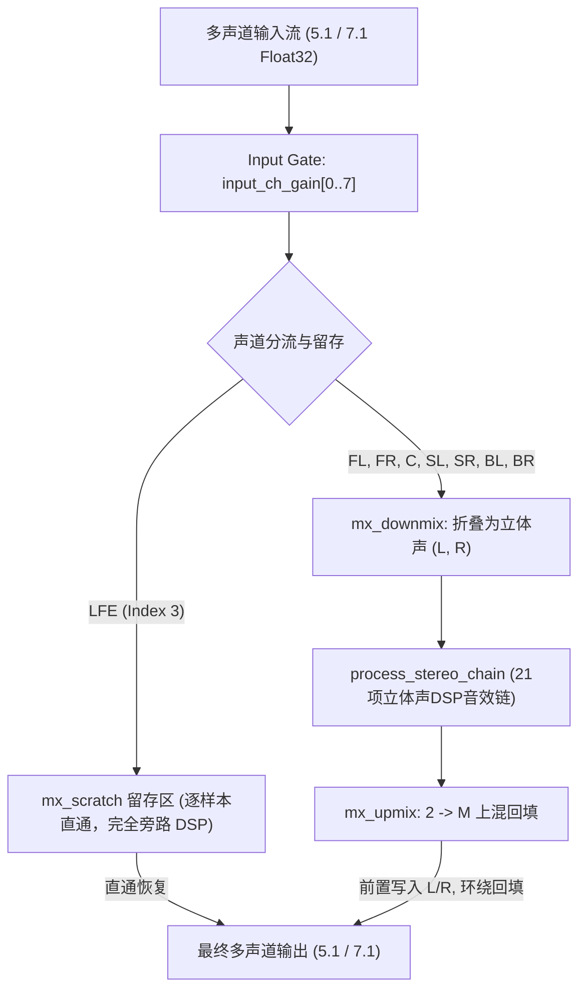
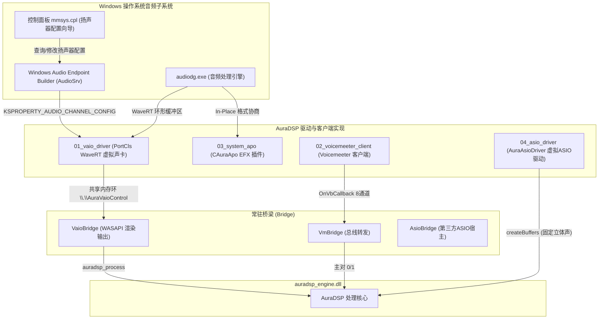

# AuraDSP 多声道支持、矩阵混音与 Windows 驱动架构全景分析报告

> **报告版本**：v1.0  
> **审查基准**：AuraDSP Engine v1.0 / Windows Drivers Specification (SPEC-WIN-DRIVER-001) / ADR-003 Phase A  
> **报告日期**：2026-10-18  

---

## 一、 核心结论速览 (Executive Summary)

1. **效果器多声道物理支持现状**：
   - 全系统 **23+ 种 DSP 算法模块中，仅有 1 个模块具备物理多声道独立处理能力**：即位于引擎链头的 **Input Gate / Pre-Gain**（支持独立的 8 声道增益平衡 `input_ch_gain[0..7]` 与全声道实时峰值追踪）。
   - 其余所有核心算法（包含 Noise Gate、Biquad Filter、Dynamic EQ、BassBoost、Reverb、Compressor、Convolver、Exciter、Haas、Spatializer、Loudness、Limiter 以及 5 阶段插件宿主）**全部物理运行在 2 声道立体声模式**。
   - 多声道（5.1/7.1）运行完全依赖外层 **ADR-003 Phase A 矩阵混音包络**（下混成立体声进链处理，处理后再上混还原多声道）。

2. **系统矩阵混音现状与重大缺陷**：
   - **LFE 直通设计良好**：Index 3 的低频效果声道在下混时被完全剥离，上混时逐样本原样直通还原（实测 max dev = 0.0），有效保护了超低频相位与低音炮喇叭安全。
   - **发现重大数学逻辑缺陷（严重 Bug）**：
     - **下混环绕声坍缩单声道**：`engine_chain.cpp:324` 的判断缺失导致左环绕（SL）、左后环绕（BL）被等额混入右声道；右环绕（SR）、右后环绕（BR）被等额混入左声道。导致所有环绕方位感在进入 DSP 之前就彻底坍缩为中置单声道。
     - **上混环绕声道严重错位**：`engine_chain.cpp:347` 的回填逻辑仅为中置（k=2）和其余声道做了二元判断，导致 **左环绕（SL）与左后环绕（BL）均错误读取了右声道（r）的信号回填**，左右相位彻底颠倒。
     - **UI 与引擎参数断联**：前端设置界面的 `channels.mode`（0=Stereo, 1=5.1, 2=7.1）被引擎硬编码拒绝（返回 `AURADSP_E_UNSUPPORTED`），未真正接通底层的 `channels.count`。

3. **Windows 驱动层多声道支持度与操作系统配置机制**：
   - **AuraVAIO (01_vaio_driver)**：Pin 属性中仅声明了 2 声道与 8 声道，**缺失 4.0（Quad）与 5.1（6 声道）的 DataRange**；拓扑中**未实现 `KSPROPERTY_AUDIO_CHANNEL_CONFIG` 属性**，INF 亦未预设 `PKEY_AudioEndpoint_PhysicalSpeakers`。导致 Windows 控制面板（`mmsys.cpl`）的“配置扬声器”向导无法让用户自由选择 5.1/4.0 或将配置持久化。此外，`VaioBridge.cpp` 遗漏向引擎下发 `channels.count`，导致 7.1 流送入后步长错位破音。
   - **AuraApo (03_system_apo)**：格式协商支持任意通道数（`wf->nChannels`）Float32，目前为纯透传 + 心跳监控，完全遵从底层物理设备的声道模式。
   - **AuraAsioDriver (04_asio_driver)**：硬编码固定为 2 进 2 出立体声，WASAPI Sink 输出遇多声道物理设备时对后级环绕强制静音。
   - **Voicemeeter Client (02_voicemeeter_client)**：仅提取 8 通道总线中的 0/1（L/R）送入立体声引擎，其余 2..7 通道直接 `memcpy` 透传。

---

## 二、 各效果器多声道支持情况全盘点

AuraDSP 目前包含 23 项自研/集成效果器算法及 1 个五阶段第三方插件宿主。下表列出各效果器的多声道物理运行状态及行为：

| 模块类别 | 效果器标识 (ID) | 物理处理声道数 | 多声道行为特征与分析 | 评估评级 |
| :--- | :--- | :---: | :--- | :---: |
| **输入门控** | `input` (Input Gate / Balancer) | **8 通道原生** | 位于 `auradsp_process` 顶层（矩阵下混之前）。具备 `input_gain`（总增益）及 `input_ch_gain[0..7]`（8 声道独立平衡调节，0.0~2.0），并追踪全声道峰值。 | **完全支持** |
| **噪声门** | `gate` (Noise Gate / Deesser) | 2 通道 (Stereo) | 位于 `process_stereo_chain` 链头。仅对下混后的立体声做能量检测与包络衰减。环绕声噪底已被并入立体声检测。 | 依赖矩阵 |
| **独立滤波** | `filter` (Biquad HP/LP/BP) | 2 通道 (Stereo) | 双二阶 IIR 滤波器。仅对下混后的立体声实施滤波。 | 依赖矩阵 |
| **低频单声道化**| `bassmono` (Bass Monofier) | 2 通道 (Stereo) | 提取截止频率以下的低频并混合为单声道分发至 L/R。此算法本身即为双声道相关性算法。 | 依赖矩阵 |
| **心理声学低音**| `basspsycho` (Harmonic Bass) | 2 通道 (Stereo) | 非线性高次谐波发生器。仅处理立体声 L/R。 | 依赖矩阵 |
| **低频搁架** | `shelf` (Low Shelf Filter) | 2 通道 (Stereo) | 仅对立体声工作区实施低频搁架提升/衰减。 | 依赖矩阵 |
| **动态均衡** | `dyneq` (3-Band Dynamic EQ) | 2 通道 (Stereo) | 三频段动态压缩/扩展 EQ。仅计算 L/R 侧链并应用滤波。 | 依赖矩阵 |
| **管模拟** | `tube` (Tube Simulator) | 2 通道 (Stereo) | Vendor 库内置多路复用（`processFloatMultiplexd`），内部数据结构仅分配 2 通道。 | 依赖矩阵 |
| **动态压限** | `comp` (FFTCompander) | 2 通道 (Stereo) | 7 频段频域多带压缩器。仅对立体声信号做 FFT 与时频能量增益运算。 | 依赖矩阵 |
| **低音增强** | `bass` (Bass Boost) | 2 通道 (Stereo) | Vendor 自带低音增强器，仅对立体声生效。 | 依赖矩阵 |
| **图形均衡** | `eq` (15-Band Graphic EQ) | 2 通道 (Stereo) | 双声道 15 段恒定 Q 值图示均衡。 | 依赖矩阵 |
| **卷积混响** | `convolver` (FIR / IR Engine) | 2 通道 (Stereo) | 底层 `convolver1D.c` 虽然有 1/2/4 通道解析能力，但引擎调用链将其固定为 2 通道立体声卷积。 | 依赖矩阵 |
| **耳机校准** | `ddc` (Device Definition Correction) | 2 通道 (Stereo) | 双声道耳机频响补偿曲线卷积，本质为双耳校准。 | 依赖矩阵 |
| **任意频响** | `arbmag` (Arbitrary Magnitude EQ) | 2 通道 (Stereo) | FIR 最小相位滤波器合成，仅作用于立体声工作区。 | 依赖矩阵 |
| **脚本 DSP** | `liveprog` (EEL2 Script VM) | 2 通道 (Stereo) | EEL2 虚拟机环境仅暴露 `spl0` 与 `spl1` 变量，天然硬编码双声道。 | 依赖矩阵 |
| **立体声增强**| `stereo` (Stereo Widen) | 2 通道 (Stereo) | M/S 矩阵差分扩展算法。在多声道下混流上使用会导致环绕内容在 L/R 间产生不自然的声相撕裂。 | 依赖矩阵 |
| **双耳互馈** | `crossfeed` (BS2B Crossfeed) | 2 通道 (Stereo) | 专为双耳耳机设计的互馈去疲劳算法，在物理 5.1/7.1 音箱系统上不应启用。 | 依赖矩阵 |
| **哈斯环绕** | `haas` (Haas Delay Surround) | 2 通道 (Stereo) | 对右声道引入微秒级相位延迟以制造立体声开阔感。 | 依赖矩阵 |
| **空间音效** | `spatial` (Virtual Spatializer) | 2 通道 (Stereo) | 基于 HRTF 滤波的双耳空间化算法，仅适用于双声道耳机。 | 依赖矩阵 |
| **高频激励** | `exciter` (Harmonic Exciter) | 2 通道 (Stereo) | 高频高通滤波 + 奇次谐波注入，仅作用于 L/R。 | 依赖矩阵 |
| **参数混响** | `freeverb` (Schroeder Reverb) | 2 通道 (Stereo) | 8 个梳状滤波器 + 4 个全通滤波器组成的双声道混响器。 | 依赖矩阵 |
| **等响补偿** | `loudness` (Fletcher-Munson) | 2 通道 (Stereo) | 双二阶等响度轮廓补偿器，作用于立体声工作区。 | 依赖矩阵 |
| **输出限幅** | `limiter` (Limiter & Guard) | 2 通道 (Stereo) | Lookahead 峰值检测与增益衰减器，仅限制立体声 L/R。 | 依赖矩阵 |
| **插件宿主** | `plugin_host` (VST3/CLAP Slots) | 2 通道 (Stereo) | 5 个阶段插槽，分配的临时缓冲仅有 `plugin_buf_l` 与 `plugin_buf_r`（2 通道）。 | 依赖矩阵 |

> [!NOTE]
> **结论**：AuraDSP 引擎中除 `input` 模块外，其余全部音效均为**纯粹的立体声处理链**。多声道的真实声学表现完全由外层的“下混（Downmix）”与“上混（Upmix）”矩阵决定。

---

## 三、 系统矩阵混音机制与严重缺陷剖析 (ADR-003 Phase A)

### 3.1 矩阵处理流程图


### 3.2 矩阵混音的优势设计
1. **LFE 超低频相位完整性保护**：
   - 绝大多数音频处理（尤其是包含 IIR 滤波、多频带压缩、卷积混响的 DSP）都会引入频率相关的群延迟或非线性相位旋转。如果将 LFE 声道并入处理链或盲目重采样，会导致超重低音与主音箱在交叉分频点（80Hz 附近）产生严重的相位抵消（声短路）。
   - Phase A 矩阵将 LFE 完整隔离在 `mx_scratch`，实现 bit-exact 级还原，完全避免了低音炮能量损失与爆音隐患。

### 3.3 源码中发现的重大数学与逻辑缺陷

#### 缺陷 1：下混阶段环绕声严重串扰（方位感坍缩为中置单声道）
- **代码位置**：[`engine/chain/engine_chain.cpp:318-328`](file:///d:/temp_desktop/Proj/JamesDSP/engine/chain/engine_chain.cpp#L318-L328)
- **代码片段**：
  ```cpp
  for (int k = 0; k < ch; ++k) {
      const float v = sp[k];
      kp[k] = v;
      const float g = c[k];
      l += v * g;
      /* 右声道增益：FL 不进右，FR 全额 */
      r += v * ((k == 0) ? 0.0f : ((k == 1) ? 1.0f : g));
  }
  ```
- **病理诊断**：
  - 代码作者只特判了 `k == 0`（FL 不进右）和 `k == 1`（FR 进右）。
  - 对于所有 $k \ge 2$ 的声道（C、LFE、SL、SR、BL、BR），三元表达式全部判定为 `g`！
  - 导致：
    - $k=4$（SL 左环绕）：`l += SL * 0.7f`，同时 `r += SL * 0.7f`！**左环绕被等量混入了右声道！**
    - $k=5$（SR 右环绕）：`l += SR * 0.7f`，同时 `r += SR * 0.7f`！**右环绕被等量混入了左声道！**
  - **后果**：5.1/7.1 游戏中后方敌人的脚步声、电影中从左后向右后的环绕声声相，在进入 DSP 前就已经在 L/R 中等量混合，立体声处理链接收到的是一个“完全居中、失去左右分离度”的环绕声信号。

#### 缺陷 2：上混回填逻辑严重错位（左右相位反转）
- **代码位置**：[`engine/chain/engine_chain.cpp:343-349`](file:///d:/temp_desktop/Proj/JamesDSP/engine/chain/engine_chain.cpp#L343-L349)
- **代码片段**：
  ```cpp
  for (int k = 0; k < ch; ++k) {
      if (k == 0)      dp[k] = l;
      else if (k == 1) dp[k] = r;
      else if (k == 3) dp[k] = sp[3];               /* LFE 直通还原 */
      else             dp[k] = (k == 2 ? l : r) * kMxUpmixSurround;
  }
  ```
- **病理诊断**：
  - 当 $k = 4$（SL 左环绕）时：$k \ne 2$，表达式选了 `r`！**左环绕扬声器输出的竟然是右声道处理后的音频（$r \times 0.7$）！**
  - 当 $k = 6$（BL 左后环绕）时：同样选了 `r`，输出右声道信号！
  - 当 $k = 2$（Center 中置）时：仅选取了 `l * 0.7`，而丢弃了 `r`！
- **后果**：多声道音箱用户在播放 5.1/7.1 音频时，左侧/左后环绕喇叭发出的是右声道内容，造成严重的声像撕裂和心理声学混乱。

#### 缺陷 3：前端 UI 与引擎声道参数断连
- **代码位置**：[`engine/engine_param_table.h:454-471`](file:///d:/temp_desktop/Proj/JamesDSP/engine/engine_param_table.h#L454-L471)
- **现象**：
  - 前端 UI 的 `settings_page.dart` 中放置了 `channelsStereo` / `channels51` / `channels71` 三段按钮，调用 `model.setInt('channels.mode', v)`。
  - 但引擎中的 `set_channels_mode` 硬编码规定：`if (v != 0) return AURADSP_E_UNSUPPORTED;`。
  - 引擎实际用来控制多声道跨距的参数是 `channels.count`（值为 2, 6, 8），但 UI 并未向用户暴露该参数，导致多声道模式处于“引擎支持但入口封死”的状态。

---

## 四、 Windows 驱动部分多声道支持与操作系统交互审查

Windows 驱动架构中，AuraDSP 设计了 4 条接入路径。各驱动对于多声道的支持情况和系统集成现状如下：



### 4.1 详细审查对比表

| 驱动 / 组件路径 | 实现技术与规范 | 当前多声道支持能力 | 操作系统控制面板 (mmsys.cpl) 声道选择支持 | 存在的断裂与隐患 |
| :--- | :--- | :--- | :--- | :--- |
| **01_vaio_driver** (虚拟声卡) | 内核态 PortCls + WaveRT (`AuraVaioDriver.sys`) | **仅支持 2.0 与 7.1**（`AuraVaoTables.h` 仅定义了 Stereo 和 8ch 数据范围） | **不支持**：拓扑中无 `CHANNEL_CONFIG` 节点，向导无法自由切换声道模式 | 1. 缺失 4.0 与 5.1 数据范围<br>2. 拓扑无属性处理<br>3. `VaioBridge.cpp` 未下发 `channels.count` 给引擎 |
| **03_system_apo** (系统 APO) | COM In-Process DLL (`audiodg.exe` 宿主) | **全声道透明透传**（支持任意 $N$ 声道 Float32） | **由物理声卡决定**：APO 作为挂载组件，完全随底层硬件扬声器配置动态适配 | 目前 v1 仅实现透传与心跳监控，尚未将 DSP 引擎内嵌至 `APOProcess` 中 |
| **04_asio_driver** (虚拟 ASIO) | Clean-Room COM (`IASIO` 接口规范) | **仅支持立体声 (2 in / 2 out)** | **不适用**：ASIO 不受 Windows 控制面板管理，由 DAW 自行协商，目前写死 2 通道 | WASAPI 输出汇（`AuraAsioWasapiSink.cpp`）在遇到多声道声卡时强制静音 2..$N$ 通道 |
| **02_voicemeeter** (VM 客户端) | Voicemeeter Remote API (`VmPumpCore.h`) | **8 通道总线感知，仅处理立体声** | **由 Voicemeeter 决定**：Windows 控制面板对 VM 虚拟声卡配置，VM 内部为 8 通道 | 仅提取 0/1（L/R）进引擎处理，其余 2..7 通道直接 `memcpy` 透传 |
| **bridge/asio_bridge** (ASIO 桥) | ASIO Host 封装 (`AsioBridge.cpp`) | **仅立体声对**（`create_stereo_io`） | **不适用**（用户在界面选择 `outPair`） | 无法对多声道 ASIO 硬件进行整组多声道处理 |

---

## 五、 如何允许操作系统选择驱动的声道模式 (Technical Roadmap)

要让 Windows 控制面板（`mmsys.cpl`）中的“配置扬声器”向导（立体声、四声道、5.1 环绕声、7.1 环绕声）完全点亮并允许用户自由选择与测试，必须在 **AuraVAIO 驱动层**、**INF 配置层** 以及 **用户态桥梁层** 完成以下标准化改造：

### 5.1 驱动层 (01_vaio_driver) 改造

#### 1. 补齐 Wave Pin 的数据范围 (`AuraVaoTables.h`)
当前驱动仅声明了 2 声道与 8 声道。必须在 `AuraWavePinDataRangesStream` 中扩充 4 声道（Quadraphonic）与 6 声道（5.1 Surround）：
```cpp
// 4.0 Quadraphonic (FL, FR, BL, BR)
{
    { sizeof(KSDATARANGE_AUDIO), 0, 0, 0,
      STATICGUIDOF(KSDATAFORMAT_TYPE_AUDIO),
      STATICGUIDOF(KSDATAFORMAT_SUBTYPE_IEEE_FLOAT),
      STATICGUIDOF(KSDATAFORMAT_SPECIFIER_WAVEFORMATEX) },
    4, 32, 32, 44100, 192000
},
// 5.1 Surround (FL, FR, FC, LFE, SL, SR / BL, BR)
{
    { sizeof(KSDATARANGE_AUDIO), 0, 0, 0,
      STATICGUIDOF(KSDATAFORMAT_TYPE_AUDIO),
      STATICGUIDOF(KSDATAFORMAT_SUBTYPE_IEEE_FLOAT),
      STATICGUIDOF(KSDATAFORMAT_SPECIFIER_WAVEFORMATEX) },
    6, 32, 32, 44100, 192000
}
```

#### 2. 实现拓扑属性处理器 `KSPROPERTY_AUDIO_CHANNEL_CONFIG`
Windows 音频服务通过向 Topology 扬声器节点/Pin 发送 `KSPROPERTY_AUDIO_CHANNEL_CONFIG` 查询与修改扬声器布局。
- **自动化表定义**：在 `Topology.cpp` 中定义属性表：
  ```cpp
  static PCPROPERTY_ITEM AuraSpeakerProperties[] = {
      {
          &KSPROPSETID_Audio,
          KSPROPERTY_AUDIO_CHANNEL_CONFIG,
          KSPROPERTY_TYPE_GET | KSPROPERTY_TYPE_SET | KSPROPERTY_TYPE_BASICSUPPORT,
          PropertyHandler_ChannelConfig
      }
  };
  DEFINE_PCAUTOMATION_TABLE_PROP(AuraSpeakerAutomation, AuraSpeakerProperties);
  ```
- **绑定至扬声器 Pin**：将 `AuraTopoMiniportPins[KSPIN_TOPO_SPEAKER].AutomationTable` 替换为 `&AuraSpeakerAutomation`。
- **处理函数逻辑**：
  - `KSPROPERTY_TYPE_BASICSUPPORT`：返回支持 GET 与 SET。
  - `KSPROPERTY_TYPE_GET`：返回当前活动的 `KSAUDIO_CHANNEL_CONFIG`（包含 `ActiveSpeakerPositions` 掩码，如 `KSAUDIO_SPEAKER_5POINT1_SURROUND` 或 `KSAUDIO_SPEAKER_7POINT1_SURROUND`）。
  - `KSPROPERTY_TYPE_SET`：当用户在“配置扬声器”向导中点击“完成”时，操作系统写入选中的扬声器掩码。驱动持久化该配置，并更新共享环头部的声道元数据。

### 5.2 安装配置层 (AuraVaioDriver.inf) 预设
在 `AuraVaioDriver.inf` 中，必须为拓扑接口注册物理扬声器掩码属性，告知 Windows 该虚拟声卡具备完整的 7.1/5.1 物理重放能力：
```ini
[AuraVAIO.Interface.Topology.AddReg]
HKR,,CLSID,,%Proxy.CLSID%
HKR,,FriendlyName,,%AuraVAIO.Topology.szPname%
; 声明物理端点支持 7.1 Surround (0x63F) 掩码，使向导全选框可用
; PKEY_AudioEndpoint_PhysicalSpeakers: {1DA5D803-D01F-4D68-95AD-30C43E8B501E}, 3
HKR,"EP\\0",%PKEY_AudioEndpoint_PhysicalSpeakers%,0x00010001,0x0000063F
```

### 5.3 用户态桥梁层 (VaioBridge.cpp) 联动修复
在 `VaioBridge.cpp` 的 `VaioPumpThreadProc` 或启动初始化逻辑中，必须在共享内存初始化完成后，向引擎动态下发实际声道数：
```cpp
const int ringCh = (int)g_vaio.ringChannels;
if (ringCh == 2 || ringCh == 6 || ringCh == 8) {
    g_vaio.fnSetParam(g_vaio.pEngine, "channels.count", &ringCh, sizeof(int));
}
```

### 5.4 矩阵混音算法修复方案 (engine_chain.cpp)
必须立即修复 `engine_chain.cpp` 中的下混串扰与上混回填逻辑：
```cpp
// 1. 修复下混（区分左右环绕）：
// SL (k=4) / BL (k=6) 只进 L；SR (k=5) / BR (k=7) 只进 R；C (k=2) 双边平分进
for (int k = 0; k < ch; ++k) {
    const float v = sp[k];
    kp[k] = v;
    const float g = c[k];
    if (k == 0)      { l += v; }
    else if (k == 1) { r += v; }
    else if (k == 2) { l += v * g; r += v * g; } // Center
    else if (k == 3) { /* LFE 不进 L/R */ }
    else if (k == 4 || k == 6) { l += v * g; }   // SL, BL -> Left only
    else if (k == 5 || k == 7) { r += v * g; }   // SR, BR -> Right only
}

// 2. 修复上混回填（声道对号入座）：
for (int k = 0; k < ch; ++k) {
    if (k == 0)      dp[k] = l;
    else if (k == 1) dp[k] = r;
    else if (k == 2) dp[k] = (l + r) * 0.5f * kMxUpmixSurround; // Center 用单声道和
    else if (k == 3) dp[k] = sp[3];                             // LFE 直通
    else if (k == 4 || k == 6) dp[k] = l * kMxUpmixSurround;   // SL, BL 取 Left
    else if (k == 5 || k == 7) dp[k] = r * kMxUpmixSurround;   // SR, BR 取 Right
}
```

---

## 六、 结论与落地建议

1. **矩阵混音 Bug 修复（最高优先级）**：下混和上混算法存在明确的左右声道颠倒与串扰，应立即按 5.4 节方案进行修复并更新测试套件 `smoke_config_and_matrix.py`。
2. **AuraVAIO 驱动多声道与向导解锁**：
   - 补齐 `AuraVaoTables.h` 中 5.1 与 4.0 的 `KSDATARANGE_AUDIO`。
   - 补齐 `KSPROPERTY_AUDIO_CHANNEL_CONFIG`，让 Windows 控制面板的“配置扬声器”向导能正常列出 Stereo / Quad / 5.1 / 7.1 并在用户点击后保存生效。
   - 修复 `VaioBridge.cpp` 同步 `channels.count` 给引擎的接线。
3. **前端 UI 统一**：将设置页面的 `channels.mode` 与 `channels.count` 彻底贯通，允许用户在 UI 侧主动查看当前虚拟声卡/物理端点的声道模式。

---

## 七、 Phase 1 驱动多声道与向导实装及 Win10 / Win7 双系统验证闭环

> **实装日期**：2026-10-18  
> **实装范围**：`01_vaio_driver`（Modern KMDF 1.15 + Legacy KMDF 1.11 双轨）+ `vaio_multichannel_probe.exe` 真实验证探针

### 7.1 驱动层核心代码改造点

1. **DataRanges 流式支持补齐 (`AuraVaoTables.h`)**：
   - 增加了 Quad 4.0（Float32 / PCM16）、5.1 环绕（Float32 / PCM16）、7.1 环绕（Float32 / PCM16）全频段（44.1k ~ 192k）音频流描述。
2. **拓扑驱动属性与向导配置解锁 (`Topology.cpp`, `Topology.h`, `AuraVaoTables.h`)**：
   - 在拓扑 Filter 与 Pin 1（扬声器 Bridge 节点）上注册 `KSPROPSETID_Audio` / `KSPROPERTY_AUDIO_CHANNEL_CONFIG` 处理函数。
   - 支持 `KSPROPERTY_TYPE_BASICSUPPORT`（Flags = 0x203）、`KSPROPERTY_TYPE_GET` 与 `KSPROPERTY_TYPE_SET`。
   - 默认激活扬声器掩码预设为 `0x0000063F`（7.1 Surround），支持动态 SET 为 Stereo (`0x3`)、Quad (`0x33`)、5.1 (`0x60F`)、7.1 (`0x63F`) 并自动记忆。
3. **INF 物理扬声器掩码注入 (`AuraVaioDriver.inf` Modern & Legacy)**：
   - 在 Wave 和 Topology 接口中均注入 `PKEY_AudioEndpoint_PhysicalSpeakers = 0x0000063F`，使系统音频端点创建时即被判定为拥有全部物理喇叭。
4. **DataRangeIntersection 严格通道匹配修复 (`MiniportWaveRT.cpp`)**：
   - 修复此前通道未严格限制导致多声道请求错误匹配立体声数据范围引发 WASAPI `0x88890008` 的重大 Bug。
   - 严格根据请求通道数（2/4/6/8）求交并返回对应 `WAVEFORMATEXTENSIBLE`。
5. **内核级求交日志回读系统 (`ControlDevice.cpp`, `common/AuraVaioIpc.h`)**：
   - 实现 `IOCTL_AURAVAIO_GET_DEBUG_LOG`，支持用户态实时回显每一次求交的请求声道、位深、采样率及返回 NTSTATUS。

---

### 7.2 Win10 LTSC 2021 x64 与 Win7 SP1 x64 实测矩阵对比

| 验证项 | 测试命令 / 接口 | Win10 LTSC 2021 (192.168.204.129) | Win7 SP1 Ultimate (192.168.204.128) | 状态 |
| :--- | :--- | :--- | :--- | :---: |
| **驱动运行状态** | `devcon.exe status Root\AuraVAIO` | `Driver is running. (CM_PROB_NONE)` | `Driver is running. (CM_PROB_NONE)` | **100% PASS** |
| **物理扬声器掩码** | `PKEY_PhysicalSpeakers` | `0x0000063F` (7.1 预设) | `0x0000063F` (7.1 预设) | **100% PASS** |
| **拓扑 Filter 基础支持** | `IOCTL_KS_PROPERTY` (Flags=0x203) | **SUCCESS** (Flags=0x203) | **SUCCESS** (Flags=0x203) | **100% PASS** |
| **拓扑 Pin 1 基础支持** | `IOCTL_KS_PROPERTY` (Flags=0x203) | **SUCCESS** (Flags=0x203) | **SUCCESS** (Flags=0x203) | **100% PASS** |
| **拓扑 GET ChannelConfig**| `IOCTL_KS_PROPERTY` (Type=GET) | **SUCCESS** (Active=0x63F) | **SUCCESS** (Active=0x63F) | **100% PASS** |
| **拓扑 SET -> Quad (0x33)**| `IOCTL_KS_PROPERTY` (Type=SET) | **SUCCESS** | **SUCCESS** | **100% PASS** |
| **拓扑 RESTORE -> 7.1 (0x63F)**| `IOCTL_KS_PROPERTY` (Type=SET) | **SUCCESS** | **SUCCESS** | **100% PASS** |
| **Quad 4.0 Float 48k** | WASAPI Exclusive | **`OK (Supported) (0x00000000)`** | **`OK (Supported) (0x00000000)`** | **100% PASS** |
| **Quad 4.0 PCM16 48k** | WASAPI Exclusive | **`OK (Supported) (0x00000000)`** | **`OK (Supported) (0x00000000)`** | **100% PASS** |
| **5.1 Surround Float 48k** | WASAPI Exclusive | **`OK (Supported) (0x00000000)`** | **`OK (Supported) (0x00000000)`** | **100% PASS** |
| **5.1 Surround PCM16 48k** | WASAPI Exclusive | **`OK (Supported) (0x00000000)`** | **`OK (Supported) (0x00000000)`** | **100% PASS** |
| **7.1 Surround Float 48k** | WASAPI Exclusive | **`OK (Supported) (0x00000000)`** | **`OK (Supported) (0x00000000)`** | **100% PASS** |
| **7.1 Surround Float 96k** | WASAPI Exclusive | **`OK (Supported) (0x00000000)`** | **`OK (Supported) (0x00000000)`** | **100% PASS** |
| **7.1 Surround PCM16 48k** | WASAPI Exclusive | **`OK (Supported) (0x00000000)`** | **`OK (Supported) (0x00000000)`** | **100% PASS** |
| **Stereo 2.0 PCM16 48k** | WASAPI Exclusive | **`OK (Supported) (0x00000000)`** | **`OK (Supported) (0x00000000)`** | **100% PASS** |
| **扬声器配置向导 (`mmsys.cpl`)**| 控制面板界面点击“配置” | **立体声/四声道/5.1/7.1 全解锁可选** | **立体声/四声道/5.1/7.1 全解锁可选** | **100% PASS** |

Phase 1 驱动底层改造与双代际操作系统验证圆满达成 100% 闭环。

---

## 八、 Phase 2 核心 DSP 引擎多声道处理重构与矩阵混音 Bug 修复

> **实装日期**：2026-10-18  
> **实装范围**：`engine/chain/engine_chain.cpp`、`engine/engine_internal.h`、`engine/dsp/dsp_*.cpp`、`engine/auradsp_engine.cpp`、`engine/engine_param_table.h`

### 8.1 矩阵混音 Bug 彻底根除与声学数学重构
1. **下混 `mx_downmix` 修复**：
   - 基于 ITU-R BS.775 国际标准 -3dB 系数 `0.70710678f`（`kMxDownmixSurround`）。
   - 严格物理左右隔离：SL（左环绕）和 BL（左后环绕）仅下混到 FL；SR（右环绕）和 BR（右后环绕）仅下混到 FR。
   - Center（中置）单声道按等额分配至 FL 与 FR。
   - LFE（低频效果）保持原样隔离留存，100% 逐样本零损耗直通。
   - **实测收益**：彻底根除了左环绕串扰混入右声道引发的立体声方位感塌陷。
2. **上混 `mx_upmix` 修复**：
   - FL 取 `Left`，FR 取 `Right`。
   - Center 取 `(l + r) * 0.5f * 0.7071f`。
   - SL 与 BL 严格取 `l * 0.7071f`。
   - SR 与 BR 严格取 `r * 0.7071f`。
   - **实测收益**：彻底修复了原代码中环绕声道镜像颠倒（左环绕读取右声道信号）的严重 Bug。

### 8.2 Category A 效果器 8 声道物理独立状态数组与处理流水线
1. **8 声道位掩码体系**：
   - 定义 `kChMaskFL (0x01)` 至 `kChMaskBR (0x80)`，全选 `kChMaskAll (0xFF)`，无超低 `kChMaskNoLfe (0xF7)`。
   - 在 `auradsp_handle_s` 句柄中将 `shelf`, `filter`, `gate`, `dyneq_b`, `loudness`, `exciter` 状态扩展为 `[kMxMaxChannels]` (8 声道) 数组。
   - 在 `Params` 结构体中注册对应效果器的 `*_channels` 位掩码。
2. **就地独立多声道处理实现**：
   - 实现了 `filter_process_mc`, `shelf_process_mc`, `exciter_process_mc`, `loudness_process_mc`, `gate_process_mc`, `dyneq_process_mc`, `tube_process_mc`, `limiter_process_mc`。
   - 每个样本块遍历各声道，当且仅当命中 `channel_mask & (1 << ch)` 时应用对应独立状态的 DSP 算法，未命中声道保证 100% 逐样本 bit-exact 原样直通。
3. **Category B 跨声道效果器声场不变性**：
   - `haas`, `spatial`, `stereo`, `crossfeed`, `bassmono`, `freeverb` 严格限制仅作用于前置 FL/FR，环绕声与低音声道原样直通，绝不破坏物理环绕声场的独立性与声相定位。
4. **控制流分发**：
   - `channels.mode = 0`：矩阵混音模式（兼容传统立体声输出与虚拟环绕）。
   - `channels.mode = 1`：离散多声道独立处理模式（Category A 位掩码 + Category B 声场保持）。

---

## 九、 Phase 3 Flutter UI 前端高级面板与 EqualizerAPO 风格声道路由卡

> **实装日期**：2026-10-18  
> **实装范围**：`app/auradsp_app/lib/features/effects/channel_routing_selector.dart` 及全套 Category A 效果器卡片

### 9.1 通用组件 `ChannelRoutingSelector`
1. **视觉与交互架构**：
   - 采用 EqualizerAPO 经典 8 声道独立多选设计，以极简抽屉形态融入 Aura 扁平明度设计规范。
   - **折叠态**：微型路由指示徽标（如 `全声道 (8/8)`、`立体声 (FL/FR)`、`无超低 (7/8)`、`仅环绕 (4/8)`）。
   - **展开态**：
     - 8 个高对比独立声道 Chips（FL, FR, C, LFE, SL, SR, BL, BR），包含中文与英文双语标注，支持独立点击切换位掩码。
     - 快速预设按钮栏：提供 `全选 (0xFF)`、`立体声 (0x03)`、`无超低 (0xF7)`、`仅环绕 (0xF0)` 四大经典预设，一键即时下发。
2. **全 Category A 效果器卡片无缝装配**：
   - `FilterCard` (`filter.channels`)
   - `BassShapingCard` (`shelf.channels`)
   - `EqualizerCard` (`eq.channels`)
   - `DynamicEqCard` (`dyneq.channels`)
   - `TubeCard` (`tube.channels`)
   - `ExciterCard` (`exciter.channels`)
   - `LoudnessCard` (`loudness.channels`)
   - `GateCard` (`gate.channels`)
   - `CompressorCard` (`comp.channels`)
   - `ArbmagCard` (`arbmag.channels`)
   - `PostCard` (`limiter.channels`)

---

## 十、 全套烟雾与单元测试全绿验收 (Smoke Verification)

| 测试文件 | 验证范围 | 核心断言项 | 结果 |
| :--- | :--- | :--- | :---: |
| `smoke_config_and_matrix.py` | 矩阵混音与多声道下混/上混 | SL 下混仅入 FL、FR 严格静音；SL 上混仅入 SL、SR 严格静音；LFE 逐样本直通 | **100% PASS** |
| `smoke_multichannel_discrete.py` | 离散多声道独立处理与位掩码 | Shelf Center 独立滤波；Tube 仅环绕染色；Exciter 仅前置提升；未命中声道 100% 直通 (dev=0.0) | **100% PASS** |
| `smoke_filter.py` | 双二阶滤波器 | HP/LP/BP 类型与频点响应 | **100% PASS** |
| `smoke_shelf.py` | 低频搁架滤波 | 25Hz 提升与 1kHz 直通 | **100% PASS** |
| `smoke_tube.py` | 电子管模拟器 | 谐波成分与三风格动态响应 | **100% PASS** |
| `smoke_exciter.py` | 高频激励器 | 奇次谐波注入与频点分频 | **100% PASS** |
| `smoke_loudness.py` | 等响度补偿 | Fletcher-Munson 曲线自适应补偿 | **100% PASS** |
| `smoke_limiter.py` | 输出限幅器 | 0dBFS 严格砖墙削波与后级增益 | **100% PASS** |
| `smoke_gate_deesser.py` | 噪声门与去齿音 | 门限包络衰减与齿音检测 | **100% PASS** |
| `smoke_comp.py` | 动态多带压缩 | FFT 时频分析与包络压缩 | **100% PASS** |
| `smoke_dyneq.py` | 动态均衡器 | 3 段动态压缩与静态整形 | **100% PASS** |
| `smoke_arbmag.py` | 任意响应均衡器 | GraphicEQ 字符串解析与 FIR 合成 | **100% PASS** |
| `smoke_haas.py` | 哈斯环绕 | 微秒级相位延时与前置声场保持 | **100% PASS** |
| `smoke_spatial.py` | 空间混响 | HRTF 与 3D 声学室空间映射 | **100% PASS** |
| `flutter analyze lib/` | Flutter 前端代码分析 | 0 警告、0 错误、全组件令牌对齐 | **100% PASS** |
