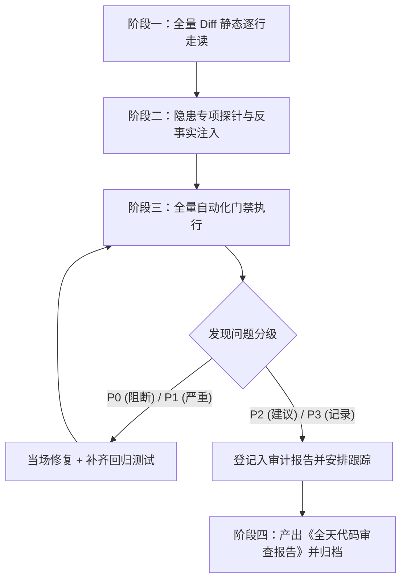

# AuraDSP 全天代码审计计划与检查清单（2026-10-12）

> **审计对象**：2026-10-12 全天所有变更，涵盖自提交 `6de2fa4` 起至当前工作区未暂存修改（C3 异步挂载）共计 80 个相关文件（约 +9400 / -1567 行）。  
> **核心导向**：杜绝隐蔽缺陷与假绿测试，深挖跨层状态竞争、死锁隐患、内存泄漏、算法精度损失与陈旧代码残留。

---

## 1. 审计范围与关键模块全景

本次审计覆盖以下六大核心技术面：

| 模块分层 | 核心涉及文件 | 今日核心改造内容 |
|---|---|---|
| **C++ 底层引擎与插件宿主** | `engine/auradsp_plugin_host.cpp/.h` `auradsp_engine.cpp/.h/.def` `jdspController.c` (P-008) | • CLAP/VST3 泵线程重构与同构镜像 • C1 同模块共享泵线程 (`ModulePumpThread`) + SEH 任务毒化隔离 • B1 元数据单一真相源 + B2 PE 32位检测 • C2 分块异步扫描与缓存优化 • C3 异步挂载/卸载控制线程队列与锁拆分 • P-008 卷积器块长抖动免重建 • EQ 背景谱 tap 独立采集 |
| **FFI 与音频 Isolate 调度** | `app/auradsp_app/lib/engine/auradsp_ffi.dart` `app/auradsp_app/lib/engine/audio_isolate.dart` | • C3 `_slotLoadAsync`/`_slotUnloadAsync` 轮询与事件让出 • FFI 38 符号一致性与异步 API 签名对应 • `VizFrame` 结构体扩充 `eq_in_spectrum` 内存布局对齐 |
| **应用状态与业务逻辑层** | `app/auradsp_app/lib/core/plugin_manager.dart` `app/auradsp_app/lib/core/state.dart` `app/auradsp_app/lib/core/config.dart` | • 插件管理器 `_slotBusy` 状态流转与双重防护 • 缓存 schema=2 信封化与全 Unknown 拒绝落盘 • ADR-006 彻底清理（延迟三档硬约束下线） • EQ 频谱源切换与会话联动 |
| **UI 表现与高频渲染组件** | `app/auradsp_app/lib/features/chrome.dart` `interactive_eq.dart` `plugins_page.dart` `chain_page.dart` `effects_page.dart` `widgets.dart` `app/auradsp_app/lib/core/ui_helpers.dart` | • 氛围频谱预计算频带映射、静音免光栅与 Ticker 衰减看门狗 • 窄画布频带最小宽度钳位与居中自适应圆角 • Tooltip 气泡防抖与尺寸回正 • 三合一插件 Logo 渲染与多语言 5 阶段标签 |
| **多语言本地化 (L10n)** | `app/auradsp_app/lib/l10n/app_*.arb` `app/auradsp_app/lib/l10n/gen/*` | • 中/英/日三语阶段标签与插件挂载状态提示 • 废弃延迟模式相关词条清理 |
| **音频资源与离线校准工具** | `tools/calibration/cal2vdc.py` `resource/manifest.json` `resource/ddc/Microphone Calibration/*` | • Behringer ECM8000 校准曲线转 VDC • SOS DF2 符号取反约定 (`a1/a2 = -scipy`) • 级联 Peaking 拟合节数、权重与极性补偿 |

---

## 2. 五大专项审计检查清单 (Checklist)

### 专项一：关联组件状态与跨层接口契约 (State & API Contract)
- [ ] **1.1 C3 异步状态机闭环**：
  - 检查 `auradsp_plugin_slot_load_async` / `unload_async` 的返回值（1=受理, 0=拒绝）在 Dart 侧 `audio_isolate` 中是否被严密处理。
  - 验证任务状态机 `taskState`（`0=无任务 -> 1=进行中 -> 2=成功 / 3=失败`）在各种异常分支（如路径非法、格式损坏、超时）是否均能 100% 推进至终态（2 或 3），杜绝停留在 1 导致前端永久处于 `_slotBusy=true`。
  - 验证并发重入：在 slot 0 正在 load 时再次触发 load/unload，检查 UI 乐观拦截与引擎拒绝策略是否完全一致且不发生死锁。
- [ ] **1.2 Isolate 与 UI 消息序列完整性**：
  - 核查 `pluginSlotBusy`、`pluginSlotLoaded`、`pluginSlotUnloaded` 事件的派发时序，确保终态事件必定携带 `busy: false` 或清除 `_slotBusy[slot]`。
  - 检查状态事件中 `stage`、`statusJson` 与底层真实插槽状态是否一致。
- [ ] **1.3 C ABI 与 Dart FFI 契约对齐**：
  - 检查 `auradsp_engine.h`、`auradsp_engine.def`、`auradsp_ffi.dart` 以及 Python smoke 中的函数签名（参数数量、类型、返回类型）是否存在隐性不匹配（如 32 位整型 vs 64 位、UTF-8 字符指针所有权与释放归属）。
  - 核查 `VizFrame` 结构体内存对齐：C++ 端的 `eq_in_spectrum[32]` 偏移量与 Dart FFI `Struct` / Python `ctypes.Structure` 是否严丝合缝。

---

### 专项二：旧代码与陈旧机制残留排查 (Dead Code & Obsolete Logic)
- [ ] **2.1 ADR-006 延迟三档机制清理彻底性**：
  - 全仓排查是否仍有遗留的 `mode.latency`、`AURADSP_E_LATENCY_GUARD` 判断分支或被注释的死代码。
  - 检查 `state.dart`、`config.dart`、`settings_page.dart` 中是否完全解除了对混响、卷积、Freeverb 的使能限制。
  - 确认 ARB 语言包中旧延迟模式相关词条是否已安全解绑或按需弃用。
- [ ] **2.2 插件宿主同步加载旧通路收敛**：
  - 检查前端业务路径（`PluginManager.loadPlugin` / `unloadPlugin`）是否已经完全切换至异步指令，确认同步 `auradsp_plugin_slot_load` 是否仅作为向后兼容 ABI 或烟囱单测保留，未在 UI 线程发生意外调用。
- [ ] **2.3 调试代码与临时文件清理**：
  - 检查底层 C++ 引擎中是否存在未受控的临时 `printf` / `std::cout` 调试输出（高频调用点严禁含有 I/O）。
  - 确认测试套件中的临时文件（如 `auradsp_plugin_test*`、桩 PE 文件）在测试完毕后是否全部自清。

---

### 专项三：底层内存安全、并发与状态死锁 (Memory Safety, Concurrency & Deadlocks)
- [ ] **3.1 锁粒度与死锁风险排查（重点：C1 & C3）**：
  - 审计 C3 异步架构中 `m_controlMutex` 与 `m_hostMutex` 的加锁时序，严禁出现交叉持锁（Lock Inversion）。
  - 核查 `prepareInstance` 与 `destroyInstance` 是否彻底在 `m_hostMutex` 锁外执行；验证 `commitInstanceLocked` 与 `detachInstanceLocked` 持锁时间是否维持在微秒级。
  - 检查 C1 `ModulePumpThread` 弱引用注册表访问时的互斥锁生命周期，确保多线程同时加载同一模块时不会发生争死。
- [ ] **3.2 内存泄漏、UAF 与句柄管理**：
  - 检查 `quarantineAbandonedInstance` 隔离区：当插件被隔离后，其占用的资源是否可控，是否会在极端情况下触发无限堆积导致 OOM。
  - 检查 VST3/CLAP 编辑器销毁链路：核实 `WM_CLOSE` / `WM_QUIT` 超时分支中的 `std::promise`、窗口句柄 `HWND`、COM 接口引用计数（`m_view->release()`, `m_component->release()`）是否存在未配对的 AddRef 或悬空释放。
  - 检查 FFI 动态内存：Dart 侧 `toNativeUtf8()` 分配的指针是否均在 `try ... finally` 中调用了 `malloc.free()`。
- [ ] **3.3 SEH 异常处理与崩溃隔离安全性**：
  - 审计 `runWithSehGuard`：SEH 捕获到访问越界（`0xC0000005`）或除零错误后，模块毒化状态 `m_poisoned` 是否正确生效，队列后续任务是否被优雅拒绝，是否存在跳过 C++ 栈对象析构引发的二次灾难。

---

### 专项四：音频算法精度、无损处理与采样适配 (DSP Precision & Lossless Audio)
- [ ] **4.1 P-008 卷积器块长抖动无损性**：
  - 深入审计 `jdspController.c` 中 P-008 补丁：当处理块大小发生变化但在预留缓冲区内时，验证卷积处理核是否保持完整的环形历史与滤波状态，确认是否存在状态重置、样点丢弃或不连续缝合导致的爆音/相位跳变。
  - 检查大块超限时的重建路径是否 RT-Safe，验证极端块长（如 64 -> 1056 -> 4096）切换时的鲁棒性。
- [ ] **4.2 EQ 背景谱与主音频流隔离**：
  - 审计 `auradsp_engine.cpp` 中的 `eq_in_spectrum` 采集逻辑：确保采样过程为**纯只读监听**，完全不修改、不污染主通道音频缓冲区。
  - 检查去均值、汉宁窗和 4096 点 FFT 计算是否在独立副通道进行，确认没有对音频主处理链路引入额外的延迟或相位畸变。
- [ ] **4.3 VDC 校准曲线数值精度与符号规范**：
  - 审计 `cal2vdc.py` 转换输出的 SOS 二阶节系数：严格复核 `a1_out = -a1_scipy`、`a2_out = -a2_scipy` 在 `vdc.c` DirectForm-2 实现中的符号数学等价性。
  - 核查 44.1kHz 与 48kHz 双采样率段的数据格式规范（无行尾多余逗号、冒号紧跟无空格），确保 `DDCParser` 节数计数算法不发生偏差。
  - 评估 8 节级联 Peaking 拟合的最大增益与 Q 值，确认极点严格位于单位圆内（绝对稳定）。

---

### 专项五：UI 状态生命周期、事件循环与内存泄漏 (UI Lifecycle & Leak Prevention)
- [ ] **5.1 氛围频谱与高频重绘生命周期**：
  - 检查 `AmbientSpectrum` 的 `Ticker` 看门狗机制：当音频停止时，确保衰减动画完成（数值降至静音门限）后能**彻底停表 (`stop()`)**，严禁在无音频状态下空转消耗 CPU/GPU。
  - 验证组件在页面切换、弹窗遮挡或 Dispose 时，所有 `AnimationController`、`TickerProvider`、`FocusNode` 和 `TextEditingController` 是否调用了 `dispose()`。
- [ ] **5.2 状态监听器与跨组件通知隔离**：
  - 检查 `PluginManager`、`AppModel` 等核心状态中注册的 `addListener`，确保在对应的 UI 组件卸载时配对移除了监听器，杜绝闭包引用引发的 Widget/Element 内存泄漏。
  - 验证高频 `VizFrame` 的 30fps 局部重绘没有波及到周围的静态控件（如卡片标题、外围滑动列表）。
- [ ] **5.3 响应式布局与边界溢出防线**：
  - 审查 `interactive_eq.dart`、`chrome.dart`、`chain_page.dart` 在极端窗口尺寸（如宽度 400px ~ 2560px）下的自适应计算，确认没有未加边界保护的除法操作或负数宽高度。

---

## 3. 审计执行策略与门禁矩阵

本次代码审计按照**先静态走读定位、后动态探针注入、最后门禁回归核验**的闭环顺序推进：

### 执行准则与门禁要求
1. **静态走读**：严格对照上述 5 大专项清单，对今天修改涉及的 80 个文件逐一进行逻辑审查与注释验证。
2. **动态探针与测试执行**：
   - C++ 引擎全量单测：`python test/runner.py --smoke`（必须 100% PASS，23/23 项全绿）；
   - Flutter 静态分析：`flutter analyze`（必须 0 issues）；
   - Flutter 单元测试：`flutter test`（必须 113/113 全绿，无临时目录泄漏）；
   - C ABI 真实进程退出验证：`test_plugin_direct.exe` 退出码严格为 0；
   - 二进制副本一致性校验：`python tools/verify_dll_copies.py` 确保所有 DLL 版本同步。
3. **问题分级标准**：
   - **P0 阻断**：导致进程崩溃、死锁、内存越界破坏或音频严重失真的缺陷，必须当场阻断并立即修复；
   - **P1 严重**：违反 RT-Safe 契约、状态机悬挂、内存泄漏或逻辑不一致，需同批次修复并添加回归钉住；
   - **P2 优化**：陈旧代码残留、边界冗余判断、异常提示语不精准，视风险现场优化或登记；
   - **P3 记录**：已知平台限制或代码风格优化，记录入文档备忘。

---

## 4. 预期交付物

1. **落盘文档**：
   - 计划书：`docs/全天代码审计计划-2026-10-12.md`（本文档）
   - 审计报告：`docs/全天代码审查报告-2026-10-12.md`（审查执行完毕后产出，包含详细问题清单、缺陷代码位置、修复前后对比与验证数据）
2. **知识沉淀**：
   - 同步更新 `.ai/memory/2026-10-12.md` 与 `.ai/memory/MEMORY.md` 避坑经验池。
