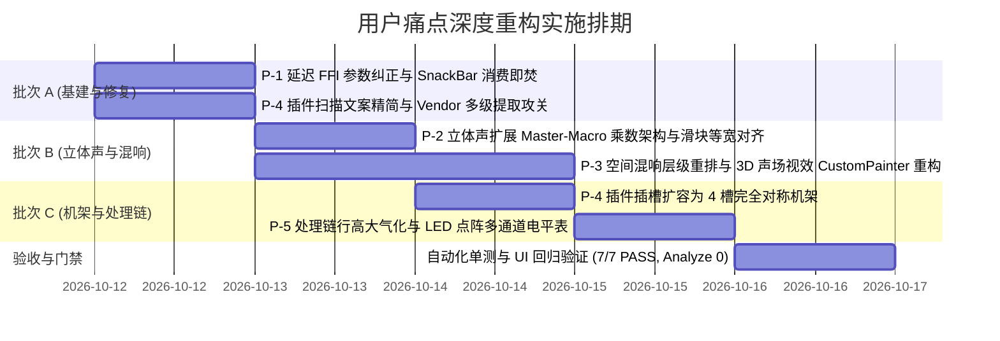

# AuraDSP 用户痛点深度重构与后续演进实施计划 — 2026-10-11

> **定位**：针对用户在实机使用中反馈的 5 大关键体验痛点（延迟提示循环弹窗、立体声扩展分带与滑块对齐、3D 空间混响极简视效与声场尺度表达、插件厂商识别与多插槽对等机架、处理链 LED 多通道电平表与行高重构）开展系统化根因排查、架构设计与落地排期。  
> **真相源关联**：[项目架构与开发规范.md](项目架构与开发规范.md)、[ADR-004](adr/ADR-004-plugin-multi-slot-and-stage-topology.md)、[用户反馈问题修复计划-2026-10-10.md](用户反馈问题修复计划-2026-10-10.md)。

---

## 0. 痛点问题清单与改进定位

| # | 问题领域 | 核心现象与痛点 | 根因分类 | 改进方向与预期成果 |
|---|---|---|---|---|
| **P-1** | 延迟探测提示 | 刷新延迟探测时提示「该组件不支持延迟探测」，且不断刷新弹出、点击关闭无效 | FFI 参数错位 + 事件未置空 | 修正 C++ FFI 签名调用 + SnackBar 消费即焚 + 未就绪静默指示 |
| **P-2** | 立体声扩展 | 命名需统一为「立体声扩展」；普通条与高级分带条长短错位；分带与普通条互斥生效反人类 | 文案 + 布局不对称 + 参数哲学割裂 | 重构为 Master-Macro 乘数联动架构 + 统一 130px 标签等宽布局 |
| **P-3** | 空间混响与 3D 视效 | 3D 声场应置顶且极简去文字；预设/普通/高级重排；现有视效无空间尺寸感且喇叭朝向错误 | 页面层级 + CustomPainter 几何缺陷 | 置顶无框 3D 空间 + 预设/干湿比/高级重排序 + 纠正扬声器波纹 + 尺寸景深联动 |
| **P-4** | 插件库与插槽架构 | 扫描文案繁杂；厂商常显 Unknown；2 槽位太少；双槽位功能感觉不对称、设置反人类 | 文案 + VST3 元数据提取不全 + 硬编码槽位与倒挂拓扑 | 文案改为「扫描」+ 补齐 FactoryInfo/PE 厂商推断 + 扩至 4 槽完全对称机架 |
| **P-5** | 处理链与多通道电平 | 实心长条电平表占空间大；行高局促不够大气；未考量多通道扩展 | UI 紧凑型排版 + 单调连续条绘制 | 行高增至 46~48px + 模拟乐器合成器风格 LED 分段点阵灯柱（预备 2/4/6/8 声道扩展） |

---

## 1. 痛点一：延迟探测浮窗反复循环弹出根治 (P-1)

### 1.1 深度根因排查
经过对代码调用栈的全程逆向追踪，发现该问题由 **三层叠加缺陷** 共同引发：

1. **FFI 接口入参错位（C++ 恒返回 -1）**：
   - C++ 原型（`auradsp_engine.h:126`）：
     ```c
     int auradsp_probe_component(const char* component, double sample_rate, uint32_t* out_delay_samples);
     ```
     其设计为自建独立探针，**不接收任何引擎 handle**，第 1 个入参为字符串标识（如 `"bass"`, `"reverb"` 等）。
   - Dart FFI 绑定（`auradsp_ffi.dart:389`）：
     ```dart
     late final int Function(Pointer<Void>, double, Pointer<Uint32>) probeComponent = ...;
     ```
     错误地将第一个参数声明为 `Pointer<Void>`（被误认作 handle）。
   - 调用侧（`audio_isolate.dart:1088`）：
     ```dart
     rc = l.probeComponent(hd, rate, out); // 把引擎 handle 指针当做字符串传入！
     ```
     C++ 端在做 `strcmp` 时将指针地址解释为字符串，导致组件名永远不匹配，引擎**恒定返回 -1**。
2. **事件流与 SnackBar 消费机制缺乏闭环（关闭后反复复读）**：
   - 探针失败后，`state.dart` 将 `lastInfo` 赋值为 `'该组件不支持延迟探测（需外部资源）'`，并递增 `eventSeq`；
   - `shell.dart` 的 `EventBanner` 监听到 `eventSeq` 递增后唤起 `ScaffoldMessenger.showSnackBar`；
   - **致命漏洞**：当用户点击 SnackBar 右侧的关闭按钮（或自动淡出）时，`model.lastInfo` **从未被置空**！后续任何与延迟无关的动作（如插件扫描完成、参数变化、页面切换）只要再次递增 `eventSeq`，`EventBanner` 就会再次读取未被清空的残留 `lastInfo`，造成“关了又隔一会儿再弹”的幽灵弹窗假象。
3. **侵入式反馈越级**：
   - 延迟测量失败并非阻断性错误，属于状态回退（未测），直接弹全局 SnackBar 属于信息骚扰。

### 1.2 实施方案
1. **修正 FFI 签名与参数传递**：
   - 在 `auradsp_ffi.dart` 中纠正 `probeComponent` 签名：第一参数为 `Pointer<Utf8>`（组件名称）；
   - 在 `audio_isolate.dart` 中将 `comp.toNativeUtf8()` 传入底层，使内置效果器能真正测量出算法延迟。
2. **SnackBar 消费即焚机制**：
   - 在 `AppModel` 增加 `void clearLastInfo()` 与 `void clearLastGuard()`；
   - 在 `EventBanner` 弹出 SnackBar 的瞬间立即清空 `lastInfo`，杜绝幽灵复读。
3. **静默降级原则**：
   - 对未加载外部资源的组件（如无文件的 VDC/卷积），点击刷新延迟仅在卡片顶部的 `LatencyBadge` 内切为“未测量”，Tooltip 给予提示，不再下发全局 SnackBar。

---

## 2. 痛点二：立体声扩展分带对齐与 Master-Macro 哲学革新 (P-2)

### 2.1 文案与规范统一
- 将原有的“声场展宽”彻底统一更名为**“立体声扩展”**（英文：Stereo Expansion / 日文：立体音響拡張）；
- 统一所有卡片上的索引、标题、说明文案，消除“声场展宽”这一历史命名。

### 2.2 滑块长度不对齐根因与布局统一
- **错位根因**：
  - 普通条 `ValueSlider`：左侧标签区写死 `SizedBox(width: 140)`，右侧写死数值框 `SizedBox(width: 60)` + 归位图标；
  - 高级分带 `_BandSlider`：左侧标签写死 `SizedBox(width: 56)`，右侧直接省去了数值与归位图标，Slider 两端自由铺满；
  - 导致普通条的滑轨左右两侧都被挤压，看起来明显“比其它条短”，且和下面的 5 个分带滑轨两端无法垂直对齐。
- **重构方案**：
  - 抽象统一规范组件 `AuraSliderRow` 或标准化 `ValueSlider`；
  - 标签区固定为 `width: 130`（保证中英日文案均不溢出且统一对齐）；
  - 右侧统一为 `width: 56`（数字 + 单位）+ `width: 24`（归位复位图标占位）；
  - `_StereoAdvanced` 的 5 个子带完全复用此对齐规范，实现全卡片滑轨 100% 垂直像素对齐。

### 2.3 参数哲学革新：告别“互斥锁定”，迈向“宏观总控 + 微观塑形”
- **原有反人类设计**：动了子带之后强制将主滑块置为 `overridden`（压暗并提示“分带生效中”），二者二选一不可兼得。
- **专业级 Master-Macro 设计方案**：
  - **高级 5 子带（Band 1~5）**：定义各频段的**空间塑形系数（0% ~ 200%，默认 100%）**。例如专业混音中常将低频设为 0%（单声道居中，保证低频相位坚实无抵消），高频设为 140%（空气感展宽）；
  - **普通主滑块（Master Expansion）**：作为**全局总扩展宏旋钮（Master Multiplier，0% ~ 200%）**；
  - **合成公式**：
    $$\text{ActualBandMix}_i = \text{MasterMix} \times \text{BandProfile}_i$$
  - **交互体验**：
    - 普通用户：无需展开高级区，单滑块控制总宽窄；
    - 专业用户：展开高级区微调各频段基础轮廓，关上面板后，依然可以通过主滑块一键等比例放大或收窄整体声场；
    - 两者完美协同，逻辑优雅自然。

---

## 3. 痛点三：空间混响层级重排与 3D 声场视效重构 (P-3)

### 3.1 页面层级与极简风重构
根据用户指示，将 `_SpatialReverbCard` 内部结构彻底重构为四层流式布局：

```
┌────────────────────────────────────────────────────────┐
│ 02 空间混响 [开启]                             [延迟表] │
├────────────────────────────────────────────────────────┤
│ 1. [3D 声学室视效]（置顶、极简无边框、无「3D声场渲染」字样） │
├────────────────────────────────────────────────────────┤
│ 2. [预设空间药丸组]（大音乐厅 / 录音棚 / 房间 / 自定义）  │
├────────────────────────────────────────────────────────┤
│ 3. [混响干湿比普通条]（Wet/Dry Mix 0%~100%，标准对齐）  │
├────────────────────────────────────────────────────────┤
│ 4. [高级声学物理精调]（折叠：Room Size / Decay / Damp）│
└────────────────────────────────────────────────────────┘
```

- **视觉去除繁琐**：删除原有的 `l.fv3DTitle`（“3D声场渲染”）小标题，顶部直接呈现通透的声学空间三维投影；右侧精简显示参数数据胶囊（如 `2.1x · 45%`）。

### 3.2 3D 声场渲染视效深度重构（CustomPainter）
- **扬声器波纹朝向修复**：
  - 原代码错误：右声源弧度为 `-math.pi * 0.15` 跨度 `0.7 * pi`，声波弧形向右下方散开；
  - 修正：左右声源必须作为立体声主监听音箱，面向正前方的听众（Listening Position）。两只音箱波纹弧形统一朝向前方偏中心交叉（辐射角对称收敛向中央），真实模拟声波辐射。
- **空间尺寸（Room Size）强烈三维感表达**：
  - **透视立方体动态拉伸**：后墙（Back Wall）的距离与网格纵深线随 `roomSize`（0.5x ~ 2.5x）动态进行深度非线性透视缩放；0.5x 时呈现紧凑的贴脸录音小间，2.5x 时呈现纵深极远的宏大殿堂；
  - **早期反射射线（Early Reflections）与材质光晕**：声源到侧墙与天花板的反射线随 Decay 与 Room Size 呈现扩散衰减；后墙加入柔和动态微光渐变，生动传达声场空间感。

---

## 4. 痛点四：插件库扫描、厂商识别与对称机架化 (P-4)

### 4.1 文案精简
- 将“聚合扫描插件”精简为**“扫描”**（英文：Scan，日文：スキャン），去除冗长繁杂标签。

### 4.2 插件厂商（Vendor）识别率攻关
- **根因**：当前 C++ 扫描器仅读取了 `PClassInfo2::vendor`；若插件只在工厂信息中声明了 `IPluginFactory::getFactoryInfo(&factoryInfo)`，或者未实现 `IPluginFactory2`，则直接退化为 `"Unknown"`。
- **多级提取方案**：
  1. **标准工厂信息提取**：在 `GetPluginFactory()` 后立即调用 `factory->getFactoryInfo(&factoryInfo)` 提取默认厂商；
  2. **类扩展信息提取**：依次尝试 `IPluginFactory3` (`PClassInfoW`) 与 `IPluginFactory2` (`PClassInfo2`)；
  3. **目录层级启发式识别**：扫描标准 VST3 目录时，若插件位于 `.../VST3/<VendorName>/<Plugin>.vst3`，且厂商为 Unknown，则自动提取父目录名作为厂商备选；
  4. **Windows PE VersionInfo 回退**：对于顽固插件，通过 `GetFileVersionInfoW` 读取 PE 资源中的 `CompanyName` 或 `LegalCopyright`。四重保障彻底消灭 Unknown。

### 4.3 插槽数量扩容与对等机架设计（告别反人类）
- **痛点反思**：
  - 目前固定为 2 个插槽（`kMaxPluginSlots = 2`），且在 UI 上 Slot 1 和 Slot 2 采用横向 Tab 切换；用户选了不同的 Stage 之后，界面顺序和实际音频处理拓扑完全脱节，造成“两个槽位功能不对称”的心智负担。
- **架构升级方案**：
  1. **插槽数扩容至 4 个（对等机架）**：
     - 将 `kMaxPluginSlots` 常量从 2 扩展为 **4 个插槽**（完全满足降噪 ➔ 前级染色 ➔ 空间混响 ➔ 母带限制的多插件串联需求）；
  2. **消除槽位不对称性**：
     - C++ 底层与 Dart 侧所有槽位地位完全一致，无任何 Slot 0 特殊逻辑；
  3. **机架式拓扑 UI（Plugin Rack）**：
     - 在“第三方插件页”和“处理链页”中统一设计为**插件机架列表（Rack List）**；
     - 每个插件卡片显示其所在的插入阶段（如 `[Stage 0 Pre-DSP]` 或 `[Stage 3 Post-Reverb]`）；
     - 插件卡片可以按照实际音频信号流从前到后自然排列，用户可以在卡片上直接选择切换 Stage，甚至支持上下拖拽换位，拓扑直观透彻。

---

## 5. 痛点五：处理链多通道 LED 分段点阵电平表与行高重构 (P-5)

### 5.1 专业合成器风格 LED 分段点阵电平表（Segmented LED Meter Bar）
- **设计灵感**：参考经典模拟合成器（Serum / Roland）与广播级调音台硬件 LED 灯柱。
- **视觉规格**：
  - 弃用扁平实心长条，改为每个声道由 **10 粒微型 LED 方块灯珠** 组成的纵向/横向灯柱：
    - 灯 1~6（-60 dBFS ~ -12 dBFS）：常态荧光绿 / 橄榄绿（Aura Accent）；
    - 灯 7~8（-12 dBFS ~ -3 dBFS）：过渡暖黄（Warning）；
    - 灯 9~10（-3 dBFS ~ 0 dBFS+）：过载橙红 / 削波红（Error）；
  - 灯珠间距 1.5px，带有微弱发光质感（LED Glow）；
  - 保留峰值瞬时记忆（Peak Hold 1.2 秒），动态更具机械声学美感。
- **多通道无缝自适应**：
  - 2 声道（Stereo）：2 列 LED 点阵；
  - 4 声道（Quad）/ 5.1 环绕声（6 声道）：横向整齐排列 4 列或 6 列灯柱；
  - 统一封装为 `AuraLedMeter(levels: [dbL, dbR, ...])`，完全面向 Phase 8 多声道架构。

### 5.2 处理链行高与呼吸感重构
- **现有问题**：单行 padding 为 `vertical: 6px`，整体行高仅约 36px，文字和拖拽把手局促，没有高级感。
- **优化标准**：
  - 单行高度提升至 **46 ~ 48px**（`padding: AuraSpace.sm`，约 10px 上下边距）；
  - 序号与阶段名称字体微调（13.5px，字重 SemiBold），增加拖拽滑动手感；
  - 右侧放置 LED 点阵灯珠与平滑圆角旁路胶囊，整体观感达到桌面 DAW 宿主级水准。

---

## 6. 排期与分阶段实施计划 (Execution Milestones)



---

## 7. 验收标准与质量门禁

1. **P-1 门禁**：
   - 连续点击各音效卡片延迟刷新按钮，不再出现持续死循环 SnackBar；
   - 支持延迟探测的内置效果器实测输出合理的样本延迟与毫秒数。
2. **P-2 门禁**：
   - 全页面文案统一为“立体声扩展”；
   - 普通条与高级 5 子带滑块两端在 400px / 700px / 1200px 宽度下完全垂直像素对齐；
   - 调节分带后主滑块不被禁用，仍可自由线性缩放总宽度。
3. **P-3 门禁**：
   - 空间混响卡片从上到下严格保持：3D 视效 ➔ 预设药丸 ➔ 干湿比普通条 ➔ 高级折叠面板；
   - 3D 声学室无文字多余标签，右侧音箱辐射波纹正确朝向正前方，房间体积随 roomSize 产生明显透视拉伸。
4. **P-4 门禁**：
   - 扫描按钮精简为“扫描”；
   - 本机扫描的主流 VST3（如 FabFilter, iZotope, Steinberg 等）正确识别并回显真实厂商名称；
   - 提供 4 个完全对等的插件插槽，支持在机架上清晰管理。
5. **P-5 门禁**：
   - 处理链每一行高度达到 46~48px，视觉舒适开阔；
   - 电平表呈现为多段点阵 LED 灯柱，发光分段与过载提示清晰生动；
   - `flutter analyze` 保持 0 issues，全量自动化门禁 100% 通过。
