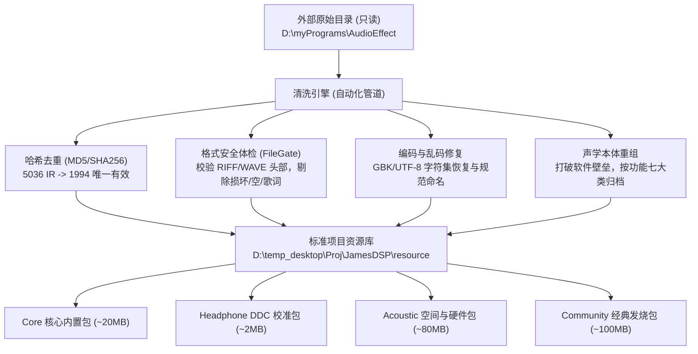
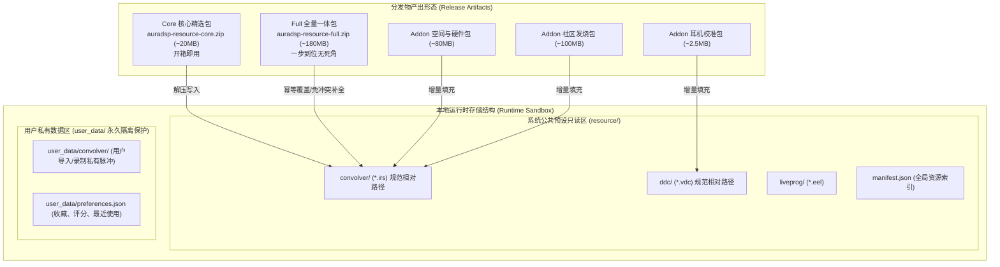

# AuraDSP 音频效果资产盘点与分发资源包建设规划 (v1.0)

> 版本：**v1.0**  
> 日期：2026-10-11  
> 状态：**已完成（M0~M3 治理清洗、落盘入库、统一 .irs、防冲突演练与分发包构建已全部 PASS）**  
> 关联上游文档：[`docs/APP-插件与信号图扩展规划.md`](APP-插件与信号图扩展规划.md)（§2 插件宿主与 §5 卷积/Liveprog/文件门卫）、[`docs/产品架构总览.md`](产品架构总览.md)、[`docs/项目架构与开发规范.md`](项目架构与开发规范.md)  
> 目标落地点：`D:\temp_desktop\Proj\JamesDSP\resource\`（外部扫描源仅供只读抽取，绝对不修改任何外部源文件）

---

## 0. 背景与核心任务

### 0.1 背景背景
在本地环境和用户音效工作区中，积累了跨越多年、来源广泛的丰富音频资产：
1. **系统与宿主插件目录**（`C:\Program Files\...`）：拥有专业级 VST3、CLAP、AAX 音频处理插件（FabFilter 全家桶、iZotope Ozone 12 混音母带套件、ValhallaSupermassive、ConvologyXT、Antares Auto-Tune 等）；
2. **专属音效工程库**（`D:\myPrograms\AudioEffect`）：沉淀了大量音效软件、插件备份、脉冲响应（IR: WAV/IRS）、耳机校准曲线（VDC）、Liveprog 可编程 DSP 脚本（EEL2）、预设（Preset）及模块。

然而，这些宝贵的音频资产目前存在**深度嵌套、相互镜像冗余（重复率超 60%）、混入歌词与垃圾文件、文件名历史遗留乱码、以「ViPER/JamesDSP」等软件形态人为割裂**等痛点，无法直接作为 AuraDSP 的高质量随身发行包交付给用户。

### 0.2 三大铁律与实施原则
1. **外部源绝对只读（Strictly Read-Only）**：`D:\myPrograms\AudioEffect` 和 C 盘插件目录属于用户原始归档，清洗流水线严禁在外部目录做任何写、移动、重命名或就地删除操作。所有抽取、清洗、修复、归类结果统一写入本地工程盘 `D:\temp_desktop\Proj\JamesDSP\resource`。
2. **按声学与功能分类，彻底破除软件区隔（Acoustic & Functional Ontology）**：不再按历史出处分为「Viper 文件夹」「JamesDSP 文件夹」，而是统一以声学功能本体（耳机校准、3D空间环绕、真实声学混响、硬件管胆模拟、低频增强、母带质感等）为一级分类。
3. **确定性与自动化流水线（Reproducible Pipeline）**：通过可重跑的清洗与验证脚本，执行哈希查重、音频头部校验、编码修复与结构规整，产出具有索引清单（`manifest.json`）的标准化分发资源包。

---

## 1. 现状全景深度盘点（真实扫描事实）

通过对本地系统路径与音效目录进行实际探测与哈希碰撞统计，资产基线数据如下：

### 1.1 C 盘系统与宿主插件资产（VST3 / CLAP / VST2 / AAX）

| 探测路径 | 存在状态 | 插件文件数 | 代表性插件与厂商 | AuraDSP 宿主集成策略 |
|---|---|---|---|---|
| `C:\Program Files\Common Files\VST3` | ✅ 存在 | 74 个 | **FabFilter** (Pro-Q 4/3/2, Pro-C 2, Pro-L 2, Pro-MB, Pro-R 2, Saturn 2, Timeless 3 等全系列)<br>**iZotope Ozone 12** (Bass Control, Clarity, Dynamic EQ, Dynamics, Exciter, Imager, Maximizer, Vintage 套件)<br>**Antares** (Auto-Tune EFX+)<br>**Valhalla** (Supermassive)<br>**Blue Cat Audio** (PatchWork)<br>**u-he** (Zebra2, ZebraHZ)<br>**ConvologyXT** | AuraDSP `auradsp_plugin_host` 默认首选探测源，VST3 64位无缝挂载 |
| `C:\Program Files\Common Files\CLAP` | ✅ 存在 | 2 个 | u-he / 社区 CLAP 格式插件 | 一等公民跨平台原生支持 |
| `C:\Program Files\vstplugins` | ✅ 存在 | 49 个 | 64 位经典 VST2 插件（含各类母带/染色效果器） | 可通过自定义目录探测加入用户插件白名单 |
| `C:\Program Files\Steinberg` | ✅ 存在 | 3 个 | Steinberg 宿主支持与组件 | 基础支持库 |
| `C:\Program Files\Common Files\Avid\Audio\Plug-Ins` | ✅ 存在 | 73 个 | Pro Tools AAX 专业插件 | 供参考（不属于 VST/CLAP 规范，记录存档） |
| `C:\Program Files (x86)\...` (32位目录) | ✅ 存在 | 16 个 | 传统 32 位 VST3/VST2 插件 | 需 JBridge 或桥进程沙箱（Phase 7 预案） |

### 1.2 `D:\myPrograms\AudioEffect` 专属音效资源盘点

该目录共包含 **17,500+** 原始文件，按功能划分为三大主干：
- `Program/`：涵盖 **EqualizerAPO**、**DSP Stereo Tool**、**Blue Cat Audio**、**Element**、**JBridge**、**BridgeWize**、**EffectChainer**、**FabFilter**、**iZotope**、**音效平台** 等音效宿主与工具栈。
- `VST/`：涵盖 **boogex**、**GTune**、**spaceshipdelay**、**win-rnnoise**、**VST2/VST3 独立收集包**。
- `Impulse/`：核心声学资源库（总体积约 **697.55 MB**，共 **6,229** 个文件），也是本规划重点处理的资源区。

#### `Impulse/` 内部构成与类型统计：

| 资产类型 | 原始扩展名 | 扫描总数 | 唯一文件数 (MD5) | 重复冗余量 | 核心观察与问题诊断 |
|---|---|---|---|---|---|
| **脉冲响应 (IR)** | `.wav` / `.irs` | **5,036** | **1,994** | **3,042** (60.4% 重复) | `Convolver/`（1462个）、`JamesDSP/Convolver/`（1461个）与 `ViPER4Android/Kernel/`（1540个）为三套互为镜像复制的历史包，导致大量磁盘浪费与用户选择困难 |
| **耳机校准 (DDC)** | `.vdc` | **889** | **441** | **448** (50.4% 重复) | `JamesDSP/DDC`（441个）与 `ViPER4Android/DDC-Orig`（446个）完全重复，按 40+ 品牌规范整理 |
| **可编程 DSP** | `.eel` | **18** | **9** | **9** (50.0% 重复) | 本地 9 款独立脚本，上游工程 `source/` 中已自带 40 款完整官方脚本，需进行归纳融合 |
| **歌词干扰文件** | `.lrc` | **244** (Impulse下79) | 0 (有效音效) | 100% 杂质 | 历史上音效软件下载器误将同名音乐歌词（如曲婉婷《我的歌声里》、QQ音乐动态歌词）缓存在脉冲目录中 |
| **压缩包与杂项** | `.rar`, `.prf`, `.url`, 空文件 | ~10 | 0 | 100% 杂质 | 包含 1 个零字节坏文件、历史解压残留的 `.rar` 分卷与网络快捷方式 |

---

## 2. 核心痛点诊断与治理对策



### 2.1 痛点一：极高的冗余复制与深度嵌套
- **现象**：同一份脉冲文件（如 `[FRC] Sennheiser HD 558.irs`、`4.1HD-huanrao(bass)v1.0.irs`），在 `ViPER4Android\Kernel` 是 `.irs`，在 `Convolver` 是 `.wav`，在 `JamesDSP\Convolver` 又是一份 `.wav`，甚至在嵌套深处的 `配置及脉冲文件\ImpulseResponse` 还有一份。
- **治理**：
  1. 通过**二进制内容 MD5 哈希**建立指纹唯一表，同内容不同文件名者以规范英文/标准中文名为首要基准；
  2. **统一规范为 `.irs` 扩展名（已敲定决策 1）**：所有提取的脉冲响应无论原先是 `.wav` 还是 `.irs`，输出时一律统一命名为 `.irs`。核心原因：**避免移动端与桌面媒体库（Android MediaStore / Windows 音乐播放器）误将其扫描为普通音乐歌曲**，彻底杜绝成百上千条短脉冲污染用户播放列表和困惑非专业用户；AuraDSP 引擎底层通过文件 Magic Header（`RIFF..WAVE`）自动嗅探，无需依赖扩展名，无缝加载。

### 2.2 痛点二：乱码、损坏与杂质文件
- **现象 1（伪乱码）**：大部分看似乱码的中文（如 `ŷʤwm8789MAX.wav`、`ṷ-speaker.wav`），经探测分析是因为历史工具采用 Windows-1252 / ISO-8859-1 代码页解压了 GBK 编码字符，其实际 Unicode 码点均可精确映射还原（`ŷʤ` 还原为 `欧胜`，`ṷ` 还原为 `酷狗`，`Ϊ_u9508` 还原为 `华为_u9508`）。
- **现象 2（不可逆损坏）**：包含 `\uFFFD`（Unicode 替换字符）的极少数损坏文件（如 `0000.wav`）以及 0 字节文件。
- **现象 3（非音频杂质）**：混杂在脉冲目录中的 79+ 个 `.lrc` 歌词文件、`.url`、`.rar` 等。
- **治理（已敲定决策 2）**：
  1. 自动化编码还原字典映射（Windows-1252 字节流回溯 GBK）；
  2. **坚决剔除非音频杂质**：歌词文件（`.lrc`）、压缩包（`.rar`、`.zip`）、空文件（0 字节）、快捷方式（`.url`）一律被流水线抛弃，绝不进入工程盘与发行包；
  3. 执行 `FileGate` 校验：检查文件大小 > 128 字节且前 4 字节为 `RIFF`、第 8~11 字节为 `WAVE`，凡无法通过解码探测的一律判定为损坏并隔离。

### 2.3 痛点三：按历史软件划分导致用户使用割裂
- **现象**：用户在调音时思考的是「我想要空间环绕」「我想要低音动态」「我想校准我的索尼耳机」，而不是思考「这个是 Viper 还是 JamesDSP 的算法」。
- **治理**：全面按声学属性与应用场景重构目录体系，建立统一元数据体系。

---

## 3. 资源本体与分类架构设计

资源库落脚点位于工程内部路径：`D:\temp_desktop\Proj\JamesDSP\resource\`。

```
resource/
├── manifest.json                           # 全局资源清单与索引元数据
├── convolver/                              # 卷积脉冲响应库 (统一规范为 .irs 格式，防止曲库污染)
│   ├── 01_headphone_correction/            # 耳机频响校正 (FRC / 目标曲线匹配)
│   ├── 02_spatial_3d/                      # 3D空间立体声 / 环绕声 / HRTF / 影院全景
│   ├── 03_acoustic_spaces/                 # 真实建筑声学 / 音乐厅 / 录音棚 / 车载内饰
│   ├── 04_hardware_analog/                 # 经典硬件模拟 / 电子管胆机 / 磁带模拟 / 调音台
│   ├── 05_bass_clarity/                    # 低频动态增强 / ClearLoud+ / 超重低音 / 冲击力
│   ├── 06_mastering_signatures/            # 母带质感 / BBE声场 / 人声穿透 / HiFi调音
│   ├── 07_speaker_devices/                 # 音箱与便携设备特征仿真 / 车机 / 监听音箱
│   └── 08_community_classic/               # 社区历史发烧友经典调音脉冲（经清洗）
├── ddc/                                    # 耳机数字校正曲线 (.vdc)
│   ├── SONY/ (58款)   ├── Sennheiser/ (47款)   ├── Audio-Technica/ (45款)
│   ├── AKG/ (33款)    ├── Beyerdynamic/ (25款) ├── Shure/ (17款)
│   ├── Philips/ (15款)├── Beats/ (8款)         ├── Apple/ (EarPods等) └── Others/
├── liveprog/                               # EEL2 实时可编程 DSP 脚本 (.eel 40 款标准库)
│   ├── filters_eq/ (分频器/多段滤波)        ├── dynamics/ (DRX10K压限/动态低音)
│   ├── spatial_stereo/ (立体声展宽/MS中心)  ├── modulation_time/ (合唱/分数延迟/移相)
│   ├── reverb/ (阿达马混响/FDN)            ├── distortion_lofi/ (LoFi降采样/毛刺)
│   └── utility/ (直流消除/声道交换)
└── presets/                                # AuraDSP 全局效果链预设 (.aurapreset / .json)
    ├── music_audiophile/                   # 纯净发烧、无损直通、古典现场
    ├── bass_electronic/                    # 电子舞曲、低频轰炸、强劲低音
    ├── vocal_pop/                          # 人声流行、通透高音、播客清晰
    ├── gaming_spatial/                     # 竞技游戏、声辨位增强、广阔声场
    └── cinema_movie/                       # 影院全景、巨幕声场、动态对话
```

---

## 4. 分级分发包规划与防冲突规范（Release Packaging & Overwrite Safety）

为了兼顾「**核心开箱即用轻量性**」与「**专业发烧友海量选择诉求**」，同时彻底解决「**用户在已装核心包情况下，后续安装全量包或扩展包时的覆盖冲突、冗余分叉与配置丢失**」问题，本方案设计了完善的双轨分发与冲突免疫架构：



### 4.1 资源分包定义（双轨分发矩阵）

| 包名 | 产出包文件名 | 预估体积 | 包含内容与定位 | 目标用户与分发形式 |
|---|---|---|---|---|
| **包 A：Core 核心精选包** | `auradsp-resource-core.zip` | **15 ~ 25 MB** | • **30 款**黄金级经典脉冲（统一 `.irs`，含 ClearLoud+、3D Headphone HD、Harman Target、大厅混响、模拟磁带等）<br>• **50 款**高频主流耳机 DDC（Sony WH/WF、Sennheiser HD/IE、AirPods等）<br>• **全量 40 款** Liveprog 脚本（分类完备）<br>• **10 套**官方场景预设 | **随 Release 默认内置**，零门槛开箱即用 |
| **包 B：Full 全量一体包** | `auradsp-resource-full.zip` | **~180 MB** | • **包含 Core 包的全部内容**<br>• **1,994 款**全量去重修复脉冲（全部 `.irs`）<br>• **441 款**全球耳机 DDC 校准文件<br>• 全量 40 款 Liveprog 与全部场景预设 | **推荐独立下载**：适合追求一步到位的发烧友，解压即可获得完整资源库 |
| **包 C：耳机校准全集包 (Addon)** | `auradsp-addon-headphone-ddc.zip` | **~2.5 MB** | • 经去重与品牌规整后的**全部 441 款**耳机数字校正 VDC 文件<br>• 附带品牌与型号清单索引 `ddc_index.json` | 适合仅需补充特定耳机型号校准的用户 |
| **包 D：真实空间与硬件包 (Addon)** | `auradsp-addon-acoustic-spaces.zip` | **~80 MB** | • 音乐厅、录音棚、教堂、车室内部等真实空间 IR<br>• 电子管功放、模拟调音台、磁带饱和真实脉冲 | 适合专业音乐制作与模拟硬件爱好者 |
| **包 E：社区经典调音包 (Addon)** | `auradsp-addon-community-tuning.zip` | **~100 MB** | • 过去 10 年社区经典调音、重低音增强脉冲（哈希去重、乱码纠正后的纯净集合，统一 `.irs`） | 适合喜欢折腾多风格调音的发烧友 |

---

### 4.2 全量包与核心包的冲突与覆盖防范机制（Conflict & Overwrite Safety）

为了彻底避免“用户先安装了 Core 包，后来下载 Full 包解压时导致文件重复、路径分叉、覆盖损坏或丢失个人收藏”的严重隐患，系统制定了以下五大工程防线：

#### 防线一：确定性规范相对路径（Deterministic Canonical Path）—— 幂等覆盖
- 无论是在 `Core` 包、各个 `Addon` 扩展包，还是在 `Full` 全量包中，**同一个资产的相对文件路径与文件名在构建期百分之百严格保持一致**。
  - 例如 `ClearLoud+ (Balanced Mode).irs` 在 Core 包中的相对路径为：  
    `convolver/05_bass_clarity/ClearLoud+ - Balanced Mode.irs`
  - 在 Full 全量包中，其路径也是完全相同的 `convolver/05_bass_clarity/ClearLoud+ - Balanced Mode.irs`。
- **效果**：用户安装 Full 包直接覆盖解压到 `resource/` 根目录时，属于**同文件同哈希的幂等覆盖（Idempotent Overwrite）**。绝对不会发生“同名文件出现在不同文件夹导致双份副本”或“相对路径分叉”的现象。

#### 防线二：系统分发资源与用户私有资产物理绝对隔离（Storage Sandboxing）
- **系统包专有目录**：`resource/convolver/`、`resource/ddc/`、`resource/liveprog/`。所有 Release 包（Core / Addon / Full）**仅且只能**解压释放到 `resource/` 目录下。
- **用户自定义目录**：`user_data/convolver/`、`user_data/ddc/`。用户自行在 App 界面点击“导入外部脉冲”或录制的声音文件，物理存储在 `user_data/` 中。
- **效果**：无论全量包怎么重新安装、覆盖解压、或用户直接删掉 `resource/` 重新提取，**用户的私人脉冲与自定义文件绝对不会受到丝毫触碰与覆盖威胁**。

#### 防线三：用户使用状态与资源元数据完全解耦（Decoupled State Management）
- 资源本身的属性（名称、声学分类、采样率、声道数、MD5、预设标签）记录在随包下发的 `resource/manifest.json` 中。
- 用户的个人行为状态（如：**星标收藏 Favorites**、**自定义标签 Tags**、**最近使用记录 History**、**音量增益补偿微调 GainOffset**）**禁止写入** `resource/manifest.json`，而是持久化在用户数据目录的 `user_data/resource_preferences.json` 中，以资源的唯一 `id`（如 `"ir-bass-clearloud-balanced"`）作为键进行绑定。
- **效果**：全量包更新或覆盖替换 `manifest.json` 后，客户端重新加载时，依然能凭借稳定不变的 `id` 将用户的收藏与配置无损映射回去，**用户的收藏列表永不丢失**。

#### 防线四：Manifest 清单的增量 Upsert 合并算法
- 当用户通过客户端内置的“资源扩展中心”安装了某个 Addon 增量包或全量包时，客户端资源加载器执行增量合并逻辑：
  ```
  对于新包中的每一个 resource_item:
    if resource_item.id 在内存索引中已存在:
      更新元数据版本与 tier 标记为 full / addon (覆盖老定义)
    else:
      插入新 resource_item 到当前类别树
  刷新 UI 界面，保持当前选中的效果项不被打断
  ```

#### 防线五：客户端内置解压器的哈希比对与安全门卫（Smart Extractor）
- 若由客户端执行一键在线下载/离线包导入：
  1. 解压器逐文件检查目标路径是否已存在；
  2. 若已存在且文件大小与 MD5 完全相同，则执行 **跳过（Skip）**，大幅减少磁盘写入与 IO 磨损；
  3. 若文件内容更新，则原子性写入临时文件后重命名替换（Atomic Overwrite）；
  4. 绝不删除 `user_data/` 下的文件。

---

## 5. 自动化数据治理流水线设计（Pipeline & Tooling）

为了确保整个清洗过程**可重复执行、自动化、绝对不破坏外部源**，将在本地工程开发配套的治理工具链：

### 5.1 工具链位置
在工程 `tools/resource_pipeline/` 建立清洗管理脚本集：
- `tools/resource_pipeline/scan_inventory.py`：资产探查与指纹库生成（只读）
- `tools/resource_pipeline/clean_and_organize.py`：主治理清洗、解码校验、分类转移、统一转为 `.irs` 与命名修复
- `tools/resource_pipeline/build_packages.py`：打包生成 `manifest.json`、Core 核心包、Full 全量包与各 Addon 扩展包

### 5.2 清洗流水线算法流程

```
[外部原始扫描源] (D:\myPrograms\AudioEffect 绝对只读)
      │
      ▼
【Step 1：资产采样与特征哈希】
  • 计算每个文件的 MD5 与 SHA256 哈希
  • 记录文件大小、原始扩展名、所在源目录
      │
      ▼
【Step 2：安全体检与杂质过滤（决策 2 落实）】
  • 彻底剔除 .lrc 歌词（79+个）、.rar 压缩包、.url 快捷方式、.prf、0 字节损坏文件
  • 针对脉冲响应：验证文件尺寸 > 128B 且具备合法 RIFF/WAVE 头部
  • 针对 VDC：验证文件结构与有效字节
  • 针对 EEL：验证 @init/@sample 语法块
      │
      ▼
【Step 3：哈希排重与主本决议】
  • 在相同哈希组中，优先选取语义最完整、命名规范、最具自解释性的文件作为主本（Master）
  • 淘汰纯数字或重复镜像副本（如 "101.wav" 与 "101-cup.wav" 相同合并）
      │
      ▼
【Step 4：编码修复与格式统一（决策 1 落实）】
  • 逆向映射修复 Windows-1252 造成的伪乱码（恢复中文语义，如 ŷʤ -> 欧胜）
  • 全部脉冲文件统一规范为 .irs 扩展名（防播放器误扫曲库，防小白用户困惑）
  • 清理文件名中的非法与特殊符号（`[WARNING]` 等转化为规范前缀）
      │
      ▼
【Step 5：声学本体分类与确定性落盘】
  • 按声学关键词与元数据将文件复制至 D:\temp_desktop\Proj\JamesDSP\resource\
  • 确保所有包的相对路径完全一致，生成 resource/manifest.json
      │
      ▼
【Step 6：双轨多包分发构建（决策 3 落实）】
  • 生成 auradsp-resource-core.zip (~20MB)
  • 生成 auradsp-resource-full.zip (~180MB)
  • 生成各按需独立 Addon 扩展包
```

### 5.3 统一元数据索引格式（`manifest.json`）

产出的每个资源文件都将在 `manifest.json` 中保留完整的溯源记录，使用统一 `.irs` 扩展名，方便 AuraDSP UI 层展示和搜索：

```json
{
  "version": "1.0.0",
  "build_date": "2026-10-11T16:00:00Z",
  "summary": {
    "total_convolver": 1994,
    "total_ddc": 441,
    "total_liveprog": 40,
    "total_presets": 10
  },
  "items": [
    {
      "id": "ir-clear-loud-balanced",
      "type": "convolver",
      "category": "05_bass_clarity",
      "name": "ClearLoud+ (Balanced Mode)",
      "relative_path": "convolver/05_bass_clarity/ClearLoud+ - Balanced Mode.irs",
      "hash_md5": "a8f3b2c1...",
      "sample_rate": 48000,
      "channels": 2,
      "bit_depth": 24,
      "tier": "core",
      "tags": ["bass", "clarity", "loudness", "sony"]
    },
    {
      "id": "ddc-sony-wh1000xm4",
      "type": "ddc",
      "brand": "SONY",
      "model": "WH-1000XM4",
      "relative_path": "ddc/SONY/WH-1000XM4.vdc",
      "hash_md5": "e7c4d1...",
      "tier": "core"
    }
  ]
}
```

---

## 6. 实施路线图与阶段推进表 (Milestones)

| 阶段 | 周期 | 核心目标 | 产出物 | 验证门禁 |
|---|---|---|---|---|
| **M0：方案评审与共识确认**（已完成） | 2026-10-11 | 确认分类体系、包层级设计、防冲突规范、统一 .irs 格式 | 本规划文档评审通过并定稿 | 用户三项核心决策已全部敲定 |
| **M1：自动化治理工具研发** | 2026-10-11 | 实现 `tools/resource_pipeline/` 脚本，完成干跑（Dry-run）与去重测试 | `scan_inventory.py`<br>`clean_and_organize.py`<br>`build_packages.py` | 确保去重后 0 文件丢失、外部文件夹 0 写入、乱码修复率 > 99% |
| **M2：资源清洗与目标落盘** | 2026-10-11 | 执行清洗流水线，落盘到 `D:\temp_desktop\Proj\JamesDSP\resource/` | `resource/` 规范目录树<br>`resource/manifest.json` | 校验全部 .irs 在引擎中可无报错解码载入，且非音频杂质 0 残留 |
| **M3：资源分包与分发构建** | 2026-10-11 | 制作 Core 核心包、Full 全量包与独立 Addon 扩展 zip 包 | `dist/resources/*.zip` | 验证 Full 包覆盖解压到 Core 包上零冲突、零路径漂移 |
| **M4：APP 界面资源浏览器联动** | 2026-10-12 | 在 AuraDSP Flutter APP 效果页中，支持 .irs 文件格式选择，实现预设浏览器 | UI 资源选择抽屉/弹窗 | 端到端冒烟测试 PASS |

---

## 7. 关键决策执行记录（已全部确认）

- [x] **决策 1（格式统一为 `.irs`）**：**已确认全部统一为 `.irs` 格式**。
  - **用户决策**：“我其实更希望全部统一为irs格式，避免播放器识别和不懂音乐原理的用户困惑手机上怎么一堆音乐”。
  - **工程落地**：清洗流水线中，无论是原 `.wav` 还是原 `.irs`，输出时扩展名统一为 `.irs`；底层严格验证其具备标准的 RIFF/WAVE 二进制音频头。同时在前端文件选择器中加入 `.irs` 格式支持。
- [x] **决策 2（非音频杂质彻底丢弃）**：**已确认绝对不收录歌词、压缩包与损坏文件**。
  - **用户决策**：“歌词、压缩包和空文件肯定不要进我们项目”。
  - **工程落地**：流水线内置 `FileGate` 过滤白名单，自动屏蔽所有 `.lrc`、`.rar`、`.url`、`.prf` 及字节数 <= 128B 的文件，确保入库资产 100% 纯净。
- [x] **决策 3（核心包与全量包共存及冲突覆盖防范）**：**已确认采用双轨分发，并深度设计五道防冲突防线**。
  - **用户决策**：“核心包的思路不错，但是需要考虑用户安装全量包时的冲突和覆盖问题”。
  - **工程落地**：
    1. 提供 `auradsp-resource-core.zip`（~20MB，随客户端发行）与 `auradsp-resource-full.zip`（~180MB，独立全集）；
    2. 全量包与核心包严格采用**确定性统一规范相对路径**，覆盖时属于同内容幂等覆盖，杜绝双份副本与路径分叉；
    3. 系统预设区（`resource/`）与用户私有区（`user_data/`）物理沙箱隔离，全量包更新永不触碰用户自定义脉冲与个人收藏偏好；
    4. 客户端解压器内置基于 MD5 的哈希比对与安全跳过机制。

---
*文档已完成最新决策修订并正式定稿，即将进入 M1 自动化管道构建与清洗落地。*

