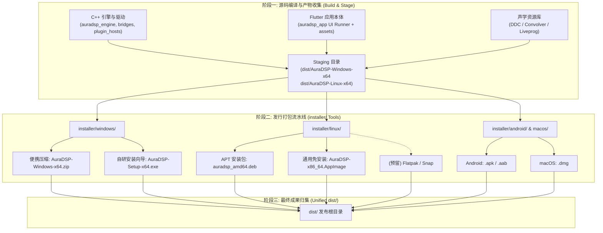

# AuraDSP 全平台发行架构与产物规范

本文档定义了 AuraDSP (JamesDSP Desktop & Multiplatform) 的全平台打包与发布技术架构，明确各平台编译产物如何被采集、校验、打包并最终汇聚到 `dist/` 根发布目录。

> **发布规范总则（2026-11-06 owner 裁定，本文件为其落点）**
> - **版本号**：格式 `vXX.XX.X`——主版本、次版本各最多两位数，修订号一位起；**首个正式版本为 v0.1.0**（此前 0.5.0 为开发期内部版本，不再沿用）。
> - **平台范围**：当前发行仅含 **Windows + Linux** 桌面；Android / macOS 为后续阶段（规格预留，不阻塞当前发行）。
> - **发行分支**：正式发行**只能从 `main` 分支构建**（开发走 `feature/* → dev → main` 单向合并，见 AGENT.md 分支策略）。
> - **发行门禁**：构建发行前，CI 八 job、双平台冒烟与 Dart 单测必须全绿；任一红灯不得发行。
> - **完整发行**：每个平台必须同时具备三件——**驱动包、便携包、正式安装包**（构成见 §2.3），缺一不算完整发行。
> - **前置条件**：`installer/` 子项目（打包工具链与各平台安装包实现）完善后方可首发；Linux 部分已于 2026-11-06 落地（见 `installer/linux/pack.sh` 与 05 号设计规划），Windows 部分按 02 号设计推进。
> - **资源包独立发行（2026-11-06 owner 裁定）**：资源包与软件本体**分开发行、独立版本线**——资源包版本从 `0.0.1` 起、tag 为 `resources-v{版本}`（与本体 `v{版本}` 严格区分，见 §2.4）；本体发版**不重复附带**资源包，仅当资源内容真有变更时才发新的资源包版本。
> - **存储口径**：GitHub **Release 资产与 Actions artifacts 是两套独立存储**（见 §5 注记）——Release 单文件 <2 GiB、单 Release ≤1000 个资产、总容量与带宽官方明确不限；artifacts 有账户配额，靠 `retention-days` 控制保留期。两者不可混淆。

---

## 1. 发行流水线总览 (Pipeline Architecture)

AuraDSP 的发布流程采用“**两阶段解耦模型**”：
1. **阶段一（Build & Stage）**：负责编译 C++ 原生引擎、驱动常驻桥、插件隔离宿主，以及 Flutter 桌面端/移动端宿主，并将二进制与声学资源按各平台目录规范对齐（Staging）。
2. **阶段二（Pack & Distribute）**：由 `installer/` 目录下的打包工具链读取 Staging 目录中的规范产物，完成资源内嵌、压缩封装、代码签名、注册表配置、桌面文件集成，最终生成各平台面向终端用户的安装包或独立便携包并输出至 `dist/`。



---

## 2. 版本号与命名规范 (Versioning & Naming Standard)

### 2.1 统一版本真相源 (Single Source of Truth)
AuraDSP 的版本号统一定义在 `app/auradsp_app/pubspec.yaml`：
```yaml
version: 0.1.0+1
```
其中：
- `0.1.0` 为版本号 `Major.Minor.Patch`，格式受发布总则约束：对外标签写作 `v0.1.0`（`vXX.XX.X`——主、次版本各最多两位数，修订号一位起；修订号超过 9 时进位次版本）。首个正式版本即 `v0.1.0`。
- `+1` 为构建序号 `BUILD_NUMBER`。

在跨平台打包工具启动时，由 `installer/shared/version_resolver.py` 直接解析 `pubspec.yaml`，向各平台打包工具导出统一的环境变量：
- `AURADSP_VERSION="0.1.0"`
- `AURADSP_BUILD="1"`
- `AURADSP_FULL_VERSION="0.1.0.1"`
- `AURADSP_TAG="v0.1.0"`

### 2.2 产物命名范式
所有存入 `dist/` 的发行文件名必须遵循严谨、自解释的命名结构，方便终端用户识别与 CI 自动抓取：

```text
AuraDSP-Windows-x64-v{VERSION}.zip          # Windows 64位绿色便携版
AuraDSP-Setup-x64-v{VERSION}.exe            # Windows 64位自研安装程序
auradsp_{VERSION}_{BUILD}_amd64.deb         # Linux Debian/Ubuntu APT 包
AuraDSP-v{VERSION}-x86_64.AppImage          # Linux 64位通用 AppImage
org.auradsp.AuraDSP-{VERSION}.flatpak       # Linux Flatpak 商店包（预留）
auradsp_{VERSION}_amd64.snap                # Linux Snap 商店包（预留）
AuraDSP-v{VERSION}-android-arm64-v8a.apk    # Android 64位真机包
AuraDSP-v{VERSION}-android-universal.apk    # Android 全架构通用包
AuraDSP-v{VERSION}.aab                      # Android Google Play 商店包
AuraDSP-v{VERSION}-macOS-Universal.dmg      # macOS 通用架构 DMG 安装镜像
AuraDSP-Driver-x64-v{VERSION}.zip           # Windows 驱动包（AuraVAIO 驱动 + install_driver.ps1）
auradsp-driver-loopback_{VERSION}_all.deb   # Linux 驱动包（snd-aloop 自启配置，见 03 §6）
AuraDSP-Linux-x64-v{VERSION}.tar.gz         # Linux 便携包（AppImage 的等价补充形态）
```

### 2.3 完整发行构成（每平台三件，缺一不可）

| 平台 | 驱动包 | 便携包 | 正式安装包 |
| :--- | :--- | :--- | :--- |
| Windows | `AuraDSP-Driver-x64-v{VERSION}.zip`（AuraVAIO 驱动 + `install_driver.ps1`，含 DRV 规约残留清理） | `AuraDSP-Windows-x64-v{VERSION}.zip`（绿色包） | `AuraDSP-Setup-x64-v{VERSION}.exe`（自研安装向导，见 02） |
| Linux | `auradsp-driver-loopback_{VERSION}_all.deb`（snd-aloop 模块自启 + 参数配置，见 03 §6） | `AuraDSP-v{VERSION}-x86_64.AppImage` + `AuraDSP-Linux-x64-v{VERSION}.tar.gz` | `auradsp_{VERSION}_amd64.deb`（见 03 §2） |

资源包（§2.4 / §4）独立发行，不随本体 Release 重复附带，不计入三件构成；本体 Release 说明中必须写明配套资源包的版本、下载地址与校验值（引用契约见 §4）。

### 2.4 资源包版本线（独立于本体，2026-11-06 owner 裁定）

资源包（声学资源库：DDC 曲线 / IR 卷积库 / Liveprog 脚本及其扩展包）与软件本体分开发行，理由是体量悬殊：本体安装包以十 MB 计，资源全量包以百 MB 计；若随本体每版重复附带，既浪费发布带宽，也让用户在每次升级时重复下载未变更的大文件。

- **版本规则**：独立序列，格式同为 `X.Y.Z` 数字版本，**首版 `0.0.1`**，只随资源内容变更递增，与本体版本（如 `v0.1.0`）无对应关系。哪个本体版本配套哪个资源包版本，以本体 Release 说明中的「配套资源包」条目为准（见 §4 引用契约）。
- **tag 命名**：`resources-v{版本}`（如 `resources-v0.0.1`）。前缀 `resources-` 与本体 tag `v{版本}` 严格区分、避免撞名；同时 §5 的本体发行流水线以 `v*` 为触发条件，`resources-v*` 不会误触发本体发行（将来资源包自动化时用独立的 `resources-v*` 触发条件，二者互不干扰）。
- **Release 形态**：标题建议 `AuraDSP 资源包 resources-v{版本}`；资产为 `tools/resource_pipeline/build_packages.py` 的产出（文件名不含版本号，版本由 tag 承载）：`auradsp-resource-core.zip`、`auradsp-resource-full.zip`、`auradsp-addon-headphone-ddc.zip`、`auradsp-addon-acoustic-spaces.zip`、`auradsp-addon-community-tuning.zip`，外加该 Release 专属的 `SHA256SUMS.txt`（§3 同格式）。
- **何时发新版**：仅当资源内容真有变更（曲线 / IR / 脚本增删改）时；本体发版、修复、重打包均不触发资源包发版。
- **历史 `v0.5.0` 的处置**：现有 `v0.5.0` Release 实为资源包性质的历史发行（2026-10-12），**先保留、不动**；待 `resources-v0.0.1` 建好并校验通过（资产齐全、SHA256 对得上、可正常下载）后，再由 owner 决定删除或保留，删除动作不在任何自动化流程内。在新资源包 Release 就绪前，文档与说明中不把 `v0.5.0` 作为规范引用目标，新引用一律指向 `resources-v*` 系列。

---

## 3. 发行产物完整性清单与校验机制 (Integrity & Checksums)

在打包流水线的最后一步，必须对 `dist/` 目录下生成的所有最终产物自动生成校验和清单：
- `dist/SHA256SUMS.txt`：包含所有正式发布包的 SHA-256 哈希值。
- `dist/RELEASE_NOTES.md`：本次版本的更新日志与分发说明。

**校验清单格式示例**：
```text
e3b0c44298fc1c149afbf4c8996fb92427ae41e4649b934ca495991b7852b855  AuraDSP-Windows-x64-v0.1.0.zip
a8f5f167f44f4964e6c998dee827110c01759f33b30bcd8822533036ca6d5f70  AuraDSP-Setup-x64-v0.1.0.exe
7d1a54127b222502f5b79b5fb0803061152a44f92b37e23c65c541ce5d5eabc1  auradsp_0.1.0_amd64.deb
b5a2c96250612366ea8c4146d73f5d44547047106130ea0945a1a227a80c611e  AuraDSP-v0.1.0-x86_64.AppImage
```

---

## 4. 依赖管理与资源分发策略 (Asset Distribution Strategy)

AuraDSP 包含较为庞大的声学核心资源库（DDC 耳机校准曲线、IR 脉冲响应卷积库、Liveprog 声学着色脚本）：
1. **核心随包预设 (In-Box Presets)**：
   - 随主程序安装包或便携包内置分发，保证开箱即用。
   - 存放在运行目录的 `resources/` 下。
2. **独立资源包 Release (Standalone Resource Release)**：
   - 由 `tools/resource_pipeline/build_packages.py` 生成（core 约 20MB / full 约 180MB / addons 若干，如 AutoEq 完整耳机库万条曲线），按 §2.4 的独立版本线单独发 Release，不塞入基础安装包以控制安装程序体积（建议主安装包控制在 60MB~90MB 以内），本体发版时不重复上传这些资产。
   - **引用契约（本体如何指向资源包）**：
     - 每个本体 Release 的说明（`RELEASE_NOTES.md` 与 GitHub Release 正文）必须包含「配套资源包」条目：资源包版本号、tag、下载地址与 SHA-256 校验值（抄自资源包 Release 的 `SHA256SUMS.txt`）。
     - 下载地址为版本钉死的直链，不用浮动地址：`https://github.com/li589/AuraDSP/releases/download/resources-v{RESVER}/auradsp-resource-full.zip`（addons 同理换文件名）。钉死版本保证校验值长期有效、配套关系可复现。
     - 用户（及将来的向导内下载功能）取得资源包后，必须先比对 SHA-256 与上述条目一致才可导入；导入合并语义与打包侧一致（core→full→addons 顺序覆盖、`user_data/` 隔离，见 `installer/windows/pack.py` 的资源合并规则）。
     - 本体安装包 / 便携包内置 core 预设保证开箱即用（上文第 1 点）；full 与 addons 属可选扩展，由用户从资源包 Release 按需获取。

---

## 5. CI/CD 自动化发布集成路线 (CI/CD Matrix)

后续在 GitHub Actions 流水线中，当检测到 Git Tag（例如 `v*`）被推送时，自动化流水线将并行拉起各平台打包作业：

| CI Job | 执行环境 | 打包入口 | 产物上传目标 |
| :--- | :--- | :--- | :--- |
| **package-windows** | `windows-latest` | `python installer/windows/pack.py` | `dist/AuraDSP-Windows-*.zip`, `dist/AuraDSP-Setup-*.exe` |
| **package-linux** | `ubuntu-22.04` | `bash installer/linux/pack.sh` | `dist/*.deb`, `dist/*.AppImage` |
| **package-android** | `ubuntu-latest` | `bash installer/android/pack.sh` | `dist/*.apk`, `dist/*.aab` |
| **package-macos** | `macos-latest` | `bash installer/macos/pack.sh` | `dist/*.dmg` |
| **release-publish** | `ubuntu-latest` | 汇集全部 Artifacts 并生成 `SHA256SUMS.txt` | 自动发布到 GitHub Release |

**发行门禁（与发布总则一致，CI 流水线必须强制）**：

1. 发行构建只接受 `main` 分支上、且标签为 `vXX.XX.X` 格式的提交；标签版本必须与 `pubspec.yaml` 一致（由 version_resolver 校验，不一致即中止）。
2. 触发发行前，该提交的 CI 八 job 必须全绿（success），且双平台冒烟（Windows 全量 / Linux 口径）与 Dart 单测无 FAIL。
3. 每平台三件产物（§2.3）齐备且通过 `dist_manifest.py --check` 与 SHA256 清单校验后，才允许 publish 到 GitHub Release。

**存储与配额注记（勿混淆）**：GitHub Release 资产与 Actions artifacts 是两套独立存储，互不占用——
- **Release 资产**：单个文件 <2 GiB、单个 Release 最多 1000 个资产，**总容量与下载带宽官方明确不限**。资源包按 §2.4 独立发 Release，不受 artifacts 配额影响，本体发版不重复附带它纯粹是为省带宽与用户下载量，不是空间不够。
- **Actions artifacts**：CI 中间产物存储，有账户级配额（本仓库曾因默认 90 天保留囤积 128 个占满）。`ci.yml` / `windows-installer.yml` 的 `upload-artifact` 必须显式设置 `retention-days`（现行 **7 天**：足够失败排障与复跑取证，又不长期囤积）；新增上传步骤不得省略。已囤积的旧 artifacts 由 owner 在 GitHub 网页端删除（API 令牌无此权限）。

