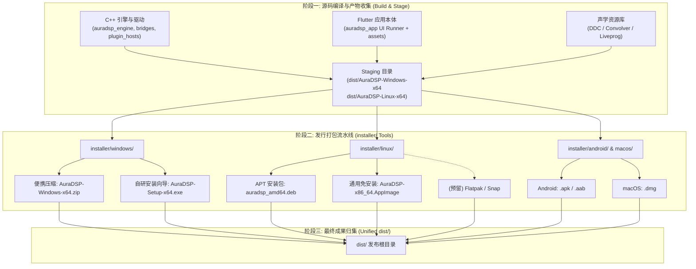

# AuraDSP 全平台发行架构与产物规范

本文档定义了 AuraDSP (JamesDSP Desktop & Multiplatform) 的全平台打包与发布技术架构，明确各平台编译产物如何被采集、校验、打包并最终汇聚到 `dist/` 根发布目录。

---

## 1. 发行流水线总览 (Pipeline Architecture)

AuraDSP 的发布流程采用“**两阶段解耦模型**”：
1. **阶段一（Build & Stage）**：负责编译 C++ 原生引擎、驱动常驻桥、插件隔离宿主，以及 Flutter 桌面端/移动端宿主，并将二进制与声学资源按各平台目录规范对齐（Staging）。
2. **阶段二（Pack & Distribute）**：由 `installer/` 目录下的打包工具链读取 Staging 目录中的规范产物，完成资源内嵌、压缩封装、代码签名、注册表配置、桌面文件集成，最终生成各平台面向终端用户的安装包或独立便携包并输出至 `dist/`。



---

## 2. 版本号与命名规范 (Versioning & Naming Standard)

### 2.1 统一版本真相源 (Single Source of Truth)
AuraDSP 的版本号统一定义在 `app/auradsp_app/pubspec.yaml`：
```yaml
version: 0.5.0+1
```
其中：
- `0.5.0` 为语义化版本号 `SEMVER`（Major.Minor.Patch）。
- `+1` 为构建序号 `BUILD_NUMBER`。

在跨平台打包工具启动时，由 `installer/shared/metadata/version_resolver.py`（或类似脚本）直接解析 `pubspec.yaml`，向各平台打包工具导出统一的环境变量：
- `AURADSP_VERSION="0.5.0"`
- `AURADSP_BUILD="1"`
- `AURADSP_FULL_VERSION="0.5.0.1"`

### 2.2 产物命名范式
所有存入 `dist/` 的发行文件名必须遵循严谨、自解释的命名结构，方便终端用户识别与 CI 自动抓取：

```text
AuraDSP-Windows-x64-v{VERSION}.zip          # Windows 64位绿色便携版
AuraDSP-Setup-x64-v{VERSION}.exe            # Windows 64位自研安装程序
auradsp_{VERSION}_{BUILD}_amd64.deb         # Linux Debian/Ubuntu APT 包
AuraDSP-v{VERSION}-x86_64.AppImage          # Linux 64位通用 AppImage
org.auradsp.AuraDSP-{VERSION}.flatpak       # Linux Flatpak 商店包（预留）
auradsp_{VERSION}_amd64.snap                # Linux Snap 商店包（预留）
AuraDSP-v{VERSION}-android-arm64-v8a.apk    # Android 64位真机包
AuraDSP-v{VERSION}-android-universal.apk    # Android 全架构通用包
AuraDSP-v{VERSION}.aab                      # Android Google Play 商店包
AuraDSP-v{VERSION}-macOS-Universal.dmg      # macOS 通用架构 DMG 安装镜像
```

---

## 3. 发行产物完整性清单与校验机制 (Integrity & Checksums)

在打包流水线的最后一步，必须对 `dist/` 目录下生成的所有最终产物自动生成校验和清单：
- `dist/SHA256SUMS.txt`：包含所有正式发布包的 SHA-256 哈希值。
- `dist/RELEASE_NOTES.md`：本次版本的更新日志与分发说明。

**校验清单格式示例**：
```text
e3b0c44298fc1c149afbf4c8996fb92427ae41e4649b934ca495991b7852b855  AuraDSP-Windows-x64-v0.5.0.zip
a8f5f167f44f4964e6c998dee827110c01759f33b30bcd8822533036ca6d5f70  AuraDSP-Setup-x64-v0.5.0.exe
7d1a54127b222502f5b79b5fb0803061152a44f92b37e23c65c541ce5d5eabc1  auradsp_0.5.0_amd64.deb
b5a2c96250612366ea8c4146d73f5d44547047106130ea0945a1a227a80c611e  AuraDSP-v0.5.0-x86_64.AppImage
```

---

## 4. 依赖管理与资源分发策略 (Asset Distribution Strategy)

AuraDSP 包含较为庞大的声学核心资源库（DDC 耳机校准曲线、IR 脉冲响应卷积库、Liveprog 声学着色脚本）：
1. **核心随包预设 (In-Box Presets)**：
   - 随主程序安装包或便携包内置分发，保证开箱即用。
   - 存放在运行目录的 `resources/` 下。
2. **扩展资源全量包 (Full Addons Pack)**：
   - 由 `tools/resource_pipeline/build_packages.py` 生成的独立压缩包（如 AutoEq 完整耳机库万条曲线）。
   - 作为附加资源单独挂在 GitHub Releases 供专业用户选配，不强行塞入基础安装包以控制安装程序体积（建议主安装包控制在 60MB~90MB 以内）。

---

## 5. CI/CD 自动化发布集成路线 (CI/CD Matrix)

后续在 GitHub Actions 流水线中，当检测到 Git Tag（例如 `v*`）被推送时，自动化流水线将并行拉起各平台打包作业：

| CI Job | 执行环境 | 打包入口 | 产物上传目标 |
| :--- | :--- | :--- | :--- |
| **package-windows** | `windows-latest` | `python installer/windows/pack.py` | `dist/AuraDSP-Windows-*.zip`, `dist/AuraDSP-Setup-*.exe` |
| **package-linux** | `ubuntu-22.04` | `bash installer/linux/pack.sh` | `dist/*.deb`, `dist/*.AppImage` |
| **package-android** | `ubuntu-latest` | `bash installer/android/pack.sh` | `dist/*.apk`, `dist/*.aab` |
| **package-macos** | `macos-latest` | `bash installer/macos/pack.sh` | `dist/*.dmg` |
| **release-publish** | `ubuntu-latest` | 汇集全部 Artifacts 并生成 `SHA256SUMS.txt` | 自动发布到 GitHub Release |

