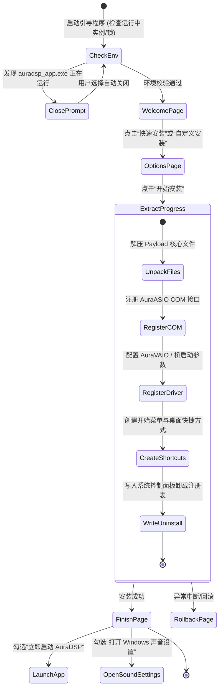

# 自研 Windows 安装程序 (Custom Setup Wizard) 详细设计方案

本文档专门针对 AuraDSP 在 Windows 平台的“**自主研发可安装版向导**”（Subproject: `installer/windows/custom_installer`）提供全方位的技术选型、架构设计与落地实施规范。

---

## 1. 为什么选择自研安装程序？

传统的第三方安装打包工具（如 NSIS、Inno Setup）虽然成熟，但在现代专业音频应用面前存在明显的局限：
1. **界面风格割裂**：标准 Windows 向导窗口基于 20 年前的 Win32 控件，与 AuraDSP 主程序采用的现代暗黑/极光流光设计风格格格不入。
2. **音频驱动与服务协同深度高**：AuraDSP 包含 **AuraASIO (COM InprocServer32 注册)**、**AuraVAIO (虚拟音频电缆驱动与常驻桥)**、**AuraVM (虚拟机桥)** 以及 **32/64位双架构插件隔离宿主 (`plugin_host_x64/x86`)**。传统的脚本式安装器在处理进程锁定判定、驱动注册、UAC 局部提权与声音控制面板 (`mmsys.cpl`) 引导时逻辑繁杂且不可控。
3. **出色的第一印象**：自研安装程序允许打造无边框、亚克力/Mica 毛玻璃流光特效、平滑安装进度动画与智能音频设备检测引导，极大地提升软件的工业级专业质感。

---

## 2. 安装向导体验旅程与流程状态机 (UX State Machine)

自研安装程序采用简洁流畅的步进式导航状态机，全程由 5 个主页面构成：



### 页面功能定义：
1. **欢迎页 (Welcome)**：展示 AuraDSP 视觉 Banner、应用版本、开源许可简述（包含“已阅读并同意许可协议”复选框）、“立即安装（推荐）”大按钮与“自定义”入口。
2. **选项页 (Custom Options)**：
   - 安装目录选择（默认为 `%LOCALAPPDATA%\Programs\AuraDSP` 或管理员模式下的 `C:\Program Files\AuraDSP`）。
   - 组件勾选：
     - [x] AuraDSP 主程序与核心音效引擎 (必选)
     - [x] AuraASIO 虚拟驱动桥 (在宿主 DAW 中暴露 AuraASIO)
     - [x] AuraVAIO 虚拟系统声卡音频桥
     - [ ] 随包预装精选声卡/耳机 DDC 校准文件
   - 快捷方式选项：[x] 桌面快捷方式，[x] 开始菜单程序组，[ ] 开机自启动。
3. **进度页 (Progress)**：
   - 现代条形进度动画与动态光效。
   - 实时显示当前正在解压的文件或执行的系统操作（如“正在解压 lib...”、“正在注册 AuraASIO 驱动...”、“正在优化系统音频路由...”）。
4. **完成页 (Finished)**：
   - 庆祝胜利动效。
   - 快捷动作：[x] 立即启动 AuraDSP，[ ] 打开 Windows 声音控制面板 (运行 `control mmsys.cpl sounds` 便于用户设置默认输出设备)。
   - “完成”按钮。

---

## 3. 安装程序工程技术选型 (Technology Stack)

针对自研安装程序子项目（位于 `installer/windows/custom_installer/`），评估以下两种最优技术方案：

| 维度 | 方案 A：轻量级 C++ (Win32 + Direct2D / WebView2) | 方案 B：轻量级 Flutter Desktop 专用安装向导 (推荐) |
| :--- | :--- | :--- |
| **UI 视觉表现** | 需手写 Direct2D 动画或使用轻量 GUI 库 | **与 AuraDSP 主程序 100% 视觉继承**（色彩、字体、阴影、动效） |
| **多语言国际化** | 需自行加载 JSON 或 stringtable | **复用主项目的 `l10n` 多语言翻译机制**，支持 CJK / 英文无缝切换 |
| **开发与维护成本** | 需编写大量 Win32 窗口管理与事件处理逻辑 | **与主项目同一技术栈**，前端组件和主题配置可直接共用 |
| **可执行体积开销** | 极小（1~3 MB 启动壳 + 内嵌 Payload） | 基础运行时约 15MB（但内嵌 Payload 压缩后，整包仍在 70~80MB 优质区间） |
| **底层系统调用** | 原生 C++，直接调用 Win32 API | 通过 Dart FFI 调用 Win32 C 导出动态库（已具备 `win32` 桥梁能力） |

> **架构结论**：
> 推荐采用 **方案 B（Flutter 专用安装子项目）** 或 **以 C++ 极简解压壳驱动方案 A** 作为备选。
> 在 `installer/windows/custom_installer/` 中以标准的独立 Flutter 桌面工程进行组织，不仅能够保证极致的视觉一致性，还能最大程度避免团队在 C++ Win32 界面代码上的额外维护负担。

---

## 4. 核心系统集成规范 (Windows System Integrations)

### 4.1 安装目录与权限策略 (Per-User vs All-Users)
- **推荐模式：双模式智能判定 (Dual Mode)**：
  - 若安装程序由普通权限启动：安装到当前用户专属目录：
    `%LOCALAPPDATA%\Programs\AuraDSP`
    此时写入注册表 `HKEY_CURRENT_USER\Software\...`，**不需要 UAC 弹窗即可完成安装**，绿色安全。
  - 若用户显式选择安装到 `C:\Program Files\AuraDSP` 或用户通过“以管理员身份运行”启动：
    安装到全局目录，写入 `HKEY_LOCAL_MACHINE\Software\...`，向全体用户暴露。

### 4.2 音频驱动与 COM 注册 (Audio Driver & COM Setup)
AuraDSP 的虚拟声卡与 ASIO 能力依赖系统级集成：
1. **AuraASIO COM 注册**：
   - 核心文件：`auraasio_bridge.dll`。
   - 注册操作：调用 `DllRegisterServer`（相当于 `regsvr32 /s auraasio_bridge.dll`）。
   - 写入注册表项：
     ```text
     HKCR\CLSID\{AURA-ASIO-GUID}\InprocServer32 = "C:\Path\To\auraasio_bridge.dll"
     HKLM\SOFTWARE\ASIO\AuraASIO\CLSID = "{AURA-ASIO-GUID}"
     HKLM\SOFTWARE\ASIO\AuraASIO\Description = "AuraDSP Virtual ASIO Driver"
     ```
2. **AuraVAIO 管道就绪**：
   - 核心文件：`auravaio_bridge.dll`。
   - 创建用于跨进程音频泵送的共享内存与命名事件，确保开机自启或主程序唤醒时具备合规句柄权限。

### 4.3 写入系统“添加/删除程序” (Registry Uninstall Registration)
为了让用户在 Windows 系统“设置 -> 应用 -> 已安装的应用”中找到并管理 AuraDSP，安装程序必须在以下位置写入规范的标准键值：
- 路径（Per-User）：`HKCU\Software\Microsoft\Windows\CurrentVersion\Uninstall\AuraDSP`
- 路径（All-Users）：`HKLM\Software\Microsoft\Windows\CurrentVersion\Uninstall\AuraDSP`

**键值清单**：
```ini
DisplayName = "AuraDSP"
DisplayVersion = "0.5.0.1"
Publisher = "AuraDSP Team"
DisplayIcon = "C:\Path\To\auradsp_app.exe,0"
InstallLocation = "C:\Path\To\AuraDSP"
UninstallString = "\"C:\Path\To\AuraDSP\uninstall.exe\""
QuietUninstallString = "\"C:\Path\To\AuraDSP\uninstall.exe\" /silent"
EstimatedSize = 145000 ; 估算体积 (KB)
NoModify = 1
NoRepair = 1
URLInfoAbout = "https://github.com/AuraDSP/AuraDSP"
```

### 4.4 卸载机制设计 (`uninstall.exe`)
安装过程中，安装程序会在目标安装目录留下一个自卸载程序 `uninstall.exe` 以及一份已安装文件清单 `install_manifest.json`：
1. **防止自杀锁**：`uninstall.exe` 运行时，先自我拷贝一份到 `%TEMP%\AuraDSP_Uninstall\` 运行，释放安装目录中的句柄。
2. **反注册 COM**：调用 `DllUnregisterServer` 清除 `auraasio_bridge.dll` 的 CLSID。
3. **清理快捷方式**：删除桌面、开始菜单的 `.lnk` 文件。
4. **清理安装目录与注册表**：删除安装清单中的所有解压文件，最后清除 `Uninstall\AuraDSP` 注册表项。
5. **用户数据防误删保护**：默认保留用户的个性化预设（位于 `%APPDATA%\AuraDSP` 或 `%LOCALAPPDATA%\AuraDSP`），弹窗提示“是否同时清除用户预设与声学校准配置文件”。

---

## 5. 打包封装结构 (Single Setup EXE Packaging)

安装包发布文件为一个单体可执行文件：`AuraDSP-Setup-x64-v0.5.0.exe`。
它的内部物理结构由“**引导启动器（Bootstrapper）**”和“**高压缩 Payload 数据区**”融合构成：

```text
+------------------------------------------------------+
| 1. Win32 PE 头与数字签名区 (PE Header & Authenticode)  |
+------------------------------------------------------+
| 2. 安装向导 UI 与执行引擎 (Installer Wizard Runtime)  |
+------------------------------------------------------+
| 3. PE 资源区 (RT_RCDATA / Payload Section)           |
|    - payload.tar.zst (以 Zstandard/LZMA 高压缩率压缩)  |
|      包含: auradsp_app.exe, *.dll, data/, resources/  |
+------------------------------------------------------+
| 4. 附加元数据尾部 (Installer Metadata Block)           |
|    - 包含 Payload 真实 SHA-256 校验码与解压清单大小   |
+------------------------------------------------------+
```

打包工具只需一行命令，即可将 `dist/AuraDSP-Windows-x64/` 绿色目录无缝封装成此安装包。
详细的工程骨架与脚本接入规划见 `installer/windows/custom_installer/README.md`。

